# 📚 Pedagogical Reading Order & Curriculum Guide — C++ and DSA

> **How to Use This Curriculum:**
>
> This curriculum gives a main learning progression with optional specialist
> material inside each topic. Use it as follows:
>
> 1. You read the foundational concept first before moving to dependent
>    concepts.
> 2. Use each row's concept and rationale to connect an example to the
>    techniques it builds on.
> 3. Treat advanced math, specialist sorting, DP optimizations, and advanced
>    graph algorithms as optional on a first pass. Revisit examples that use
>    later topics after learning their prerequisites.
> 4. **Go one file at a time.** Step numbers run across the whole guide, not
>    per folder. When you finish Step N, open Step N + 1 next.
>
> **Progression Path:**
>
> 🟢 Foundational (Levels 1–5): C++ Language Mechanics ➔ Complexity Analysis ➔
> Core Array Techniques ➔ Number Theory & Math ➔ Recursion & Divide-and-Conquer
>
> 🟡 Intermediate (Levels 6–12): Sorting Algorithms ➔ Searching Algorithms ➔
> Backtracking ➔ Object-Oriented Programming (OOP) ➔ Linked Lists ➔ Stacks &
> Queues ➔ Hashing & Hash Tables
>
> 🟠 Advanced (Levels 13–18): Binary Trees & BSTs ➔ Heaps & Priority Queues ➔
> String Pattern Matching ➔ Greedy Algorithms ➔ Dynamic Programming (DP) ➔ Graph
> Algorithms
>
> 🔴 Expert (Levels 19–20): Advanced Range Queries & Tree Decompositions ➔
> Advanced Algorithmic Paradigms & Randomization
>
> 🟣 Master (Levels 21–23): Modern C++ Deep Dive (Templates, C++17/20,
> Concurrency, Performance) ➔ Systems Data Structures ➔ Complete Low-Level
> Design (LLD)

```mermaid
flowchart TD
    L1["Level 1: C++ Fundamentals"] --> L2["Level 2: Complexity Analysis"]
    L2 --> L3["Level 3: Core Algorithmic Techniques"]
    L3 --> L4["Level 4: Mathematical Algorithms"]
    L4 --> L5["Level 5: Recursion & Divide-and-Conquer"]
    L5 --> L6["Level 6: Sorting Algorithms"]
    L6 --> L7["Level 7: Searching Algorithms"]
    L7 --> L8["Level 8: Backtracking"]
    L8 --> L9["Level 9: Object-Oriented Programming (OOP)"]
    L9 --> L10["Level 10: Linked Lists"]
    L10 --> L11["Level 11: Stacks and Queues"]
    L11 --> L12["Level 12: Hashing & Hash Tables"]
    L12 --> L13["Level 13: Hierarchical Trees"]
    L13 --> L14["Level 14: Heaps & Priority Queues"]
    L14 --> L15["Level 15: String Pattern Matching"]
    L15 --> L16["Level 16: Greedy Algorithms"]
    L16 --> L17["Level 17: Dynamic Programming (DP)"]
    L17 --> L18["Level 18: Graph Algorithms"]
    L18 --> L19["Level 19: Advanced Range Queries & Trees"]
    L19 --> L20["Level 20: Advanced Algorithmic Paradigms"]
    L20 --> L21["Level 21: Modern C++ Deep Dive & Concurrency"]
    L21 --> L22["Level 22: Advanced Data Structures for Systems"]
    L22 --> L23["Level 23: Complete Low-Level Design (LLD)"]
```

---

## Level 1: C++ Language Fundamentals

> **Prerequisite & Pedagogical Rationale:** Before implementing algorithms, you
> must master C++ execution semantics: program structure, data storage in
> memory, operators, conditional branches, loops, function call frames,
> contiguous array indexing, dynamic vectors, multidimensional grids, strings,
> and direct memory manipulation with pointers.

### `CPP-Basics/Fundamentals/` · Steps 1–32

C++ execution model, variable storage, operators, control flow, loops, and
memory addressing prerequisites.

| Step | File | Concept Covered | Why Read First & Concept Unlocked |
| - | - | - | - |
| 1 | [`helloWorld.cpp`](CPP-Basics/Fundamentals/helloWorld.cpp) | Program structure, `#include <iostream>`, `main()`, `std::cout`, execution entry point. | Start here: Understand how C++ programs compile, link, and print output. |
| 2 | [`datatypes.cpp`](CPP-Basics/Fundamentals/datatypes.cpp) | Core data types (`int`, `char`, `bool`, `float`, `double`), `sizeof`, `numeric_limits` ranges, fixed-width `<cstdint>` types, and `auto`. | Builds on Hello World: Every variable needs a type that decides its size, range, and allowed operations. |
| 3 | [`variables.cpp`](CPP-Basics/Fundamentals/variables.cpp) | Memory allocation for primitive types (`int`, `float`, `char`, `bool`) and `cin` input. | Builds on program structure: Introduces variables to store data before computing. |
| 4 | [`constants_literals.cpp`](CPP-Basics/Fundamentals/constants_literals.cpp) | Immutable constants (`const`), literal representations, and compile-time constants. | Builds on variables: Teaches immutability to prevent accidental state changes. |
| 5 | [`initialization_and_narrowing.cpp`](CPP-Basics/Fundamentals/initialization_and_narrowing.cpp) | Zero/value initialization, brace initialization, narrowing conversions, and vector constructor overloads. | Initialize values deliberately before studying arrays and containers. |
| 6 | [`scope_storage.cpp`](CPP-Basics/Fundamentals/scope_storage.cpp) | Variable scope (local vs global vs block), lifetime, and storage duration. | Builds on variables: Explains where variables live in memory and when they are destroyed. |
| 7 | [`type_casting.cpp`](CPP-Basics/Fundamentals/type_casting.cpp) | Implicit type coercion and explicit type casting between primitives. | Builds on types: Needed when combining different data types in expressions. |
| 8 | [`formatting_setw_setprecision.cpp`](CPP-Basics/Fundamentals/formatting_setw_setprecision.cpp) | Formatted I/O streams using `<iomanip>` (`setw`, `setprecision`, `fixed`). | Builds on input/output: Teaches how to format numerical outputs accurately. |
| 9 | [`input_validation.cpp`](CPP-Basics/Fundamentals/input_validation.cpp) | Validating user input, clearing stream error flags, and ignoring invalid buffer data. | Builds on `cin`: Essential for robust programs that handle malformed inputs. |
| 10 | [`swappingTheValue.cpp`](CPP-Basics/Fundamentals/swappingTheValue.cpp) | Swapping two variables using temporary memory storage. | First algorithmic step: Foundational for sorting and variable state rotation. |
| 11 | [`operators1.cpp`](CPP-Basics/Fundamentals/operators1.cpp) | Arithmetic operators (`+`, `-`, `*`, `/`, `%`) and operator precedence. | Unlocks computation: Teaches how values are transformed mathematically. |
| 12 | [`operators2.cpp`](CPP-Basics/Fundamentals/operators2.cpp) | Relational (`<`, `>`, `==`, `!=`) and assignment operators (`=`, `+=`, `-=`). | Prerequisite for conditionals: Compares values to produce boolean results. |
| 13 | [`andOperator.cpp`](CPP-Basics/Fundamentals/andOperator.cpp) | Logical AND operator (`&&`) and short-circuit evaluation. | Combines conditions: Enables multi-clause boolean logic in control flow. |
| 14 | [`orOperator.cpp`](CPP-Basics/Fundamentals/orOperator.cpp) | Logical OR operator (`\|\|`) and lazy evaluation. | Expands logical expressions: Handles alternative truth conditions. |
| 15 | [`operators3.cpp`](CPP-Basics/Fundamentals/operators3.cpp) | Bitwise operators (`&`, `\|`, `^`, `~`, `<<`, `>>`) on integer binary representations. | Direct bit-level manipulation: Foundational for low-level performance and bitmasking. |
| 16 | [`operators4.cpp`](CPP-Basics/Fundamentals/operators4.cpp) | Miscellaneous operators: `sizeof`, comma operator, ternary syntax preview. | Examines expression evaluation rules and type memory footprints. |
| 17 | [`ifElseStatement.cpp`](CPP-Basics/Fundamentals/ifElseStatement.cpp) | Conditional branching: `if` and `else` decision blocks. | Introduces control flow: Allows programs to execute different code paths. |
| 18 | [`ifElseifElseStatement.cpp`](CPP-Basics/Fundamentals/ifElseifElseStatement.cpp) | Multi-branch decision ladders (`if - else if - else`). | Builds on binary branching: Evaluates multiple mutually exclusive conditions. |
| 19 | [`ternaryOperator.cpp`](CPP-Basics/Fundamentals/ternaryOperator.cpp) | Ternary conditional expressions (`condition ? expr1 : expr2`). | Compact branching: Replaces simple if-else blocks inside expressions. |
| 20 | [`switchCaseStatement.cpp`](CPP-Basics/Fundamentals/switchCaseStatement.cpp) | Jump-table multiway branch selection based on integral constants. | Optimized branching: Handles many discrete integral choices cleaner than if-else. |
| 21 | [`vowels.cpp`](CPP-Basics/Fundamentals/vowels.cpp) | Practical character classification using conditional logic. | Applies conditionals: Demonstrates character checking against vowels. |
| 22 | [`whileLoop.cpp`](CPP-Basics/Fundamentals/whileLoop.cpp) | Entry-controlled indefinite repetition with `while (condition)`. | Introduces iteration: Repeats execution as long as a condition holds true. |
| 23 | [`forLoop.cpp`](CPP-Basics/Fundamentals/forLoop.cpp) | Definite counted iteration: initialization, condition, and update expressions. | Structured iteration: Standard loop pattern for iterating fixed ranges. |
| 24 | [`doWhileLoop.cpp`](CPP-Basics/Fundamentals/doWhileLoop.cpp) | Exit-controlled iteration: loop body executes at least once before checking condition. | Guaranteed initial pass: Useful for menu-driven programs and validated inputs. |
| 25 | [`omittingPartsOfLoop.cpp`](CPP-Basics/Fundamentals/omittingPartsOfLoop.cpp) | Omitting init, condition, or step in `for` loops (infinite loops, custom updates). | Deepens loop mechanics: Demonstrates loop flexibility and infinite loop controls. |
| 26 | [`break.cpp`](CPP-Basics/Fundamentals/break.cpp) | Premature loop termination using `break`. | Flow alteration: Stops iteration early once a target condition is met. |
| 27 | [`continueKeyword.cpp`](CPP-Basics/Fundamentals/continueKeyword.cpp) | Skipping remaining loop body and jumping to next iteration using `continue`. | Iteration filtering: Bypasses specific elements without terminating the entire loop. |
| 28 | [`goto_and_labels.cpp`](CPP-Basics/Fundamentals/goto_and_labels.cpp) | Unconditional jumps using labels and `goto`. | Control flow mechanics: Explains low-level jump instructions and why structured loops are preferred. |
| 29 | [`numberSystem1.cpp`](CPP-Basics/Fundamentals/numberSystem1.cpp) | Converting binary numbers to decimal using base-2 place-value loops. | First algorithmic application: Applies loops and arithmetic to positional number systems. |
| 30 | [`numberSystem2.cpp`](CPP-Basics/Fundamentals/numberSystem2.cpp) | Converting decimal numbers to binary using repeated division and modulus. | Inverses numberSystem1: Deepens understanding of binary representation. |
| 31 | [`stringstream.cpp`](CPP-Basics/Fundamentals/stringstream.cpp) | Parsing and converting formatted text using `std::stringstream`. | Bridges strings and numbers: Enables parsing mixed textual and numeric streams. |
| 32 | [`const_pointers_references.cpp`](CPP-Basics/Fundamentals/const_pointers_references.cpp) | Constness qualifiers applied to pointers and references preview. | Capstones fundamentals: Bridges variable immutability to direct memory references. |

### `CPP-Basics/Pattern-Printing/` · Steps 33–45

Nested loop mechanics, coordinate space mapping, and geometric pattern
generation.

| Step | File | Concept Covered | Why Read First & Concept Unlocked |
| - | - | - | - |
| 33 | [`rectOrsquarePattern.cpp`](CPP-Basics/Pattern-Printing/rectOrsquarePattern.cpp) | Solid rectangular and square star grids using 2D nested loops. | Start here: Teaches row outer loops and column inner loops. |
| 34 | [`hollowRectPattern.cpp`](CPP-Basics/Pattern-Printing/hollowRectPattern.cpp) | Hollow rectangles: printing stars only at boundaries (`i==0`, `i==n-1`, `j==0`, `j==m-1`). | Builds on grids: Introduces boundary coordinate conditions inside nested loops. |
| 35 | [`trianglePattern.cpp`](CPP-Basics/Pattern-Printing/trianglePattern.cpp) | Right-angled star triangle with row-dependent column bounds (`j <= i`). | Dynamic inner loops: Inner loop bound depends directly on the outer loop index. |
| 36 | [`invertedTriangle.cpp`](CPP-Basics/Pattern-Printing/invertedTriangle.cpp) | Inverted right-angled star triangle (`j <= n - i`). | Inverts row bounds: Decreases column iterations as row count increases. |
| 37 | [`equiTriangle.cpp`](CPP-Basics/Pattern-Printing/equiTriangle.cpp) | Equilateral star pyramid with leading spaces and odd star counts. | Multi-loop row structure: Coordinates leading space loops with star printing loops. |
| 38 | [`SequialEquTriangle.cpp`](CPP-Basics/Pattern-Printing/SequialEquTriangle.cpp) | Sequential star pyramid variations and aligned equilateral shapes. | Extends equilateral stars: Refines symmetric space-star alignment. |
| 39 | [`numTriangle.cpp`](CPP-Basics/Pattern-Printing/numTriangle.cpp) | Right-angled numeric triangle printing row/column indices. | Transitions to values: Replaces characters with loop counter numbers. |
| 40 | [`numericalRectPattern.cpp`](CPP-Basics/Pattern-Printing/numericalRectPattern.cpp) | Rectangular number grids with repeating or sequential row values. | 2D numeric mapping: Formulates matrix coordinates as mathematical expressions. |
| 41 | [`numbRectPattern.cpp`](CPP-Basics/Pattern-Printing/numbRectPattern.cpp) | Number rectangle patterns with modular cycling values. | Modular arithmetic in loops: Cycles numbers inside 2D grid coordinates. |
| 42 | [`hollowNumRect.cpp`](CPP-Basics/Pattern-Printing/hollowNumRect.cpp) | Hollow numerical rectangles displaying digits on borders. | Combines numbers + boundary checks: Only prints numbers on boundary conditions. |
| 43 | [`hollowNumbTriangle.cpp`](CPP-Basics/Pattern-Printing/hollowNumbTriangle.cpp) | Hollow numerical triangles with interior space padding. | Combines triangle row bounds with boundary-only digit printing. |
| 44 | [`oddEvenSquare.cpp`](CPP-Basics/Pattern-Printing/oddEvenSquare.cpp) | Alternating odd/even parity square grids. | Parity logic in grids: Uses `(i + j) % 2` to create chessboard-like numeric grids. |
| 45 | [`numbEquTriangle.cpp`](CPP-Basics/Pattern-Printing/numbEquTriangle.cpp) | Numeric equilateral pyramid with palindromic number sequences. | Capstones patterns: Combines leading spaces, increasing digits, and decreasing digits. |

### `CPP-Basics/Number-Problems/` · Steps 46–51

Digit extraction, arithmetic series, powers, and mathematical loop algorithms.

| Step | File | Concept Covered | Why Read First & Concept Unlocked |
| - | - | - | - |
| 46 | [`countNoOfDigit.cpp`](CPP-Basics/Number-Problems/countNoOfDigit.cpp) | Counting digits in an integer using division by 10 (`n /= 10`). | Start here: Core digit extraction loop used across all number problems. |
| 47 | [`sumOfDigits.cpp`](CPP-Basics/Number-Problems/sumOfDigits.cpp) | Accumulating digits of an integer using modulus (`n % 10`) and division. | Builds on digit counting: Accumulates extracted digits into a running sum. |
| 48 | [`reverseDigitOfNumb.cpp`](CPP-Basics/Number-Problems/reverseDigitOfNumb.cpp) | Reversing integer digits via `rev = rev * 10 + (n % 10)`. | Builds on digit extraction: Reconstructs an integer in reversed positional order. |
| 49 | [`factorialNumb.cpp`](CPP-Basics/Number-Problems/factorialNumb.cpp) | Computing factorial $n!$ using multiplicative accumulation. | Multiplicative loops: Foundational for permutations, combinations, and series. |
| 50 | [`sumOfSeries.cpp`](CPP-Basics/Number-Problems/sumOfSeries.cpp) | Evaluating alternating mathematical series ($1 - 2 + 3 - 4 + \dots$). | Series evaluation: Applies loop parity checks to alternate addition and subtraction. |
| 51 | [`aToPowerb.cpp`](CPP-Basics/Number-Problems/aToPowerb.cpp) | Computing exponentiation $a^b$ using repeated multiplication. | Capstones numeric loops: Prepares for logarithmic binary exponentiation in DSA. |

### `CPP-Basics/Functions/` · Steps 52–60

Modular code organization, call stacks, parameter passing, and overloading.

| Step | File | Concept Covered | Why Read First & Concept Unlocked |
| - | - | - | - |
| 52 | [`Functions.cpp`](CPP-Basics/Functions/Functions.cpp) | Declaring, defining, and invoking modular C++ functions. | Start here: Moves code out of `main()` into reusable, callable subroutines. |
| 53 | [`what_is_the_output_of_below.cpp`](CPP-Basics/Functions/what_is_the_output_of_below.cpp) | Formal vs actual parameters and function call execution flow. | Execution trace: Clarifies how arguments map into function parameters. |
| 54 | [`PassByValue.cpp`](CPP-Basics/Functions/PassByValue.cpp) | Pass-by-value semantics: function receives an isolated copy of arguments. | Copy semantics: Explains why caller variables remain unchanged by callee modifications. |
| 55 | [`PassByReference.cpp`](CPP-Basics/Functions/PassByReference.cpp) | Pass-by-reference semantics using `&`: caller memory is directly mutated. | Reference mutation: Enables functions to modify caller state and return multiple outputs. |
| 56 | [`DefaultParams.cpp`](CPP-Basics/Functions/DefaultParams.cpp) | Default argument values specified from right to left in function signatures. | API flexibility: Allows callers to omit optional arguments. |
| 57 | [`StandardLibFuncion.cpp`](CPP-Basics/Functions/StandardLibFuncion.cpp) | Using standard `<cmath>` functions (`pow`, `sqrt`, `ceil`, `floor`). | Standard library integration: Leverages built-in math functions in algorithms. |
| 58 | [`inline_functions.cpp`](CPP-Basics/Functions/inline_functions.cpp) | Inline functions and compiler expansion to eliminate call overhead. | Optimization: Explains how the compiler substitutes code inline to avoid stack frame pushes. |
| 59 | [`overload_resolution.cpp`](CPP-Basics/Functions/overload_resolution.cpp) | Function overloading: multiple functions with identical names but differing parameter types. | Compile-time polymorphism: Enables natural, type-specific function names. |
| 60 | [`recursion_vs_iteration.cpp`](CPP-Basics/Functions/recursion_vs_iteration.cpp) | Comparing iterative loops with self-calling recursive functions. | Bridges functions to recursion: Analyzes stack frame overhead vs loop performance. |

### `CPP-Basics/Arrays/` · Steps 61–69

Fixed-size contiguous sequential memory, indexing, traversals, and basic array
scans.

| Step | File | Concept Covered | Why Read First & Concept Unlocked |
| - | - | - | - |
| 61 | [`basicArray.cpp`](CPP-Basics/Arrays/basicArray.cpp) | Array declaration, fixed memory allocation, contiguous storage, and 0-based indexing. | Start here: First data structure storing multiple homogeneous elements in contiguous memory. |
| 62 | [`basicArray2.cpp`](CPP-Basics/Arrays/basicArray2.cpp) | Traversing arrays using standard `for` loops, while loops, and range-based for loops. | Builds on declaration: Teaches sequential element traversal and boundary safety. |
| 63 | [`basicArray3.cpp`](CPP-Basics/Arrays/basicArray3.cpp) | Reading dynamic user input into array slots and calculating array lengths. | Builds on traversal: Fills array buffers directly from `cin`. |
| 64 | [`inputArray.cpp`](CPP-Basics/Arrays/inputArray.cpp) | Reading and displaying complete user-defined arrays. | Solidifies input/output cycles for array buffers. |
| 65 | [`the_sum_of_all_the_elements.cpp`](CPP-Basics/Arrays/the_sum_of_all_the_elements.cpp) | Accumulating all elements of an array into a single sum variable. | Basic reduction: First linear scan accumulating values across an array. |
| 66 | [`the_maximum_value_out_of_all.cpp`](CPP-Basics/Arrays/the_maximum_value_out_of_all.cpp) | Finding maximum and minimum elements in an array using single-pass tracking. | Extremum tracking: Foundational pattern for searches, ranges, and greedy algorithms. |
| 67 | [`linear_search_-_search_if_a.cpp`](CPP-Basics/Arrays/linear_search_-_search_if_a.cpp) | Linear Search: checking element existence and returning index in $O(n)$. | First search algorithm: Scans elements sequentially until key is found or array exhausted. |
| 68 | [`reverse_array.cpp`](CPP-Basics/Arrays/reverse_array.cpp) | Reversing an array in-place using two-pointer swap from ends. | In-place mutation: Demonstrates swapping symmetric indices towards the center. |
| 69 | [`frequency_count.cpp`](CPP-Basics/Arrays/frequency_count.cpp) | Counting occurrences of elements using frequency tracking. | Capstones basic arrays: Introduces direct-address frequency arrays. |

### `CPP-Basics/Vectors/` · Steps 70–76

Dynamic resizable arrays with `std::vector`, automatic capacity management, and
methods.

| Step | File | Concept Covered | Why Read First & Concept Unlocked |
| - | - | - | - |
| 70 | [`basicVector1.cpp`](CPP-Basics/Vectors/basicVector1.cpp) | Declaring `std::vector`, dynamic resizing, `push_back`, `pop_back`, `size`, and `capacity`. | Start here: Overcomes fixed-size array limitations with automatic heap memory management. |
| 71 | [`loopVector1.cpp`](CPP-Basics/Vectors/loopVector1.cpp) | Iterating vectors via index loops, range-based `auto`, and iterators. | Builds on vector basics: Teaches idiomatic C++ traversal for dynamically sized vectors. |
| 72 | [`the_number_of_occurances_of_a.cpp`](CPP-Basics/Vectors/the_number_of_occurances_of_a.cpp) | Counting exact occurrences of target value in a vector. | Applies vector traversal: Implements frequency counting on resizable arrays. |
| 73 | [`the_number_of_elements_strictly_greater.cpp`](CPP-Basics/Vectors/the_number_of_elements_strictly_greater.cpp) | Counting elements strictly greater than threshold value. | Conditional counting: Filters elements matching relational predicates. |
| 74 | [`the_difference_between_the_sum_of.cpp`](CPP-Basics/Vectors/the_difference_between_the_sum_of.cpp) | Calculating difference between sum of even-index and odd-index elements. | Index parity traversal: Manipulates subsets of elements based on index math. |
| 75 | [`the_last_occurrence_of_an_element.cpp`](CPP-Basics/Vectors/the_last_occurrence_of_an_element.cpp) | Finding last occurrence of target element via backward traversal. | Backward traversal: Shows when scanning from tail to head is faster than scanning from front. |
| 76 | [`if_the_given_array_is_sorted.cpp`](CPP-Basics/Vectors/if_the_given_array_is_sorted.cpp) | Checking if a sequence is sorted in non-decreasing order in single pass. | Capstones vectors: Validates array monotonicity, the prerequisite for binary search. |

### `CPP-Basics/STL-Essentials/` · Step 77

Practical container and algorithm vocabulary used by later standalone examples.

| Step | File | Concept Covered | Why Read First & Concept Unlocked |
| - | - | - | - |
| 77 | [`stl_toolkit.cpp`](CPP-Basics/STL-Essentials/stl_toolkit.cpp) | array/vector ranges, sort, lower_bound, accumulation, hash containers, multisets, stacks, queues, heaps, and comparators. | Preview library usage now; implementation details follow in the dedicated data-structure modules. |

---

### `CPP-Basics/Array-Problems/` · Steps 78–102

Core array algorithms: two pointers, in-place partitions, prefix sums, and
Boyer-Moore.

| Step | File | Concept Covered | Why Read First & Concept Unlocked |
| - | - | - | - |
| 78 | [`the_second_largest_element_in_the.cpp`](CPP-Basics/Array-Problems/the_second_largest_element_in_the.cpp) | Finding second largest element in array using two linear passes. | Start here: Extends maximum tracking by finding runner-up without sorting. |
| 79 | [`the_second_largest_element_in_the_2.cpp`](CPP-Basics/Array-Problems/the_second_largest_element_in_the_2.cpp) | Finding second largest element in a single pass maintaining top two variables. | Optimization: Reduces two passes to one pass by updating largest and second largest together. |
| 80 | [`the_unique_number_in_a_given.cpp`](CPP-Basics/Array-Problems/the_unique_number_in_a_given.cpp) | Finding single non-duplicate element among pairs. | Frequency analysis: Identifies solitary elements before learning XOR bit tricks. |
| 81 | [`the_total_number_of_pairs_in.cpp`](CPP-Basics/Array-Problems/the_total_number_of_pairs_in.cpp) | Counting all pairs in an array whose sum equals target value. | Pair matching: Introduces nested $O(n^2)$ search before optimized two-pointer techniques. |
| 82 | [`the_number_of_triplets_whose_sum.cpp`](CPP-Basics/Array-Problems/the_number_of_triplets_whose_sum.cpp) | Counting all triplets summing to target value. | Extends pair search: Introduces 3-element combinations ($O(n^3)$ baseline). |
| 83 | [`sort_an_array_consisting_of_only.cpp`](CPP-Basics/Array-Problems/sort_an_array_consisting_of_only.cpp) | Sorting array of 0s and 1s using two-pass frequency count. | Counting sort preview: Solves two-value arrays in $O(n)$ time. |
| 84 | [`sort_an_array_consisting_of_only_2.cpp`](CPP-Basics/Array-Problems/sort_an_array_consisting_of_only_2.cpp) | Sorting array of 0s and 1s in a single pass using two pointers from ends. | Two-pointer partitioning: Swaps 0s to left and 1s to right in-place. |
| 85 | [`an_array_of_integer_a_move.cpp`](CPP-Basics/Array-Problems/an_array_of_integer_a_move.cpp) | Moving all even integers to front and odd integers to back in-place. | Applies two-pointer partition: Partitions array based on parity predicates. |
| 86 | [`sort_colors_dutch_national_flag.cpp`](CPP-Basics/Array-Problems/sort_colors_dutch_national_flag.cpp) | Dutch National Flag algorithm: 3-way partition for 0s, 1s, and 2s in single pass. | Advances two pointers: Uses three pointers (`low`, `mid`, `high`) for 3-way partitioning. |
| 87 | [`an_integer_array_a_sorted_in.cpp`](CPP-Basics/Array-Problems/an_integer_array_a_sorted_in.cpp) | Squares of a sorted array: merging negative and positive squares using two pointers. | Two pointers on sorted array: Compares magnitudes from extreme ends in $O(n)$. |
| 88 | [`rotate_the_given_array_a_by.cpp`](CPP-Basics/Array-Problems/rotate_the_given_array_a_by.cpp) | Rotating array by k positions using extra auxiliary array. | Array rotation: Establishes cyclic index shift logic using modulo arithmetic. |
| 89 | [`rotate_the_given_array_a_by_2.cpp`](CPP-Basics/Array-Problems/rotate_the_given_array_a_by_2.cpp) | Rotating array by k positions in-place using 3 reversals in $O(1)$ extra space. | Algorithm optimization: Eliminates auxiliary space via reverse(0..n-1), reverse(0..k-1), reverse(k..n-1). |
| 90 | [`merge_union_next_permutation.cpp`](CPP-Basics/Array-Problems/merge_union_next_permutation.cpp) | Merging two sorted sequences, union, intersection, and lexicographical next permutation. | Sequence operations: Foundational for merge steps and permutation generation. |
| 91 | [`an_integers_array_a_return_the.cpp`](CPP-Basics/Array-Problems/an_integers_array_a_return_the.cpp) | In-place prefix sum / running sum computation ($A[i] = A[i] + A[i-1]$). | Prefix sums: Transforms array so any range sum can be answered instantly. |
| 92 | [`an_array_of_integers_of_size.cpp`](CPP-Basics/Array-Problems/an_array_of_integers_of_size.cpp) | Answering range sum queries $[L, R]$ in $O(1)$ time using precomputed prefix sums. | Applies prefix sum: Answers multiple query intervals efficiently. |
| 93 | [`if_we_can_partition_the_array.cpp`](CPP-Basics/Array-Problems/if_we_can_partition_the_array.cpp) | Checking if array can be partitioned into two subarrays with equal sum. | Applies prefix logic: Compares prefix sum with total suffix sum. |
| 94 | [`leaders_and_equilibrium.cpp`](CPP-Basics/Array-Problems/leaders_and_equilibrium.cpp) | Finding array leaders (greater than all right elements) and equilibrium index. | Suffix scanning: Scans from right to left tracking suffix maximum and running sum balance. |
| 95 | [`maximum_subarray_kadane_s_algorithm.cpp`](CPP-Basics/Array-Problems/maximum_subarray_kadane_s_algorithm.cpp) | Kadane's Algorithm: maximum subarray sum in $O(n)$ time and $O(1)$ space. | Dynamic linear scan: Resets running sum when negative, achieving optimal $O(n)$ subarray sum. |
| 96 | [`maximum_circular_subarray.cpp`](CPP-Basics/Array-Problems/maximum_circular_subarray.cpp) | Maximum circular subarray: maximum/minimum Kadane passes, wraparound complement, all-negative input. | Extend ordinary Kadane while preserving the non-empty-subarray requirement. |
| 97 | [`maximum_product_subarray.cpp`](CPP-Basics/Array-Problems/maximum_product_subarray.cpp) | Maximum product subarray tracking both maximum and minimum running products. | Extends Kadane: Accounts for negative numbers flipping signs upon multiplication. |
| 98 | [`q_queries_check_if_the_given.cpp`](CPP-Basics/Array-Problems/q_queries_check_if_the_given.cpp) | Answering Q existence queries using frequency / direct address table. | Lookup optimization: Replaces $O(n)$ linear searches with $O(1)$ table lookups. |
| 99 | [`majority_element.cpp`](CPP-Basics/Array-Problems/majority_element.cpp) | Boyer-Moore Voting Algorithm: finding element appearing $> n/2$ times in $O(n)$ time and $O(1)$ space. | Optimal voting logic: Cancels out non-majority elements using counter tracking. |
| 100 | [`best_time_to_buy_and_sell.cpp`](CPP-Basics/Array-Problems/best_time_to_buy_and_sell.cpp) | Best Time to Buy and Sell Stock: single pass tracking minimum price seen so far. | Online optimization: Computes maximal difference between past minimum and current price. |
| 101 | [`find_duplicate_number.cpp`](CPP-Basics/Array-Problems/find_duplicate_number.cpp) | Finding duplicate number in array using Floyd's cycle-finding (Tortoise and Hare). | Array as pointer graph: Treats array indices as linked list pointers to detect cycles. |
| 102 | [`first_missing_positive.cpp`](CPP-Basics/Array-Problems/first_missing_positive.cpp) | First Missing Positive: O(n) cyclic placement with O(1) working space; the by-value wrapper also copies the input in O(n) space. | Capstones array problems: In-place index hashing without extra hash set memory. |

### `CPP-Basics/Two-D-Arrays/` · Steps 103–106

2D contiguous grids, row/column traversals, matrix math, and row/column zeroing.

| Step | File | Concept Covered | Why Read First & Concept Unlocked |
| - | - | - | - |
| 103 | [`taking2DArrayInput.cpp`](CPP-Basics/Two-D-Arrays/taking2DArrayInput.cpp) | 2D array declaration, memory layout (row-major order), and input/output nested loops. | Start here: Extends 1D arrays into 2D matrices $(i, j)$. |
| 104 | [`transposeMatrix.cpp`](CPP-Basics/Two-D-Arrays/transposeMatrix.cpp) | Matrix transposition: swapping elements across main diagonal ($A[i][j] \leftrightarrow A[j][i]$). | Builds on 2D arrays: Manipulates row and column indices in-place for square matrices. |
| 105 | [`multiplyMatrices.cpp`](CPP-Basics/Two-D-Arrays/multiplyMatrices.cpp) | Matrix multiplication: validating dimensions $(R_1 \times C_1) \cdot (R_2 \times C_2)$ and 3-loop product. | 2D arithmetic: Multiplies rows by columns; prerequisite for matrix exponentiation. |
| 106 | [`set_matrix_zeroes.cpp`](CPP-Basics/Two-D-Arrays/set_matrix_zeroes.cpp) | Set Matrix Zeroes: propagating zeros to entire rows and columns in $O(1)$ auxiliary space. | Capstones 2D basics: Uses matrix first row and column as flags to avoid extra memory. |

### `CPP-Basics/Two-D-Array-Problems/` · Steps 107–116

Complex matrix transformations: rotations, spirals, Pascal's triangle, and 2D
prefix sums.

| Step | File | Concept Covered | Why Read First & Concept Unlocked |
| - | - | - | - |
| 107 | [`a_boolean_2d_array_where_each.cpp`](CPP-Basics/Two-D-Array-Problems/a_boolean_2d_array_where_each.cpp) | Finding row with maximum number of 1s in row-sorted boolean matrix ($O(n \times m)$ scan). | Start here: Baseline row-by-row scanning of boolean matrices. |
| 108 | [`a_boolean_2d_array_where_each_2.cpp`](CPP-Basics/Two-D-Array-Problems/a_boolean_2d_array_where_each_2.cpp) | Finding row with maximum 1s in $O(n + m)$ time starting from top-right corner. | Optimization: Explores sorted 2D grid monotonicity by moving left on 1 and down on 0. |
| 109 | [`an_integer_n_return_the_first.cpp`](CPP-Basics/Two-D-Array-Problems/an_integer_n_return_the_first.cpp) | Generating Pascal's Triangle using 2D vector recurrence ($P[i][j] = P[i-1][j-1] + P[i-1][j]$). | Combinatorial 2D grid: Builds triangular matrix where each cell is sum of two above. |
| 110 | [`a_square_matrix_turn_it_by.cpp`](CPP-Basics/Two-D-Array-Problems/a_square_matrix_turn_it_by.cpp) | Rotating $N \times N$ matrix 90 degrees clockwise in-place using transpose + reverse rows. | Matrix geometry: Combines matrix transpose with 1D array reversals in $O(1)$ extra memory. |
| 111 | [`an_n_x_m_matrix_a.cpp`](CPP-Basics/Two-D-Array-Problems/an_n_x_m_matrix_a.cpp) | Spiral matrix traversal: traversing boundary by boundary (top, right, bottom, left). | Boundary simulation: Maintains four bounds (`top`, `bottom`, `left`, `right`) shrinking inward. |
| 112 | [`a_positive_integer_n_generate_an.cpp`](CPP-Basics/Two-D-Array-Problems/a_positive_integer_n_generate_an.cpp) | Generating $N \times N$ spiral matrix filled with numbers $1$ to $N^2$. | Inverses spiral traversal: Writes sequential numbers into cells in spiral order. |
| 113 | [`a_matrix_a_of_dimension_n.cpp`](CPP-Basics/Two-D-Array-Problems/a_matrix_a_of_dimension_n.cpp) | Submatrix rectangle sum queries using brute-force nested iteration ($O(n \times m)$ per query). | Baseline queries: Sums rectangular regions directly before optimization. |
| 114 | [`a_matrix_a_of_dimension_n_2.cpp`](CPP-Basics/Two-D-Array-Problems/a_matrix_a_of_dimension_n_2.cpp) | Submatrix rectangle sum queries using row-wise 1D prefix sums ($O(n)$ per query). | Partial optimization: Computes prefix sum across each row to speed up queries. |
| 115 | [`a_matrix_a_of_dimension_n_3.cpp`](CPP-Basics/Two-D-Array-Problems/a_matrix_a_of_dimension_n_3.cpp) | Submatrix rectangle sum queries in $O(1)$ time using full 2D prefix sum inclusion-exclusion. | Optimal 2D prefix sum: Computes 2D integral image for instant range queries in $O(1)$. |
| 116 | [`valid_sudoku.cpp`](CPP-Basics/Two-D-Array-Problems/valid_sudoku.cpp) | Valid Sudoku: validating rows, columns, and $3 \times 3$ sub-boxes for duplicate digits. | Capstones 2D problems: Validates complex multi-region constraints on 2D boards. |

### `CPP-Basics/Strings/` · Steps 117–127

Character arrays vs `std::string`, ASCII values, string operations, palindromes,
and anagrams.

| Step | File | Concept Covered | Why Read First & Concept Unlocked |
| - | - | - | - |
| 117 | [`string.cpp`](CPP-Basics/Strings/string.cpp) | `std::string` declaration, input (`cin` vs `getline`), indexing, concatenation, and ASCII conversions. | Start here: Understands string memory, null-termination, and string I/O. |
| 118 | [`functionString.cpp`](CPP-Basics/Strings/functionString.cpp) | Built-in string methods: `size()`, `substr()`, `push_back()`, `pop_back()`, and `std::reverse()`. | Builds on string basics: Uses standard string manipulation routines. |
| 119 | [`valid_palindrome.cpp`](CPP-Basics/Strings/valid_palindrome.cpp) | Valid Palindrome: two-pointer symmetric comparison ignoring non-alphanumeric characters. | Two pointers on strings: Validates symmetry from both ends towards center. |
| 120 | [`sortString.cpp`](CPP-Basics/Strings/sortString.cpp) | Sorting string characters using character frequency counting. | Counting sort on strings: Orders characters in $O(n)$ using 26-element array. |
| 121 | [`anagram.cpp`](CPP-Basics/Strings/anagram.cpp) | Checking if two strings are anagrams using character frequency comparison. | Frequency counting: Validates identical character distributions between two strings. |
| 122 | [`group_anagrams.cpp`](CPP-Basics/Strings/group_anagrams.cpp) | Group Anagrams: grouping anagrams together using sorted keys / frequency signatures. | Advanced grouping: Maps canonical string signatures to lists of matching anagrams. |
| 123 | [`isomorphic.cpp`](CPP-Basics/Strings/isomorphic.cpp) | Isomorphic Strings: checking 1-to-1 character bijection between two strings. | Bidirectional mapping: Verifies consistent character substitution mappings. |
| 124 | [`prefix.cpp`](CPP-Basics/Strings/prefix.cpp) | Longest Common Prefix: horizontal pairwise prefix scanning across array of strings. | Multi-string scanning: Compares adjacent strings to find shared prefix. |
| 125 | [`optimizedPrefix.cpp`](CPP-Basics/Strings/optimizedPrefix.cpp) | Longest Common Prefix optimized: sorting strings and comparing only first and last. | Sorting optimization: Exploits lexicographical order to find common prefix in $O(n \log n)$. |
| 126 | [`decoding.cpp`](CPP-Basics/Strings/decoding.cpp) | Decode String: decoding nested repeat patterns (e.g. `3[a2[c]]`) using recursion / stack. | Recursive grammar: Parses nested expressions with repetition multipliers. |
| 127 | [`a_binary_string_and_an_integer.cpp`](CPP-Basics/Strings/a_binary_string_and_an_integer.cpp) | Sliding window on binary strings: finding longest substring of 1s flipping at most k 0s. | Capstones strings: Introduces variable sliding window on character sequences. |

### `CPP-Basics/Pointers/` · Steps 128–156

Direct memory addressing, dereferencing, pointer arithmetic, pointer-to-pointer,
and safety.

| Step | File | Concept Covered | Why Read First & Concept Unlocked |
| - | - | - | - |
| 128 | [`address_of_operator.cpp`](CPP-Basics/Pointers/address_of_operator.cpp) | Address-of operator (`&`): discovering where variables are stored in virtual memory. | Start here: Understand that every variable has a unique byte address in RAM. |
| 129 | [`pointer_declaration_and_init.cpp`](CPP-Basics/Pointers/pointer_declaration_and_init.cpp) | Pointer syntax: declaring `int* ptr` and assigning addresses `ptr = &x`. | Builds on address-of: Creates variables that specifically store memory addresses. |
| 130 | [`dereference_operator.cpp`](CPP-Basics/Pointers/dereference_operator.cpp) | Dereference operator (`*ptr`): reading value stored at target memory address. | Builds on pointer initialization: Reads values indirectly through address pointers. |
| 131 | [`dereference_updating_values.cpp`](CPP-Basics/Pointers/dereference_updating_values.cpp) | Updating variable values through pointer dereferencing (`*ptr = 20`). | Direct memory mutation: Modifies original variable without referring to its variable name. |
| 132 | [`pointer_input_and_sum.cpp`](CPP-Basics/Pointers/pointer_input_and_sum.cpp) | Reading user input directly into pointers and computing sums via dereferencing. | Combines I/O and pointers: Demonstrates pointer manipulation in practical calculations. |
| 133 | [`callByRef.cpp`](CPP-Basics/Pointers/callByRef.cpp) | Pass-by-reference using pointers: implementing `swap(int* a, int* b)`. | Function pointer passing: Explains how pointers allow functions to modify caller variables. |
| 134 | [`callByRef2.cpp`](CPP-Basics/Pointers/callByRef2.cpp) | Returning multiple calculation results from a function using pointer parameters. | Multi-return via pointers: Bypasses single-return-value restriction of C++ functions. |
| 135 | [`pointer_arithmetic_basic.cpp`](CPP-Basics/Pointers/pointer_arithmetic_basic.cpp) | Pointer arithmetic basics: adding integers to pointers and memory steps. | Introduces pointer arithmetic: Shows how pointers navigate through contiguous memory. |
| 136 | [`pointerArithmetic.cpp`](CPP-Basics/Pointers/pointerArithmetic.cpp) | Pointer arithmetic scale: stepping by `sizeof(T)` bytes rather than raw single bytes. | Deepens arithmetic: Explains why `ptr + 1` advances by 4 bytes for `int` and 8 for `double`. |
| 137 | [`pointerArithmetic2.cpp`](CPP-Basics/Pointers/pointerArithmetic2.cpp) | Advancing pointers through contiguous array elements using `ptr++`. | Applies pointer stepping: Traverses sequential memory slots using pointer increments. |
| 138 | [`postPrePointers.cpp`](CPP-Basics/Pointers/postPrePointers.cpp) | Precedence rules: `*ptr++` vs `(*ptr)++` vs `*++ptr`. | Syntax mastery: Disambiguates operator precedence between dereference and increment. |
| 139 | [`postPrePointers2.cpp`](CPP-Basics/Pointers/postPrePointers2.cpp) | Prefix increment with dereference: evaluating `*++ptr` in practical expressions. | Solidifies pre-increment: Advances pointer first, then fetches pointed-to value. |
| 140 | [`postPrePointers3.cpp`](CPP-Basics/Pointers/postPrePointers3.cpp) | Evaluating complex combined pointer increment and dereference expressions. | Expression parsing: Analyzes multi-operator pointer expressions. |
| 141 | [`postPrePointers4.cpp`](CPP-Basics/Pointers/postPrePointers4.cpp) | Edge case evaluation for chained pointer arithmetic and assignment. | Deepens evaluation order: Prevents subtle off-by-one errors in pointer manipulation. |
| 142 | [`arrayPointer.cpp`](CPP-Basics/Pointers/arrayPointer.cpp) | Array decay: array name decaying to pointer to its first element (`arr == &arr[0]`). | Bridges arrays and pointers: Shows that array indexing `arr[i]` is syntactic sugar for `*(arr + i)`. |
| 143 | [`arrayPointer1.cpp`](CPP-Basics/Pointers/arrayPointer1.cpp) | Passing arrays to functions as pointers and preserving caller access. | Function array passing: Explains why arrays decay to pointers when passed to functions. |
| 144 | [`arrayPointer2.cpp`](CPP-Basics/Pointers/arrayPointer2.cpp) | Traversing and printing complete arrays using pointer increments (`ptr++`). | Pointer traversal: Traverses arrays without using bracket indexing. |
| 145 | [`arrayPointer4.cpp`](CPP-Basics/Pointers/arrayPointer4.cpp) | Advanced array pointer expressions and pointer differences (`ptr2 - ptr1`). | Pointer subtraction: Calculates distance between two pointers into the same array. |
| 146 | [`arrayOfPointersVsPointerToArray.cpp`](CPP-Basics/Pointers/arrayOfPointersVsPointerToArray.cpp) | Array of pointers (`int* arr[n]`) vs pointer to an array (`int (*arr)[n]`). | Memory layout precision: Differentiates arrays storing addresses from pointers to entire arrays. |
| 147 | [`pointerToPointer.cpp`](CPP-Basics/Pointers/pointerToPointer.cpp) | Pointer to pointer (`int** ptr`): storing address of another pointer variable. | Double indirection: Foundational for dynamic 2D arrays, linked list updates, and trees. |
| 148 | [`null_pointer_intro.cpp`](CPP-Basics/Pointers/null_pointer_intro.cpp) | Unpointed pointers: why uninitialized pointers contain dangerous garbage addresses. | Pointer hazards: Explains undefined behavior caused by wild memory accesses. |
| 149 | [`nullPointer.cpp`](CPP-Basics/Pointers/nullPointer.cpp) | Null pointers (`nullptr` vs `NULL`): safe initialization and null checks before dereferencing. | Memory safety: Prevents segmentation faults by verifying pointer validity. |
| 150 | [`wildPointers.cpp`](CPP-Basics/Pointers/wildPointers.cpp) | Wild pointers: dangerous uninitialized pointers and undefined behavior. | Hazard analysis: Demonstrates why declaring pointers without initialization crashes programs. |
| 151 | [`danglingPointer.cpp`](CPP-Basics/Pointers/danglingPointer.cpp) | Dangling pointers: pointers referencing memory whose lifetime has ended. | Lifetime hazards: Shows what happens when pointing to deallocated stack or heap memory. |
| 152 | [`dynamic_memory_new_delete.cpp`](CPP-Basics/Pointers/dynamic_memory_new_delete.cpp) | Heap allocation with `new` / `delete`, arrays with `new[]` / `delete[]`, and freeing memory safely. | Manual memory: Shows data that outlives its scope, the mechanism behind linked-list and tree nodes. |
| 153 | [`voidPointer.cpp`](CPP-Basics/Pointers/voidPointer.cpp) | Generic `void*` pointers: holding addresses of any data type and explicit casting. | Generic programming: Explains type-agnostic pointers used in low-level memory allocators. |
| 154 | [`constPointers.cpp`](CPP-Basics/Pointers/constPointers.cpp) | Const with pointers: pointer to const (`const int*`), const pointer (`int* const`), and both. | Const correctness: Enforces read-only memory contracts in C++ code. |
| 155 | [`functionPointers.cpp`](CPP-Basics/Pointers/functionPointers.cpp) | Function pointers: storing function entry addresses and passing callback functions. | Callback mechanics: Enables runtime function dispatch and customizable sorting predicates. |
| 156 | [`smartPointerPreview.cpp`](CPP-Basics/Pointers/smartPointerPreview.cpp) | Preview of modern C++ smart pointers (`std::unique_ptr`, `std::shared_ptr`). | Capstones pointers: Previews RAII memory management to eliminate manual `delete` bugs. |

### `CPP-Basics/Structs/` · Step 157

Grouping related values of different types into one record.

| Step | File | Concept Covered | Why Read First & Concept Unlocked |
| - | - | - | - |
| 157 | [`struct_basics.cpp`](CPP-Basics/Structs/struct_basics.cpp) | Defining a `struct`, member access with `.` and `->`, arrays of structs, and passing structs to functions. | Groups data: Bundles related fields into one record type used by sorting and linked lists. |

---

## Level 2: Complexity Analysis

> **Prerequisite & Pedagogical Rationale:** Before writing algorithms, you must
> be able to objectively measure their efficiency. Complexity analysis teaches
> you how to calculate execution time and memory consumption mathematically,
> compare asymptotic growth rates, and evaluate trade-offs.

### `Complexity-Analysis/Time-Complexity/` · Steps 158–169

Asymptotic Big-O, Big-Omega, Big-Theta notations, growth orders, and loop
counting.

| Step | File | Concept Covered | Why Read First & Concept Unlocked |
| - | - | - | - |
| 158 | [`common_growth_rates.cpp`](Complexity-Analysis/Time-Complexity/common_growth_rates.cpp) | Hierarchy of Big-O growth rates: $O(1) < O(\log n) < O(\sqrt{n}) < O(n) < O(n \log n) < O(n^2) < O(2^n)$. | Start here: Establishes mathematical framework for comparing algorithmic efficiency. |
| 159 | [`best_worst_average.cpp`](Complexity-Analysis/Time-Complexity/best_worst_average.cpp) | Asymptotic bounds: Worst-case ($O$), Best-case ($\Omega$), and Tight bound ($\Theta$). | Builds on growth rates: Defines formal bounds for varying input configurations. |
| 160 | [`time_complexity_is_-_o_1.cpp`](Complexity-Analysis/Time-Complexity/time_complexity_is_-_o_1.cpp) | Constant time $O(1)$: arithmetic, variable assignment, and direct array indexing. | Simplest complexity: Operations whose execution time is independent of input size $n$. |
| 161 | [`time_complexity_for_a_traversing_an.cpp`](Complexity-Analysis/Time-Complexity/time_complexity_for_a_traversing_an.cpp) | Linear time $O(n)$: single-loop traversal through an array of size $n$. | Linear growth: Execution time grows proportionally to number of elements. |
| 162 | [`traversal_complexity_examples.cpp`](Complexity-Analysis/Time-Complexity/traversal_complexity_examples.cpp) | Counting operations: step sizes ($i += 2$, $i += k$) and loop bounds. | Analyzes step factors: Shows why constant multipliers drop out in asymptotic analysis. |
| 163 | [`logarithmic.cpp`](Complexity-Analysis/Time-Complexity/logarithmic.cpp) | Logarithmic time $O(\log n)$: halving and doubling loops ($i *= 2$, $i /= 2$). | Logarithmic growth: Demonstrates exponential reduction of problem space per iteration. |
| 164 | [`i_0_j_sqrt_n_instructions.cpp`](Complexity-Analysis/Time-Complexity/i_0_j_sqrt_n_instructions.cpp) | Square root time $O(\sqrt{n})$: loops stepping up to $i \times i \le n$. | Sublinear growth: Essential for trial division primality tests and square-root decomposition. |
| 165 | [`time_complexity_for_nested_loop.cpp`](Complexity-Analysis/Time-Complexity/time_complexity_for_nested_loop.cpp) | Quadratic time $O(n^2)$: independent and dependent nested loops. | Polynomial growth: Analyzes double nested loops where outer loop triggers inner loop. |
| 166 | [`n_log_n.cpp`](Complexity-Analysis/Time-Complexity/n_log_n.cpp) | Linearithmic time $O(n \log n)$: divide-and-conquer recurrences and efficient sorting. | Divide-and-conquer growth: Explains the theoretical speed limit for comparison-based sorting. |
| 167 | [`you_re_given_a_number_x.cpp`](Complexity-Analysis/Time-Complexity/you_re_given_a_number_x.cpp) | Analyzing multi-condition loops and input-dependent branch termination. | Complex loops: Analyzes loop complexities with internal conditional breaks. |
| 168 | [`amortized_analysis.cpp`](Complexity-Analysis/Time-Complexity/amortized_analysis.cpp) | Introduction to amortized complexity: average cost per operation over a sequence. | Advances time analysis: Prepares for dynamic array doubling where rare costly operations are averaged. |
| 169 | [`recurrences_and_invariants.cpp`](Complexity-Analysis/Time-Complexity/recurrences_and_invariants.cpp) | Recurrence expansion, Master theorem cases and limits, and a loop-invariant proof. | Connect complexity calculations to correctness; revisit recurrence examples after Recursion. |

### `Complexity-Analysis/Space-Complexity/` · Steps 170–173

Input space, auxiliary space, stack frames, and space-time optimization trade-
offs.

| Step | File | Concept Covered | Why Read First & Concept Unlocked |
| - | - | - | - |
| 170 | [`space_complexity_-_it_is_the.cpp`](Complexity-Analysis/Space-Complexity/space_complexity_-_it_is_the.cpp) | Total space complexity vs auxiliary space: distinguishing input memory from extra memory. | Start here: Understands how algorithms consume memory in heap, stack, and data segments. |
| 171 | [`auxiliary_space.cpp`](Complexity-Analysis/Space-Complexity/auxiliary_space.cpp) | Measuring auxiliary memory: in-place algorithms ($O(1)$) vs auxiliary buffers ($O(n)$). | Builds on space basics: Teaches how to evaluate extra working memory allocated by an algorithm. |
| 172 | [`recursion_stack_space.cpp`](Complexity-Analysis/Space-Complexity/recursion_stack_space.cpp) | Call stack memory: measuring maximum depth of recursive stack frames. | Recursive space: Shows that recursion depth $d$ consumes $O(d)$ stack frame memory. |
| 173 | [`space_time_tradeoff.cpp`](Complexity-Analysis/Space-Complexity/space_time_tradeoff.cpp) | Space-time trade-off: spending extra memory (hash tables, lookup caches) to reduce CPU time. | Capstones space complexity: Evaluates when trading memory for speed is worthwhile. |

### `Complexity-Analysis/Amortized-Analysis/` · Steps 174–175

Aggregate method, accounting method, potential method, and dynamic vector
resizing.

| Step | File | Concept Covered | Why Read First & Concept Unlocked |
| - | - | - | - |
| 174 | [`amortized_analysis_basics.cpp`](Complexity-Analysis/Amortized-Analysis/amortized_analysis_basics.cpp) | Three methods of amortized analysis: Aggregate method, Accounting method, Potential function. | Start here: Mathematical tools to prove that an operation sequence has low average cost. |
| 175 | [`amortized_examples.cpp`](Complexity-Analysis/Amortized-Analysis/amortized_examples.cpp) | Proving $O(1)$ amortized push_back in dynamic arrays and binary counter increment. | Applies amortized methods: Demonstrates why vector geometric resizing yields $O(1)$ amortized insertion. |

### `Complexity-Analysis/Problems/` · Steps 176–180

Hands-on complexity calculation challenges and loop analysis quiz.

| Step | File | Concept Covered | Why Read First & Concept Unlocked |
| - | - | - | - |
| 176 | [`time_complexity_-_o_n.cpp`](Complexity-Analysis/Problems/time_complexity_-_o_n.cpp) | Step-by-step mathematical proof of linear time algorithms. | Practice 1: Solidifies single-loop summation analysis. |
| 177 | [`time_complexity_-_o_n_2.cpp`](Complexity-Analysis/Problems/time_complexity_-_o_n_2.cpp) | Mathematical summation of independent nested loops $\sum_{i=1}^n n = n^2$. | Practice 2: Formulates nested loop execution counts as geometric series. |
| 178 | [`time_complexity_-_o_n_2_2.cpp`](Complexity-Analysis/Problems/time_complexity_-_o_n_2_2.cpp) | Mathematical summation of dependent nested loops $\sum_{i=1}^n i = \frac{n(n+1)}{2} = O(n^2)$. | Practice 3: Evaluates triangular loop execution counts. |
| 179 | [`time_complexity_o_log_logn.cpp`](Complexity-Analysis/Problems/time_complexity_o_log_logn.cpp) | Analyzing repeated square root loops ($i = \sqrt{i}$) yielding $O(\log \log n)$ time. | Practice 4: Solves advanced double-logarithmic loop structures. |
| 180 | [`the_time_complexity.cpp`](Complexity-Analysis/Problems/the_time_complexity.cpp) | Comprehensive complexity evaluation quiz across mixed algorithmic loops. | Capstones Level 2: Verifies ability to accurately deduce time and space bounds on sight. |

---

## Level 3: Core Algorithmic Techniques (Arrays & Sequences)

> **Prerequisite & Pedagogical Rationale:** Before jumping into recursion or
> sorting, you must master the fundamental algorithmic patterns used to
> manipulate contiguous sequences: Prefix Sums, Two Pointers, Sliding Windows,
> Bit Manipulation, and Interval Sweeps. These techniques turn slow $O(n^2)$
> brute forces into optimal $O(n)$ solutions.

### `Techniques/Prefix-Sum/` · Steps 181–186

Cumulative running sums, range sum queries in $O(1)$, difference arrays, and
hash maps.

| Step | File | Concept Covered | Why Read First & Concept Unlocked |
| - | - | - | - |
| 181 | [`prefix_sum_-_prefix_i_stores.cpp`](Techniques/Prefix-Sum/prefix_sum_-_prefix_i_stores.cpp) | 1D Prefix Sum formula: precomputing cumulative sums $P[i] = P[i-1] + A[i]$. | Start here: Enables answering any range sum $\sum_{k=L}^R A[k] = P[R] - P[L-1]$ in $O(1)$ time. |
| 182 | [`product_of_array_except_self.cpp`](Techniques/Prefix-Sum/product_of_array_except_self.cpp) | Prefix products and suffix products: computing products of all other elements without division. | Builds on prefix concept: Combines forward prefix products with backward suffix products in $O(n)$. |
| 183 | [`difference_array.cpp`](Techniques/Prefix-Sum/difference_array.cpp) | Difference Array: performing multiple range increment updates $[L, R, +v]$ in $O(1)$ time. | Inverses prefix sum: Allows $O(1)$ range updates and $O(n)$ final array reconstruction. |
| 184 | [`subarray_sum_equals_k.cpp`](Techniques/Prefix-Sum/subarray_sum_equals_k.cpp) | Subarray Sum Equals K: combining prefix sum with hash map to find target subarrays in $O(n)$. | Capstones prefix sums: Uses $P[j] - P[i] = K \implies P[i] = P[j] - K$ lookup. |
| 185 | [`subarray_divisible_by_k.cpp`](Techniques/Prefix-Sum/subarray_divisible_by_k.cpp) | Counting divisible subarray sums using normalized prefix remainders. | Recognize equal-remainder pairs, including negative input and the empty prefix. |
| 186 | [`longest_subarray_sum_k.cpp`](Techniques/Prefix-Sum/longest_subarray_sum_k.cpp) | Longest subarray with sum K using earliest prefix indices. | Distinguish an earliest-index map for maximum length from a frequency map for counting. |

### `Techniques/Two-Pointers/` · Steps 187–191

Inward converging pointers, fast/slow pointers, pair search, and water trapping.

| Step | File | Concept Covered | Why Read First & Concept Unlocked |
| - | - | - | - |
| 187 | [`two_pointers_-_use_two_indices.cpp`](Techniques/Two-Pointers/two_pointers_-_use_two_indices.cpp) | Two Pointers paradigm: converging left and right indices on sorted arrays. | Start here: Replaces $O(n^2)$ nested pair scans with single $O(n)$ converging pass. |
| 188 | [`container_with_most_water.cpp`](Techniques/Two-Pointers/container_with_most_water.cpp) | Container With Most Water: greedily shrinking window by moving pointer with smaller height. | Builds on two pointers: Proves that moving the shorter line is optimal for finding maximum area. |
| 189 | [`three_sum.cpp`](Techniques/Two-Pointers/three_sum.cpp) | 3Sum problem: sorting array, fixing one element, and running two pointers on remainder in $O(n^2)$. | Extends to triplets: Avoids duplicate triplets while keeping runtime at $O(n^2)$ instead of $O(n^3)$. |
| 190 | [`four_sum.cpp`](Techniques/Two-Pointers/four_sum.cpp) | 4Sum: two fixed indices, opposing pointers, duplicate skipping, and wide sums. | Generalize 3Sum to unique quadruplets without repeated answers. |
| 191 | [`trapping_rain_water.cpp`](Techniques/Two-Pointers/trapping_rain_water.cpp) | Trapping Rain Water: two pointers tracking `left_max` and `right_max` in $O(n)$ time and $O(1)$ space. | Capstones two pointers: Eliminates auxiliary arrays by converging from outer boundaries. |

### `Techniques/Sliding-Window/` · Steps 192–198

Fixed-size windows, variable-size expanding/contracting windows, and substring
problems.

| Step | File | Concept Covered | Why Read First & Concept Unlocked |
| - | - | - | - |
| 192 | [`sliding_window_-_maintain_a_window.cpp`](Techniques/Sliding-Window/sliding_window_-_maintain_a_window.cpp) | Sliding Window concept: maintaining state across contiguous subarray without recomputing from scratch. | Start here: Replaces re-scanning $k$ elements with $O(1)$ add-incoming and remove-outgoing. |
| 193 | [`minimum_size_subarray_sum.cpp`](Techniques/Sliding-Window/minimum_size_subarray_sum.cpp) | Minimum-size subarray with sum at least target for non-negative numbers. | Learn why monotone window sums permit shrinking; negative numbers require a different technique. |
| 194 | [`permutation_in_string.cpp`](Techniques/Sliding-Window/permutation_in_string.cpp) | Fixed-size sliding window: checking character frequency match over window of length $k$. | Fixed window: Slides window of exact length $\|p\|$ checking if character frequencies match. |
| 195 | [`longest_substring_without_repeating_characters.cpp`](Techniques/Sliding-Window/longest_substring_without_repeating_characters.cpp) | Variable-size sliding window: expanding right pointer, contracting left pointer upon duplicate character. | Variable window: Dynamically adjusts window borders while maintaining unique character invariant. |
| 196 | [`minimum_window_substring.cpp`](Techniques/Sliding-Window/minimum_window_substring.cpp) | Minimum Window Substring: finding shortest window containing all target characters in $O(n)$. | Capstones sliding window: Tracks match counts and minimizes window length. |
| 197 | [`longest_repeating_character_replacement.cpp`](Techniques/Sliding-Window/longest_repeating_character_replacement.cpp) | Longest repeated-character substring after at most K replacements. | Maintain a frequency budget and an explicitly valid shrinking window. |
| 198 | [`subarrays_with_k_distinct.cpp`](Techniques/Sliding-Window/subarrays_with_k_distinct.cpp) | Count exactly K distinct values through atMost(K) minus atMost(K-1). | Turn an exact-count condition into two monotone counting windows. |

### `Techniques/Bit-Manipulation/` · Steps 199–203

Bitwise masks, bit shifting, Brian Kernighan's algorithm, and XOR cancellation
tricks.

| Step | File | Concept Covered | Why Read First & Concept Unlocked |
| - | - | - | - |
| 199 | [`bit_manipulation_-_works_directly_on.cpp`](Techniques/Bit-Manipulation/bit_manipulation_-_works_directly_on.cpp) | Bitwise fundamentals: setting, clearing, toggling, and checking the $k$-th bit. | Start here: Understands bitwise masks (`1 << k`), bitwise AND, OR, and XOR. |
| 200 | [`ing_bits.cpp`](Techniques/Bit-Manipulation/ing_bits.cpp) | Counting set bits: Brian Kernighan's algorithm clearing lowest set bit ($n \ \& \ (n-1)$). | Builds on bitwise: Counts set bits in $O(\text{number of 1s})$ rather than checking all 32 bits. |
| 201 | [`single_number.cpp`](Techniques/Bit-Manipulation/single_number.cpp) | Single Number: using XOR cancellation ($x \oplus x = 0$ and $x \oplus 0 = x$) to find unique element in $O(n)$ time and $O(1)$ space. | XOR properties: Explains self-inverse property of XOR to cancel out duplicate pairs. |
| 202 | [`missing_number.cpp`](Techniques/Bit-Manipulation/missing_number.cpp) | Missing Number: finding missing number in range $[0, n]$ using XOR accumulation. | Applies XOR cancellation: XORs all array elements with all integers from $0$ to $n$. |
| 203 | [`an_array_where_every_element_appears.cpp`](Techniques/Bit-Manipulation/an_array_where_every_element_appears.cpp) | Single Number II & III: finding two unique elements and handling elements repeated three times. | Capstones bit manipulation: Partitions elements using lowest set bit or 3-bit state counters. |

### `Techniques/Interval-Algorithms/` · Steps 204–211

Interval sorting, overlapping intervals, interval insertion, sweep line, and
event counters.

| Step | File | Concept Covered | Why Read First & Concept Unlocked |
| - | - | - | - |
| 204 | [`merge_intervals.cpp`](Techniques/Interval-Algorithms/merge_intervals.cpp) | Merge Intervals: sorting intervals by start time and merging overlapping ranges. | Start here: Core interval pattern: when $start_{next} \le end_{curr}$, merge ranges. |
| 205 | [`insert_interval.cpp`](Techniques/Interval-Algorithms/insert_interval.cpp) | Insert Interval: inserting new interval into sorted non-overlapping list in $O(n)$ time. | Builds on merging: Handles three distinct phases: before overlap, overlapping merge, after overlap. |
| 206 | [`erase_overlap_intervals.cpp`](Techniques/Interval-Algorithms/erase_overlap_intervals.cpp) | Non-overlapping Intervals: greedy removal of minimal intervals sorted by finish time. | Greedy intervals: Minimizes removals by always keeping the interval that finishes earliest. |
| 207 | [`meeting_rooms.cpp`](Techniques/Interval-Algorithms/meeting_rooms.cpp) | Meeting Rooms I & II: determining if meetings overlap and finding minimum rooms required. | Interval concurrency: Counts maximum concurrent active intervals using start and end pointers. |
| 208 | [`interval_intersection.cpp`](Techniques/Interval-Algorithms/interval_intersection.cpp) | Interval List Intersections: finding common intervals between two sorted lists. | Two pointers on intervals: Computes overlap $[\max(s_1, s_2), \min(e_1, e_2)]$ and advances pointer. |
| 209 | [`minimum_arrows.cpp`](Techniques/Interval-Algorithms/minimum_arrows.cpp) | Minimum Number of Arrows to Burst Balloons: finding minimum stabbing points. | Interval stabbing: Greedily shoots arrow at earliest end point to burst maximum balloons. |
| 210 | [`difference_array_events.cpp`](Techniques/Interval-Algorithms/difference_array_events.cpp) | Event-based range updates: placing $+1$ at interval starts and $-1$ at interval ends. | Event sweeps: Transforms intervals into chronological delta events on a timeline. |
| 211 | [`sweep_line.cpp`](Techniques/Interval-Algorithms/sweep_line.cpp) | Sweep Line Algorithm: sorting events chronologically and maintaining active state. | Capstones intervals: Generalizes interval processing to geometric and temporal sweep lines. |

---

## Level 4: Mathematical Algorithms & Number Theory

> **Prerequisite & Pedagogical Rationale:** Discrete mathematics and number
> theory provide the theoretical foundation for hashing, cryptography, modulo
> arithmetic, combinatorics, and geometric computations. Mastering them early
> ensures you understand why algorithms work.

### `Math-Algorithms/Basic-Math/` · Steps 212–218

Greatest common divisor, primes, modulo arithmetic, combinations, and fast
matrix powers.

| Step | File | Concept Covered | Why Read First & Concept Unlocked |
| - | - | - | - |
| 212 | [`gcd_lcm.cpp`](Math-Algorithms/Basic-Math/gcd_lcm.cpp) | Euclidean Algorithm for Greatest Common Divisor (GCD) and $\text{LCM}(a, b) = \frac{a \times b}{\gcd(a, b)}$. | Start here: Foundational math algorithm: computes GCD in $O(\log(\min(a, b)))$ steps. |
| 213 | [`sieve.cpp`](Math-Algorithms/Basic-Math/sieve.cpp) | Sieve of Eratosthenes: precomputing all prime numbers up to $N$ in $O(N \log \log N)$ time. | Builds on division: Rapidly marks composite multiples, unlocking sub-millisecond prime queries. |
| 214 | [`prime_factorization.cpp`](Math-Algorithms/Basic-Math/prime_factorization.cpp) | Prime Factorization: trial division in $O(\sqrt{n})$ and precomputed SPF (Smallest Prime Factor) in $O(\log n)$. | Builds on primes: Decomposes integers into prime powers $n = p_1^{a_1} p_2^{a_2} \dots$. |
| 215 | [`modular_arithmetic.cpp`](Math-Algorithms/Basic-Math/modular_arithmetic.cpp) | Modular arithmetic rules for addition, multiplication, subtraction, and Modular Inverse via Fermat's Little Theorem. | Essential for competitive programming: Prevents integer overflow during combinatorics. |
| 216 | [`combinatorics.cpp`](Math-Algorithms/Basic-Math/combinatorics.cpp) | Computing $nCr$ combinations and permutations modulo $10^9+7$ using precomputed factorials. | Applies modular math: Computes binomial coefficients in $O(1)$ after $O(n)$ precomputation. |
| 217 | [`matrix_exponentiation.cpp`](Math-Algorithms/Basic-Math/matrix_exponentiation.cpp) | Matrix Exponentiation: computing $A^k$ in $O(m^3 \log k)$ to solve linear recurrences like Fibonacci in $O(\log n)$. | Advanced math: Accelerates linear recursive state transitions to logarithmic time. |
| 218 | [`happy_number.cpp`](Math-Algorithms/Basic-Math/happy_number.cpp) | Happy Number: detecting cycles in digit square sums using Floyd's cycle finding. | Capstones basic math: Applies cycle detection to arithmetic state transitions. |

### `Math-Algorithms/Number-Theory/` · Steps 219–220

Euler's Totient function, Chinese Remainder Theorem, Miller-Rabin, and Pollard's
Rho.

| Step | File | Concept Covered | Why Read First & Concept Unlocked |
| - | - | - | - |
| 219 | [`totient_crt.cpp`](Math-Algorithms/Number-Theory/totient_crt.cpp) | Euler's Totient Function $\phi(n)$ and Chinese Remainder Theorem (CRT) for system of linear congruences. | Start here: Solves simultaneous modular congruence equations and counts coprime numbers. |
| 220 | [`miller_rabin_pollard.cpp`](Math-Algorithms/Number-Theory/miller_rabin_pollard.cpp) | Miller-Rabin randomized primality test and Pollard's Rho algorithm for large integer factorization in $O(n^{1/4})$. | Advances number theory: Tests primality of 64-bit integers and factors massive numbers efficiently. |

### `Math-Algorithms/Geometry/` · Steps 221–223

Cross product, line orientation, segment intersections, and convex hull.

| Step | File | Concept Covered | Why Read First & Concept Unlocked |
| - | - | - | - |
| 221 | [`line_intersection.cpp`](Math-Algorithms/Geometry/line_intersection.cpp) | 2D Vector cross products, point orientation tests (clockwise/counter-clockwise), and line segment intersection. | Start here: Core geometric primitive: determines whether two line segments cross in $O(1)$. |
| 222 | [`closest_pair.cpp`](Math-Algorithms/Geometry/closest_pair.cpp) | Closest Pair of Points in 2D plane using divide-and-conquer in $O(n \log n)$ time. | Divide-and-conquer geometry: Solves geometric proximity faster than $O(n^2)$ brute force. |
| 223 | [`convex_hull.cpp`](Math-Algorithms/Geometry/convex_hull.cpp) | Convex Hull: Graham Scan / Monotone Chain algorithm computing the convex polygon in $O(n \log n)$. | Capstones geometry: Finds the minimal enclosing boundary around a cloud of 2D points. |

### `Math-Algorithms/Advanced-Math/` · Steps 224–233

Combinatorial game theory, Stirling and Lucas combinatorics, Möbius inversion,
Gaussian elimination, linear basis, big-integer arithmetic, FFT/NTT, and
polynomials.

| Step | File | Concept Covered | Why Read First & Concept Unlocked |
| - | - | - | - |
| 224 | [`game_theory.cpp`](Math-Algorithms/Advanced-Math/game_theory.cpp) | Combinatorial Game Theory: impartial games, Nim game, and Sprague-Grundy theorem using XOR sums. | Start here: Determines winning and losing states in turn-based games. |
| 225 | [`stirling_numbers.cpp`](Math-Algorithms/Advanced-Math/stirling_numbers.cpp) | Stirling Numbers: set partitions into $k$ blocks (second kind), permutations with $k$ cycles (first kind), and Bell numbers. | Counting recurrences: Builds Pascal-like DP tables for labelled partitions and cycle decompositions. |
| 226 | [`gaussian_elimination.cpp`](Math-Algorithms/Advanced-Math/gaussian_elimination.cpp) | Gaussian Elimination: solving systems of linear equations and computing matrix determinants in $O(n^3)$. | Linear algebra: Solves system of simultaneous linear equations over real and modular fields. |
| 227 | [`linear_basis.cpp`](Math-Algorithms/Advanced-Math/linear_basis.cpp) | XOR Linear Basis: maintaining vector basis over $\mathbb{Z}_2$ to find maximum XOR subsets in $O(n \log C)$. | Bitwise linear algebra: Solves maximum XOR path and subset problems. |
| 228 | [`lucas_theorem.cpp`](Math-Algorithms/Advanced-Math/lucas_theorem.cpp) | Lucas Theorem: computing $\binom{n}{r} \bmod p$ from base-$p$ digits in $O(p + \log_p n)$. | Modular combinatorics: Handles $n$ far larger than the prime modulus using digit-wise products. |
| 229 | [`mobius_inversion.cpp`](Math-Algorithms/Advanced-Math/mobius_inversion.cpp) | Möbius Function and Möbius Inversion: divisor-sum inversion, coprime pair counting, and square-free counting with a linear sieve. | Number-theoretic inversion: Converts divisor sums into multiple sums to count coprime and square-free objects. |
| 230 | [`big_integer.cpp`](Math-Algorithms/Advanced-Math/big_integer.cpp) | Arbitrary-Precision Integer Arithmetic: signed addition, subtraction, multiplication, long division, factorial, Fibonacci, and fast exponentiation. | Beyond 64 bits: Implements schoolbook big-number arithmetic on base-10 digit vectors. |
| 231 | [`fft_ntt.cpp`](Math-Algorithms/Advanced-Math/fft_ntt.cpp) | Fast Fourier Transform (FFT) and Number Theoretic Transform (NTT) for $O(n \log n)$ polynomial multiplication. | Advanced transformation: Multiplies large polynomials and big integers in $O(n \log n)$ instead of $O(n^2)$. |
| 232 | [`polynomial_interpolation.cpp`](Math-Algorithms/Advanced-Math/polynomial_interpolation.cpp) | Lagrange Polynomial Interpolation: reconstructing a polynomial of degree $n$ from $n+1$ points in $O(n^2)$ or $O(n)$. | Polynomial fitting: Evaluates closed-form polynomials at massive values without explicit expansion. |
| 233 | [`berlekamp_massey.cpp`](Math-Algorithms/Advanced-Math/berlekamp_massey.cpp) | Berlekamp-Massey Algorithm: finding the shortest linear recurrence that generates a sequence. | Capstones advanced math: Automatically discovers recurrence relations from first few terms. |

---

## Level 5: Recursion & Divide-and-Conquer

> **Prerequisite & Pedagogical Rationale:** Recursion is the engine behind
> Divide-and-Conquer, Backtracking, Trees, Graphs, and Dynamic Programming. You
> must first master the call stack, base cases, and recurrence relations before
> attempting complex algorithms.

### `Recursion/Basics/` · Steps 234–238

Call stack frames, base cases, recurrence relations, tree of calls, and Tower of
Hanoi.

| Step | File | Concept Covered | Why Read First & Concept Unlocked |
| - | - | - | - |
| 234 | [`recursion_deep_dive.cpp`](Recursion/Basics/recursion_deep_dive.cpp) | Anatomy of recursion: call stack, activation records, stack frames, base cases, and return flow. | Start here: Understand how the CPU manages memory when a function calls itself. |
| 235 | [`factorialRecursion.cpp`](Recursion/Basics/factorialRecursion.cpp) | Linear recursion: computing factorial $n! = n \times (n-1)!$ with base case $n=1$. | Simplest recurrence: Single branch recursion unwinding values back up the call stack. |
| 236 | [`fibRecursive.cpp`](Recursion/Basics/fibRecursive.cpp) | Branching recursion: Fibonacci recurrence $F(n) = F(n-1) + F(n-2)$ and the binary recursion tree. | Branching tree: Visualizes exponential call trees ($O(2^n)$) and redundant computations. |
| 237 | [`climbStairs.cpp`](Recursion/Basics/climbStairs.cpp) | Recurrence formulation: counting ways to climb $n$ stairs taking 1 or 2 steps. | Problem formulation: Translates real-world decision choices into recursive recurrence relations. |
| 238 | [`towerOfHanoi.cpp`](Recursion/Basics/towerOfHanoi.cpp) | Tower of Hanoi: solving $n$-disk movement between 3 rods in $2^n - 1$ steps. | Classic recursion: Proves recursive decomposition: move $n-1$ disks, move 1 disk, move $n-1$ disks. |

### `Recursion/Problems/` · Steps 239–263

Recursive problem solving: numbers, arrays, strings, decision trees, and
combinatorics.

| Step | File | Concept Covered | Why Read First & Concept Unlocked |
| - | - | - | - |
| 239 | [`digitsNumbers.cpp`](Recursion/Problems/digitsNumbers.cpp) | Printing numbers from $1$ to $N$ and $N$ to $1$ using pre-recursive and post-recursive calls. | Start here: Teaches the difference between work done before recursive call vs work done after. |
| 240 | [`sumOfDigitRecursive.cpp`](Recursion/Problems/sumOfDigitRecursive.cpp) | Computing sum of digits recursively via $(n \% 10) + \text{sum}(n / 10)$. | Builds on digits: Reduces integer digit by digit until base case $n == 0$. |
| 241 | [`palindromeNumber.cpp`](Recursion/Problems/palindromeNumber.cpp) | Checking if an integer is a palindrome using recursive digit reversal. | Applies digit recursion: Builds reversed number during recursive returns. |
| 242 | [`armstrongNum.cpp`](Recursion/Problems/armstrongNum.cpp) | Evaluating Armstrong numbers using recursive power summation. | Recursive evaluation: Evaluates digit powers across recursive frames. |
| 243 | [`multipleOfNum.cpp`](Recursion/Problems/multipleOfNum.cpp) | Printing first $k$ multiples of a number recursively. | Parameter passing: Decrements multiplier count until reaching base case. |
| 244 | [`sumWithAlternateSign.cpp`](Recursion/Problems/sumWithAlternateSign.cpp) | Evaluating alternating series $1 - 2 + 3 - 4 + \dots$ using recursion. | Conditional return: Alternates sign depending on parity of recursion depth. |
| 245 | [`powerRecursive.cpp`](Recursion/Problems/powerRecursive.cpp) | Basic linear recursive exponentiation $a^b = a \times a^{b-1}$ in $O(b)$ time. | Linear power: Demonstrates linear depth recursion before logarithmic optimization. |
| 246 | [`powerRecursiveOptimized.cpp`](Recursion/Problems/powerRecursiveOptimized.cpp) | Binary Exponentiation: computing $a^b = (a^{b/2})^2$ in $O(\log b)$ time. | Logarithmic recursion: Halves exponent at each step, reducing runtime from $O(b)$ to $O(\log b)$. |
| 247 | [`greatestCommonDivisor.cpp`](Recursion/Problems/greatestCommonDivisor.cpp) | Euclidean GCD implemented recursively via $\gcd(a, b) = \gcd(b, a \% b)$. | Recursive modulo: Solves greatest common divisor in logarithmic steps. |
| 248 | [`printArray.cpp`](Recursion/Problems/printArray.cpp) | Traversing and printing array elements recursively using index parameter. | Transitions to data structures: Recursively steps through contiguous array memory. |
| 249 | [`sumOfArray.cpp`](Recursion/Problems/sumOfArray.cpp) | Computing sum of array elements recursively via $A[i] + \text{sum}(A, i+1)$. | Array reduction: Accumulates elements from base case up to the root call. |
| 250 | [`maxArray.cpp`](Recursion/Problems/maxArray.cpp) | Finding maximum element in array recursively using divide-and-conquer / linear recurrence. | Recursive extremum: Compares current element with maximum of remaining subarray. |
| 251 | [`xInArray.cpp`](Recursion/Problems/xInArray.cpp) | Recursive linear search: checking presence and returning index of target element. | Recursive searching: Searches elements recursively, unwinding upon finding target. |
| 252 | [`removeOccurances.cpp`](Recursion/Problems/removeOccurances.cpp) | Removing all occurrences of a character from a string recursively. | String mutation: Builds filtered string by appending characters during unwinding. |
| 253 | [`reverseStringRecursive.cpp`](Recursion/Problems/reverseStringRecursive.cpp) | Reversing a string recursively by swapping characters from ends or building backwards. | String symmetry: Reverses strings recursively without using iterative loops. |
| 254 | [`sequenceWithoutLoop.cpp`](Recursion/Problems/sequenceWithoutLoop.cpp) | Printing sequence $N, N-5, N-10, \dots, \le 0, \dots, N$ without any loops. | State reversal: Changes direction of recursion upon reaching non-positive boundary. |
| 255 | [`recursiveInsertSortedArray.cpp`](Recursion/Problems/recursiveInsertSortedArray.cpp) | Inserting an element into an already sorted array/vector recursively. | Sorted insertion: Essential recursive primitive for recursive sorting algorithms. |
| 256 | [`recursiveBinarySearch.cpp`](Recursion/Problems/recursiveBinarySearch.cpp) | Recursive Binary Search on sorted arrays: dividing search interval into half at each step. | Binary division: Directly bridges recursion to divide-and-conquer searching. |
| 257 | [`frogJump.cpp`](Recursion/Problems/frogJump.cpp) | Frog Jump problem: finding minimum energy to jump stones with 1 or 2 steps. | Decision branching: Explores two choices at each step, forming foundation for Dynamic Programming. |
| 258 | [`countGrid.cpp`](Recursion/Problems/countGrid.cpp) | Counting unique grid paths from $(0, 0)$ to $(m-1, n-1)$ moving only right and down. | 2D recursion tree: Branching in two spatial directions across a matrix. |
| 259 | [`sequenceOfString.cpp`](Recursion/Problems/sequenceOfString.cpp) | Generating all subsequences of a string using the Include / Exclude decision choice. | Subsets pattern: Branch 1 includes current character; Branch 2 excludes it ($2^n$ combinations). |
| 260 | [`sumOfAllSubsets.cpp`](Recursion/Problems/sumOfAllSubsets.cpp) | Calculating sum of all subsets recursively using include/exclude branches. | Subset aggregation: Propagates running sum through include/exclude branches. |
| 261 | [`countSubsequencesWithSum.cpp`](Recursion/Problems/countSubsequencesWithSum.cpp) | Counting subsequences whose element sum equals target value $K$. | Filtered recursion: Prunes recursive branches that exceed target sum. |
| 262 | [`binaryStringsNoConsecutiveOnes.cpp`](Recursion/Problems/binaryStringsNoConsecutiveOnes.cpp) | Generating all binary strings of length $N$ with no consecutive 1s. | Constrained generation: Restricts next recursive branch based on previous choice. |
| 263 | [`josephusProblem.cpp`](Recursion/Problems/josephusProblem.cpp) | Josephus Problem: finding survivor in elimination circle via recurrence $J(n, k) = (J(n-1, k) + k) \% n$. | Capstones recursion: Solves circular elimination mathematically in $O(n)$ time. |

### `Divide-and-Conquer/` · Steps 264–267

Divide, Conquer, and Combine paradigm, inversion count, Karatsuba, and Strassen.

| Step | File | Concept Covered | Why Read First & Concept Unlocked |
| - | - | - | - |
| 264 | [`divide_and_conquer_-_divide_the.cpp`](Divide-and-Conquer/divide_and_conquer_-_divide_the.cpp) | Divide and Conquer paradigm: dividing into subproblems, solving recursively, and combining solutions. | Start here: Master recurrence relations and the Master Theorem for algorithm analysis. |
| 265 | [`count_inversions.cpp`](Divide-and-Conquer/count_inversions.cpp) | Inversion Count: counting pairs $(i, j)$ with $i < j$ and $A[i] > A[j]$ in $O(n \log n)$ using modified Merge Sort. | Applies D&C: Counts split inversions during the merge step in linearithmic time. |
| 266 | [`exponentiation_and_closest_pair.cpp`](Divide-and-Conquer/exponentiation_and_closest_pair.cpp) | Divide-and-conquer geometric closest pair of points and fast exponentiation. | Advanced D&C: Divides 2D plane by vertical line and inspects boundary strip in $O(n \log n)$. |
| 267 | [`karatsuba_and_strassen.cpp`](Divide-and-Conquer/karatsuba_and_strassen.cpp) | Karatsuba integer multiplication ($O(n^{1.585})$) and Strassen matrix multiplication ($O(n^{2.807})$). | Capstones D&C: Demonstrates how reducing recursive multiplications beats standard bounds. |

---

## Level 6: Sorting Algorithms

> **Prerequisite & Pedagogical Rationale:** Sorting reorders elements into
> monotonic sequences, unlocking efficient searches, two-pointer scans, and
> greedy algorithms. You learn elementary $O(n^2)$ sorts, divide-and-conquer
> $O(n \log n)$ sorts, linear-time non-comparison sorts, and advanced hybrid
> sorts.

### `Sorting/Bubble-Sort/` · Steps 268–269

Adjacent element comparison, bubbling maximums to the right, and early-exit
optimization.

| Step | File | Concept Covered | Why Read First & Concept Unlocked |
| - | - | - | - |
| 268 | [`sortingArray.cpp`](Sorting/Bubble-Sort/sortingArray.cpp) | Standard Bubble Sort: repeatedly comparing adjacent pairs and swapping out-of-order elements in $O(n^2)$. | Start here: Most intuitive comparison sort; pushes largest unsorted element to the end in each pass. |
| 269 | [`optimizedSortedArray.cpp`](Sorting/Bubble-Sort/optimizedSortedArray.cpp) | Optimized Bubble Sort: using a boolean swapped flag to detect early termination in $O(n)$ best case. | Optimization: Terminates immediately if an entire pass completes with zero swaps. |

### `Sorting/Selection-Sort/` · Step 270

Finding minimum in unsorted suffix and placing at front in minimum swaps.

| Step | File | Concept Covered | Why Read First & Concept Unlocked |
| - | - | - | - |
| 270 | [`sortingArray.cpp`](Sorting/Selection-Sort/sortingArray.cpp) | Selection Sort: repeatedly finding minimum element in unsorted suffix and swapping with first unsorted slot. | Minimum swaps: Guarantees at most $n-1$ swaps, useful when write operations are expensive. |

### `Sorting/Insertion-Sort/` · Step 271

Inserting elements into sorted prefix; online sorting behavior.

| Step | File | Concept Covered | Why Read First & Concept Unlocked |
| - | - | - | - |
| 271 | [`sortingArray.cpp`](Sorting/Insertion-Sort/sortingArray.cpp) | Insertion Sort: shifting elements of sorted prefix to insert incoming element into correct position. | Adaptive sorting: Operates in $O(n)$ time on nearly sorted arrays; foundation for Shell sort and TimSort. |

### `Sorting/Merge-Sort/` · Step 272

Divide-and-conquer recursive halving, merging sorted halves, and stability.

| Step | File | Concept Covered | Why Read First & Concept Unlocked |
| - | - | - | - |
| 272 | [`sortingArray.cpp`](Sorting/Merge-Sort/sortingArray.cpp) | Merge Sort: recursively dividing array in halves, sorting each half, and merging in $O(n \log n)$ time. | Guaranteed performance: Consistent $O(n \log n)$ time in all cases and stable sorting order. |

### `Sorting/Quick-Sort/` · Steps 273–274

Pivot selection, Lomuto / Hoare partitioning, and Quickselect.

| Step | File | Concept Covered | Why Read First & Concept Unlocked |
| - | - | - | - |
| 273 | [`sortArray.cpp`](Sorting/Quick-Sort/sortArray.cpp) | Quick Sort: partitioning around pivot such that smaller elements are left and greater are right. | In-place D&C: Achieves fast cache-friendly $O(n \log n)$ average time without extra merge arrays. |
| 274 | [`quickSelect.cpp`](Sorting/Quick-Sort/quickSelect.cpp) | Quickselect: finding $k$-th smallest element in $O(n)$ average time using partial partitioning. | Selection optimization: Discards half the array at each step rather than sorting both halves. |

### `Sorting/Count-Sort/` · Step 275

Non-comparison sorting for discrete integer ranges in linear time.

| Step | File | Concept Covered | Why Read First & Concept Unlocked |
| - | - | - | - |
| 275 | [`sortingArray.cpp`](Sorting/Count-Sort/sortingArray.cpp) | Counting Sort: tallying frequencies in auxiliary array and computing cumulative positions in $O(n + k)$ time. | Beating $O(n \log n)$: Demonstrates linear time sorting when integer range $k$ is bounded. |

### `Sorting/Radix-Sort/` · Step 276

Digit-by-digit sorting from least significant to most significant digit.

| Step | File | Concept Covered | Why Read First & Concept Unlocked |
| - | - | - | - |
| 276 | [`sortingArray.cpp`](Sorting/Radix-Sort/sortingArray.cpp) | Radix Sort: sorting multi-digit integers digit-by-digit using stable Counting Sort in $O(d \times (n + b))$ time. | Extends Counting Sort: Handles large numbers by processing individual digits stably. |

### `Sorting/Bucket-Sort/` · Step 277

Distributing floating point numbers into buckets and sorting individually.

| Step | File | Concept Covered | Why Read First & Concept Unlocked |
| - | - | - | - |
| 277 | [`sortingArray.cpp`](Sorting/Bucket-Sort/sortingArray.cpp) | Bucket Sort: distributing uniformly distributed numbers into buckets and sorting each in $O(n)$ average time. | Uniform distributions: Optimizes sorting of floating point values over range $[0, 1)$. |

### `Sorting/Shell-Sort/` · Steps 278–279

Diminishing increment gap sorting and stability analysis.

| Step | File | Concept Covered | Why Read First & Concept Unlocked |
| - | - | - | - |
| 278 | [`shell_sort_basics.cpp`](Sorting/Shell-Sort/shell_sort_basics.cpp) | Shell Sort: generalized insertion sort comparing elements separated by diminishing gap sequences. | Bridges elementary to advanced: Breaks long-distance inversion shifts in sub-quadratic time. |
| 279 | [`gap_sequences_and_stability.cpp`](Sorting/Shell-Sort/gap_sequences_and_stability.cpp) | Comparing gap sequences (Shell, Knuth, Sedgewick) and analyzing stability. | Deepens Shell Sort: Analyzes how gap selection impacts theoretical time complexity. |

### `Sorting/Heap-Sort/` · Steps 280–281

In-place sorting using max-heap properties and heapify.

| Step | File | Concept Covered | Why Read First & Concept Unlocked |
| - | - | - | - |
| 280 | [`heap_sort_-_build_a_max.cpp`](Sorting/Heap-Sort/heap_sort_-_build_a_max.cpp) | Heap Sort: transforming array into max-heap in $O(n)$ and repeatedly extracting maximum in $O(n \log n)$. | In-place $O(n \log n)$: Combines guaranteed linearithmic speed with $O(1)$ extra memory. |
| 281 | [`variants.cpp`](Sorting/Heap-Sort/variants.cpp) | Ternary Heap Sort and Smoothsort variants. | Advanced variations: Explores multi-way heap trees and adaptive smoothsort properties. |

### `Sorting/Advanced-Sorting/` · Steps 282–292

Odd-even transposition sort, Pancake sort, Cycle sort, Bitonic sort, TimSort
concept, IntroSort, and External merge.

| Step | File | Concept Covered | Why Read First & Concept Unlocked |
| - | - | - | - |
| 282 | [`cocktail_shaker_sort.cpp`](Sorting/Advanced-Sorting/cocktail_shaker_sort.cpp) | Cocktail Shaker Sort: bidirectional bubble sort traversing forward and backward to eliminate turtles. | Start here: Resolves small values trapped at the end of bubble sort arrays. |
| 283 | [`comb_sort.cpp`](Sorting/Advanced-Sorting/comb_sort.cpp) | Comb Sort: improving bubble sort with shrink factor gaps to eliminate small values rapidly. | Gap bubble sort: Uses gap factor $1.3$ to achieve near-$O(n \log n)$ empirical performance. |
| 284 | [`gnome_sort.cpp`](Sorting/Advanced-Sorting/gnome_sort.cpp) | Gnome Sort: single-loop sorting algorithm stepping forward on order and backward on swaps. | Conceptual simplicity: Implements sorting using a single index without nested loops. |
| 285 | [`odd_even_sort.cpp`](Sorting/Advanced-Sorting/odd_even_sort.cpp) | Odd-Even Transposition Sort: alternating odd and even compare-and-swap phases that can run in parallel. | Parallel bubble sort: Splits each pass into independent non-overlapping comparisons for hardware sorting networks. |
| 286 | [`pancake_sort.cpp`](Sorting/Advanced-Sorting/pancake_sort.cpp) | Pancake Sorting: sorting array using prefix reversals only (spatula flips). | Constrained sorting: Solves sorting under restricted prefix-reversal primitives. |
| 287 | [`cycle_sort.cpp`](Sorting/Advanced-Sorting/cycle_sort.cpp) | Cycle Sort: in-place unstable sort minimizing memory writes ($O(n)$ writes). | Optimal writes: Theoretical minimum writes; critical for write-sensitive flash memory. |
| 288 | [`tree_sort.cpp`](Sorting/Advanced-Sorting/tree_sort.cpp) | Tree Sort: building Binary Search Tree and performing inorder traversal. | Bridges sorting to trees: Demonstrates sorting through hierarchical search tree insertion. |
| 289 | [`bitonic_sort.cpp`](Sorting/Advanced-Sorting/bitonic_sort.cpp) | Bitonic Sort: parallel sorting network sorting bitonic sequences in $O(\log^2 n)$ parallel time. | Parallel computing: Designed specifically for GPU and hardware parallel comparison networks. |
| 290 | [`tim_sort_concept.cpp`](Sorting/Advanced-Sorting/tim_sort_concept.cpp) | TimSort Concept: hybrid sorting combining Insertion Sort on small runs with Merge Sort. | Production sorting: Understands algorithm powering Python `sort()` and Java `Arrays.sort()`. |
| 291 | [`introsort.cpp`](Sorting/Advanced-Sorting/introsort.cpp) | IntroSort: hybrid algorithm starting with Quick Sort, switching to Heap Sort on deep recursion, and Insertion Sort on small partitions. | C++ standard library: Implements exact hybrid algorithm behind `std::sort()`. |
| 292 | [`external_sort.cpp`](Sorting/Advanced-Sorting/external_sort.cpp) | External Merge Sort: sorting multi-gigabyte datasets exceeding RAM using disk runs and $K$-way merging. | Big data sorting: Enables sorting massive datasets using secondary storage. |

### `Sorting/Problems/` · Steps 293–302

Practical challenges: custom comparators, largest number, and $K$-way
merges.

| Step | File | Concept Covered | Why Read First & Concept Unlocked |
| - | - | - | - |
| 293 | [`an_integer_array_arr_move_all.cpp`](Sorting/Problems/an_integer_array_arr_move_all.cpp) | Moving all zeros to end while maintaining relative order of non-zero elements. | In-place stability: Stable relative ordering using two-pointer displacement. |
| 294 | [`two_sorted_arrays_merge_them_into.cpp`](Sorting/Problems/two_sorted_arrays_merge_them_into.cpp) | Merging two sorted arrays into a single sorted array in $O(n + m)$ time. | Core merge step: Essential building block for external sorting and merge sort. |
| 295 | [`sortStructsWithComparators.cpp`](Sorting/Problems/sortStructsWithComparators.cpp) | Custom sorting comparators using lambda functions, structs, and `std::sort`. | Modern C++ sorting: Teaches how to sort complex objects with multi-field tie-breaking. |
| 296 | [`an_array_of_names_of_the.cpp`](Sorting/Problems/an_array_of_names_of_the.cpp) | Sorting string sequences lexicographically and by custom string lengths. | String sorting: Applies custom comparators to string collections. |
| 297 | [`largest_number.cpp`](Sorting/Problems/largest_number.cpp) | Largest Number: formulating custom comparator `a + b > b + a` to construct maximum numeric string. | Greedy sorting: Proves transitivity of concatenation comparator. |
| 298 | [`sortByFrequency.cpp`](Sorting/Problems/sortByFrequency.cpp) | Sorting array elements by frequency and preserving value order on ties. | Multi-criteria sort: Combines frequency counting with custom comparator sorting. |
| 299 | [`countInversions.cpp`](Sorting/Problems/countInversions.cpp) | Inversion Count: counting inverted pairs using merge sort divide-and-conquer. | Deepens D&C: Counts inversions during subarray merging. |
| 300 | [`a_program_to_find_kth_smallest.cpp`](Sorting/Problems/a_program_to_find_kth_smallest.cpp) | Finding $k$-th smallest element using Quickselect and min-heaps. | Selection comparisons: Compares Quickselect with heap-based selection. |
| 301 | [`merge_intervals.cpp`](Sorting/Problems/merge_intervals.cpp) | Interval sorting: sorting intervals by starting coordinates and merging overlaps. | Interval sorting: Foundational for scheduling and calendar algorithms. |
| 302 | [`lowerUpperBound.cpp`](Sorting/Problems/lowerUpperBound.cpp) | Binary search lower bound and upper bound on sorted arrays. | Capstones sorting: Directly unlocks binary search by verifying sorted array properties. |

---

### `Techniques/Coordinate-Compression/` · Step 303

Sorted unique ranks for sparse values, with order preservation and original-coordinate lookup.

| Step | File | Concept Covered | Why Read First & Concept Unlocked |
| - | - | - | - |
| 303 | [`coordinate_compression.cpp`](Techniques/Coordinate-Compression/coordinate_compression.cpp) | Offline coordinate compression with sorting, unique, and binary-search ranks. | Read after sorting and before Fenwick/segment trees; ranks preserve order, not numeric distance. |

---

## Level 7: Searching Algorithms

> **Prerequisite & Pedagogical Rationale:** Once data is ordered, searching
> becomes drastically faster. This level transitions from sequential $O(n)$
> scanning to $O(\log n)$ binary search, binary search on answer spaces, and
> sublinear searches.

### `Searching/Linear-Search/` · Steps 304–306

Sequential search, sentinel optimizations, and searching in non-contiguous
memory.

| Step | File | Concept Covered | Why Read First & Concept Unlocked |
| - | - | - | - |
| 304 | [`linear_search_-_compare_each_element.cpp`](Searching/Linear-Search/linear_search_-_compare_each_element.cpp) | Linear Search: comparing each element sequentially in unsorted collections in $O(n)$ time. | Start here: Universal baseline search requiring no prerequisites or ordering. |
| 305 | [`sentinel_and_occurrences.cpp`](Searching/Linear-Search/sentinel_and_occurrences.cpp) | Sentinel Linear Search: placing target at array end to eliminate loop boundary checks. | Loop optimization: Halves loop branch instructions per iteration. |
| 306 | [`linked_list_and_2d_search.cpp`](Searching/Linear-Search/linked_list_and_2d_search.cpp) | Linear search across linked list node chains and 2D matrices. | Data structure variations: Adapts sequential searching to non-contiguous node memory. |

### `Searching/Binary-Search/` · Steps 307–313

Interval halving, monotonic search spaces, first/last occurrences, and square
roots.

| Step | File | Concept Covered | Why Read First & Concept Unlocked |
| - | - | - | - |
| 307 | [`searchingArray.cpp`](Searching/Binary-Search/searchingArray.cpp) | Iterative Binary Search: maintaining `low`, `high`, `mid` pointers on sorted array in $O(\log n)$. | Start here: Halves candidate search interval at each step, reducing $10^9$ elements to $\approx 30$ comparisons. |
| 308 | [`searchingRecursion.cpp`](Searching/Binary-Search/searchingRecursion.cpp) | Recursive Binary Search: dividing interval recursively with base cases `low > high`. | Recursive formulation: Formulates interval halving as recursive divide-and-conquer. |
| 309 | [`firstOccurance.cpp`](Searching/Binary-Search/firstOccurance.cpp) | Finding first and last occurrence of duplicate target elements in sorted array. | Boundary refinement: Continues searching left/right even after finding key to pinpoint boundaries. |
| 310 | [`lowerUpperBound.cpp`](Searching/Binary-Search/lowerUpperBound.cpp) | Implementing `std::lower_bound` (first element $\ge X$) and `std::upper_bound` (first element $> X$). | Core primitive: Foundational for range counts and interval lookups in sorted sequences. |
| 311 | [`squareRoot.cpp`](Searching/Binary-Search/squareRoot.cpp) | Binary Search on Answer: computing integer square root $\lfloor \sqrt{n} \rfloor$ in $O(\log n)$. | Search on answer: Expands binary search beyond array indices to monotonic mathematical ranges. |
| 312 | [`binarySearchRealNumbers.cpp`](Searching/Binary-Search/binarySearchRealNumbers.cpp) | Binary search on continuous floating-point domains with precision threshold $\epsilon = 10^{-7}$. | Continuous spaces: Applies binary search to continuous real functions without integer rounding. |
| 313 | [`medianOfTwoSortedArrays.cpp`](Searching/Binary-Search/medianOfTwoSortedArrays.cpp) | Median of Two Sorted Arrays: binary searching partition line across two arrays in $O(\log(\min(m, n)))$. | Advanced binary search: Partitions two separate sorted arrays simultaneously. |

### `Searching/Binary-Search-Problems/` · Steps 314–326

Rotated arrays, peak elements, 2D matrix search, and Minimax optimization on
answer.

| Step | File | Concept Covered | Why Read First & Concept Unlocked |
| - | - | - | - |
| 314 | [`searchInsertAndFirstBad.cpp`](Searching/Binary-Search-Problems/searchInsertAndFirstBad.cpp) | Search Insert Position and First Bad Version: finding insertion index and first failing predicate. | Start here: Basic predicate binary search: finding boundary where boolean condition flips. |
| 315 | [`a_sorted_array_of_integers_a.cpp`](Searching/Binary-Search-Problems/a_sorted_array_of_integers_a.cpp) | Finding target in sorted array with duplicate elements. | Solidifies boundaries: Handles duplicate values while maintaining $O(\log n)$ bounds. |
| 316 | [`an_mountain_array_a_of_length.cpp`](Searching/Binary-Search-Problems/an_mountain_array_a_of_length.cpp) | Peak Index in Mountain Array: finding maximum element in bitonic sequence. | Monotonic slope: Compares `mid` with `mid+1` to climb towards peak. |
| 317 | [`a_peak_element_is_strictly_greater.cpp`](Searching/Binary-Search-Problems/a_peak_element_is_strictly_greater.cpp) | Find Peak Element in arbitrary unsorted array in $O(\log n)$ time. | Non-monotonic binary search: Proves that moving towards greater neighbor always leads to a local peak. |
| 318 | [`the_rotated_sorted_array_of_integers.cpp`](Searching/Binary-Search-Problems/the_rotated_sorted_array_of_integers.cpp) | Find Minimum in Rotated Sorted Array: finding inflection point / rotation count. | Rotated arrays: Compares `mid` with `high` to isolate unsorted half. |
| 319 | [`a_rotated_sorted_array_is_a.cpp`](Searching/Binary-Search-Problems/a_rotated_sorted_array_is_a.cpp) | Search in Rotated Sorted Array: identifying which half is sorted and deciding branch. | Rotated search: Determines whether target falls within sorted half in $O(\log n)$. |
| 320 | [`search_in_rotated_sorted_array_ii.cpp`](Searching/Binary-Search-Problems/search_in_rotated_sorted_array_ii.cpp) | Search in Rotated Sorted Array with duplicates: handling ambiguity when `nums[low] == nums[mid] == nums[high]`. | Degenerate cases: Shows why duplicate values force $O(n)$ worst-case shrinkage. |
| 321 | [`search_the_target_value_in_a.cpp`](Searching/Binary-Search-Problems/search_the_target_value_in_a.cpp) | Search a 2D Matrix: treating $M \times N$ sorted matrix as flattened 1D array (`row = mid / m`, `col = mid % m`). | 2D binary search: Searches sorted matrix in $O(\log(m \times n))$. |
| 322 | [`kokoEatingBananas.cpp`](Searching/Binary-Search-Problems/kokoEatingBananas.cpp) | Koko Eating Bananas: finding minimum integer speed $k$ to finish all bananas within $H$ hours. | Minimax on answer: Verifies feasibility of speed $k$ and minimizes search interval. |
| 323 | [`shipPackagesWithinDays.cpp`](Searching/Binary-Search-Problems/shipPackagesWithinDays.cpp) | Capacity To Ship Packages Within D Days: finding minimum conveyor capacity. | Capacity optimization: Verifies feasibility function for package delivery capacity. |
| 324 | [`a_new_racing_track_for_kids.cpp`](Searching/Binary-Search-Problems/a_new_racing_track_for_kids.cpp) | Aggressive Cows / Racing Track: placing $C$ items to maximize the minimum distance. | Maximizing minimums: Binary searches answer space $[1, \max(pos) - \min(pos)]$. |
| 325 | [`you_have_n_n_10_5.cpp`](Searching/Binary-Search-Problems/you_have_n_n_10_5.cpp) | Book Allocation Problem / Painter's Partition: minimizing the maximum workload assigned to $K$ painters. | Minimizing maximums: Standard competitive programming minimax allocation pattern. |
| 326 | [`kthElementTwoSortedArrays.cpp`](Searching/Binary-Search-Problems/kthElementTwoSortedArrays.cpp) | K-th Element of Two Sorted Arrays in $O(\log(\min(m, n)))$ time. | Capstones search problems: Binary searches partition cuts across two arrays. |

### `Searching/Advanced-Searching/` · Steps 327–334

Ternary search, exponential search, jump search, interpolation, and Fibonacci
search.

| Step | File | Concept Covered | Why Read First & Concept Unlocked |
| - | - | - | - |
| 327 | [`jump_search.cpp`](Searching/Advanced-Searching/jump_search.cpp) | Jump Search: jumping ahead by fixed blocks of size $\sqrt{n}$ followed by linear search in $O(\sqrt{n})$. | Start here: Balances jump cost with backward linear search. |
| 328 | [`interpolation_search.cpp`](Searching/Advanced-Searching/interpolation_search.cpp) | Interpolation Search: estimating target probe position based on value distribution in $O(\log \log n)$ average time. | Proportional probing: Estimates index like human opening dictionary on uniformly distributed data. |
| 329 | [`exponential_search.cpp`](Searching/Advanced-Searching/exponential_search.cpp) | Exponential / Galloping Search: finding range by repeatedly doubling index ($1, 2, 4, 8, \dots$) then binary searching. | Unbounded arrays: Finds target range in $O(\log i)$ where $i$ is target index; optimal for unbounded streams. |
| 330 | [`fibonacci_search.cpp`](Searching/Advanced-Searching/fibonacci_search.cpp) | Fibonacci Search: dividing array using Fibonacci numbers using only addition and subtraction. | Arithmetic-only search: Divides intervals without expensive division operations. |
| 331 | [`ternary_search.cpp`](Searching/Advanced-Searching/ternary_search.cpp) | Ternary Search: dividing interval into three equal parts to find extrema of unimodal functions in $O(\log_3 n)$. | Unimodal optimization: Finds peaks or troughs where slope changes direction. |
| 332 | [`sentinel_search.cpp`](Searching/Advanced-Searching/sentinel_search.cpp) | Advanced sentinel techniques for search loop acceleration. | Benchmarking: Compares loop instruction efficiency across search patterns. |
| 333 | [`lower_upper_bound.cpp`](Searching/Advanced-Searching/lower_upper_bound.cpp) | Generalized predicate bounds for arbitrary continuous monotonic functions. | Predicate framework: Unifies search bound queries under boolean lambdas. |
| 334 | [`search_answer_questions.cpp`](Searching/Advanced-Searching/search_answer_questions.cpp) | General blueprint and template for solving all 'Binary Search on Answer' problems. | Capstones searching: Universal template for identifying monotonic answer spaces. |

---

## Level 8: Backtracking

> **Prerequisite & Pedagogical Rationale:** Backtracking is systematic depth-
> first state-space exploration with state restoration (undo). It solves
> combinatorial search puzzles where brute force is too slow, pruning dead-end
> branches early.

### `Backtracking/` · Steps 335–349

Combinatorial state exploration: subsets, permutations, combination sums,
N-Queens, and Sudoku.

| Step | File | Concept Covered | Why Read First & Concept Unlocked |
| - | - | - | - |
| 335 | [`subsets_power_set.cpp`](Backtracking/subsets_power_set.cpp) | Subsets / Power Set: include/exclude decision tree generating all $2^n$ subsets. | Start here: Purest backtracking pattern: make choice, recurse, undo choice (pop). |
| 336 | [`subsets_II.cpp`](Backtracking/subsets_II.cpp) | Subsets II: generating unique subsets from an array containing duplicate numbers. | Pruning duplicates: Sorts array and skips identical elements at the same recursion depth. |
| 337 | [`all_permutations_of_a_string_in.cpp`](Backtracking/all_permutations_of_a_string_in.cpp) | Permutations: generating all $n!$ orderings using in-place character swapping and restoring. | Permutation state: Explores all branch paths by swapping and undoing swaps on return. |
| 338 | [`generate_parentheses.cpp`](Backtracking/generate_parentheses.cpp) | Generate Parentheses: generating all combinations of $n$ well-formed pairs. | Constraint pruning: Prunes branches where close brackets exceed open brackets. |
| 339 | [`combination_sum.cpp`](Backtracking/combination_sum.cpp) | Combination Sum: finding all combinations summing to target with unlimited element reuse. | Element reuse: Allows repeated choice of same index until target is exceeded. |
| 340 | [`combination_sum_II.cpp`](Backtracking/combination_sum_II.cpp) | Combination Sum II: finding unique combinations where each candidate number is used once. | Single-use with duplicates: Combines sorting with adjacent duplicate branch skipping. |
| 341 | [`combination_sum_III.cpp`](Backtracking/combination_sum_III.cpp) | Combination Sum III: finding combinations of $k$ distinct numbers from $1..9$ summing to $n$. | Multi-constraint backtracking: Enforces fixed element count and target sum simultaneously. |
| 342 | [`palindrome_partitioning.cpp`](Backtracking/palindrome_partitioning.cpp) | Palindrome Partitioning: partitioning string such that every substring is a palindrome. | Substring backtracking: Validates prefix palindrome before recursing on suffix. |
| 343 | [`restore_ip_addresses.cpp`](Backtracking/restore_ip_addresses.cpp) | Restore IP Addresses: partitioning digit string into four valid IP octets ($0..255$). | Segment validation: Validates 3-digit length, leading zeros, and range $\le 255$. |
| 344 | [`rat_in_a_maze.cpp`](Backtracking/rat_in_a_maze.cpp) | Rat in a Maze: finding path from $(0, 0)$ to $(n-1, n-1)$ on grid with obstacles. | 2D grid backtracking: Marks cell visited before 4-direction recursion and unmarks upon return. |
| 345 | [`word_search.cpp`](Backtracking/word_search.cpp) | Word Search: checking if word exists on 2D character grid with adjacent letter moves. | Grid character matching: Replaces matched letter with sentinel char and restores upon backtrack. |
| 346 | [`consider_an_n_n_chessboard_n.cpp`](Backtracking/consider_an_n_n_chessboard_n.cpp) | N-Queens Problem: placing $N$ non-attacking queens on $N \times N$ chessboard. | Classic board puzzle: Uses column, main diagonal, and anti-diagonal attack masks. |
| 347 | [`knight_s_tour.cpp`](Backtracking/knight_s_tour.cpp) | Knight's Tour: visiting every cell on chessboard exactly once using Warnsdorff's heuristic. | Hamiltonian path: Traverses all 64 squares with Knight L-moves, prioritizing squares with fewest exits. |
| 348 | [`place_k_knights_such_that_they.cpp`](Backtracking/place_k_knights_such_that_they.cpp) | Placing $K$ non-attacking knights on chessboard. | Knight constraints: Prunes positions attacked by previously placed knights. |
| 349 | [`consider_a_9_9_2d_array.cpp`](Backtracking/consider_a_9_9_2d_array.cpp) | Sudoku Solver: filling $9 \times 9$ grid satisfying row, column, and $3 \times 3$ box uniqueness. | Capstones backtracking: Solves exact cover constraint satisfaction problem in-place. |

---

## Level 9: Object-Oriented Programming (OOP)

> **Prerequisite & Pedagogical Rationale:** Before implementing node-based data
> structures (Linked Lists, Trees, Graphs), you must understand classes,
> structs, constructors, destructors, dynamic memory allocation, and
> polymorphism to encapsulate data and prevent memory leaks.

### `OOP/` · Steps 350–368

Classes, constructors, Rule of 3/5/0, inheritance, polymorphism, and virtual
functions.

| Step | File | Concept Covered | Why Read First & Concept Unlocked |
| - | - | - | - |
| 350 | [`class.cpp`](OOP/class.cpp) | Class definition, objects as user-defined types, data members, and member functions. | Start here: Encapsulates state and behavior into a unified user-defined type. |
| 351 | [`this_pointer.cpp`](OOP/this_pointer.cpp) | The `this` pointer: implicit pointer pointing to current invoking object instance. | Builds on class: Disambiguates member variables from parameter names and enables method chaining. |
| 352 | [`constructor.cpp`](OOP/constructor.cpp) | Constructors: default, parameterized, copy constructors, and member initializer lists. | Object initialization: Guarantees objects start in a valid, well-defined state. |
| 353 | [`destructor.cpp`](OOP/destructor.cpp) | Destructors: automatic cleanup and resource deallocation when object scope ends. | Object cleanup: Foundation for RAII (Resource Acquisition Is Initialization). |
| 354 | [`encapsulation.cpp`](OOP/encapsulation.cpp) | Encapsulation and access specifiers (`public`, `private`, `protected`), getters and setters. | Data hiding: Protects internal state invariants from outside corruption. |
| 355 | [`const_member_functions.cpp`](OOP/const_member_functions.cpp) | Const member functions and `mutable` keyword: enforcing read-only contracts on objects. | Const correctness: Allows member functions to be called on `const` object instances. |
| 356 | [`static_members.cpp`](OOP/static_members.cpp) | Static member variables and static member functions shared across all instances. | Class-level state: Maintains shared counters and factory methods independent of instances. |
| 357 | [`copy_semantics.cpp`](OOP/copy_semantics.cpp) | Shallow copy vs Deep copy: pointer copying hazards and double-free segmentation faults. | Memory integrity: Explains why dynamically allocated pointer members require deep copying. |
| 358 | [`rule_of_three_five_zero.cpp`](OOP/rule_of_three_five_zero.cpp) | Rule of Three, Five, and Zero: managing destructors, copy/move constructors, and copy/move assignments. | Modern C++ memory management: The core standard for writing robust resource-managing classes. |
| 359 | [`friendFunction.cpp`](OOP/friendFunction.cpp) | Friend functions and friend classes: granting external functions access to private members. | Controlled exposure: Allows operator overloads (`<<`, `>>`) to access class internals. |
| 360 | [`inheritanceTypes.cpp`](OOP/inheritanceTypes.cpp) | Single inheritance, multilevel inheritance, and base-to-derived access specifiers. | Code reuse: Extends base class properties and behaviors to specialized derived classes. |
| 361 | [`hierarchicalInheritance.cpp`](OOP/hierarchicalInheritance.cpp) | Hierarchical inheritance: multiple derived classes branching from a single common base class. | Class hierarchies: Models taxonomic relationships (e.g. `Shape` -> `Circle`, `Rectangle`). |
| 362 | [`multipleInheritance.cpp`](OOP/multipleInheritance.cpp) | Multiple inheritance: derived class inheriting from two or more independent base classes. | Multi-base design: Combines multiple interfaces into a single concrete type. |
| 363 | [`diamondProblem.cpp`](OOP/diamondProblem.cpp) | The Diamond Problem: duplicate base class copies resolved using `virtual` base inheritance. | Solves inheritance collision: Ensures single shared instance of common ancestor in hierarchy. |
| 364 | [`abstractionAndInheritance.cpp`](OOP/abstractionAndInheritance.cpp) | Abstract classes, pure virtual functions (`= 0`), and interfaces. | Interface design: Defines mandatory contracts that all derived classes must implement. |
| 365 | [`functionOverloading.cpp`](OOP/functionOverloading.cpp) | Compile-time polymorphism: function overloading and static method resolution. | Static dispatch: Selects best function overload at compile time based on argument types. |
| 366 | [`operatorOverloading.cpp`](OOP/operatorOverloading.cpp) | Operator overloading: customizing operators (`+`, `-`, `<<`, `[]`) for user-defined classes. | Idiomatic syntax: Enables natural mathematical expressions on custom objects. |
| 367 | [`runtimePolymorphism.cpp`](OOP/runtimePolymorphism.cpp) | Runtime polymorphism: `virtual` functions, vtable (virtual method table), and vptr. | Dynamic dispatch: Resolves function calls at runtime based on actual object type pointed to. |
| 368 | [`virtual_destructor.cpp`](OOP/virtual_destructor.cpp) | Virtual destructors: preventing partial deletion and memory leaks when deleting derived objects via base pointers. | Capstones OOP: Mandatory rule when designing polymorphic base classes. |

---

## Level 10: Linear Data Structures: Linked Lists

> **Prerequisite & Pedagogical Rationale:** Linked lists represent non-
> contiguous, dynamically allocated chains of node structures connected by
> pointers. They teach pointer manipulation, memory insertion/deletion without
> array shifting, and cycle detection.

### `Linked-Lists/Singly-Linked-List/` · Steps 369–376

Node structures, head pointer, insertions, deletions, reversals, and duplicate
removal.

| Step | File | Concept Covered | Why Read First & Concept Unlocked |
| - | - | - | - |
| 369 | [`conecpt.cpp`](Linked-Lists/Singly-Linked-List/conecpt.cpp) | Singly linked list node structure (`struct Node { int val; Node* next; }`) and manual heap allocation. | Start here: Understand how heap-allocated nodes chain together through `next` pointers. |
| 370 | [`insertion_update_and_deletion_in_a.cpp`](Linked-Lists/Singly-Linked-List/insertion_update_and_deletion_in_a.cpp) | Inserting and deleting nodes at head, tail, and arbitrary position $k$ in linked list. | Builds on node structure: Teaches pointer rewiring and freeing deleted memory with `delete`. |
| 371 | [`the_head_of_a_linked_list.cpp`](Linked-Lists/Singly-Linked-List/the_head_of_a_linked_list.cpp) | Traversing linked list, printing values, and calculating length in $O(n)$ time. | Traversal: Standard `while (temp != nullptr)` pointer advancement loop. |
| 372 | [`the_head_of_a_linked_list_2.cpp`](Linked-Lists/Singly-Linked-List/the_head_of_a_linked_list_2.cpp) | Deleting alternate nodes in linked list. | Pointer skipping: Updates `temp->next = temp->next->next` and deallocates skipped node. |
| 373 | [`the_head_of_a_singly_linked.cpp`](Linked-Lists/Singly-Linked-List/the_head_of_a_singly_linked.cpp) | Reversing a singly linked list iteratively using three pointers (`prev`, `curr`, `next`). | Iterative reversal: Core linked list operation; inverts pointer directions in $O(n)$ time and $O(1)$ space. |
| 374 | [`the_head_of_a_singly_linked_2.cpp`](Linked-Lists/Singly-Linked-List/the_head_of_a_singly_linked_2.cpp) | Reversing a singly linked list recursively. | Recursive reversal: Reverses tail first, then attaches current node to the end of reversed list. |
| 375 | [`the_head_of_a_singly_linked_3.cpp`](Linked-Lists/Singly-Linked-List/the_head_of_a_singly_linked_3.cpp) | Reversing linked list in groups of $k$ nodes. | Advanced reversal: Coordinates multiple sub-list reversals while maintaining outer links. |
| 376 | [`the_head_of_a_sorted_linked.cpp`](Linked-Lists/Singly-Linked-List/the_head_of_a_sorted_linked.cpp) | Removing duplicate values from already sorted linked list. | Sorted list deduplication: Skips equal adjacent nodes in single pass. |

### `Linked-Lists/Singly-Linked-List-Problems/` · Steps 377–393

Fast & slow pointers, Floyd's cycle detection, intersections, and list
arithmetic.

| Step | File | Concept Covered | Why Read First & Concept Unlocked |
| - | - | - | - |
| 377 | [`compare_two_linked_lists.cpp`](Linked-Lists/Singly-Linked-List-Problems/compare_two_linked_lists.cpp) | Comparing two linked lists for structural and value equality. | Start here: Traverses two lists simultaneously verifying node equivalence. |
| 378 | [`the_middle_element_of_the_given.cpp`](Linked-Lists/Singly-Linked-List-Problems/the_middle_element_of_the_given.cpp) | Finding middle node of linked list using Slow and Fast pointers (Tortoise and Hare). | Two pointers on lists: Fast pointer moves twice as fast; when it reaches end, slow is at middle. |
| 379 | [`the_head_of_the_singly_linked.cpp`](Linked-Lists/Singly-Linked-List-Problems/the_head_of_the_singly_linked.cpp) | Finding $k$-th node from end of linked list using two pointers spaced $k$ nodes apart. | Fixed-gap pointers: Locates $k$-th from end in a single pass without computing length first. |
| 380 | [`the_head_of_the_linkedlist_remove.cpp`](Linked-Lists/Singly-Linked-List-Problems/the_head_of_the_linkedlist_remove.cpp) | Removing $k$-th node from end in a single pass using dummy node. | Node deletion: Rewires pointer around $k$-th node from end. |
| 381 | [`the_heads_of_two_singly_linked.cpp`](Linked-Lists/Singly-Linked-List-Problems/the_heads_of_two_singly_linked.cpp) | Finding intersection node of two singly linked lists. | Length difference: Traverses difference in lengths or cycles pointers across both heads. |
| 382 | [`merge_two_sorted_lists.cpp`](Linked-Lists/Singly-Linked-List-Problems/merge_two_sorted_lists.cpp) | Merging two sorted linked lists into one sorted list iteratively and recursively. | Merge step: Essential building block for Linked List Merge Sort. |
| 383 | [`head_the_head_of_linked_list.cpp`](Linked-Lists/Singly-Linked-List-Problems/head_the_head_of_linked_list.cpp) | Detecting cycle in linked list: Floyd's Cycle Detection Algorithm. | Cycle detection: Proves that fast pointer must lap slow pointer if a loop exists. |
| 384 | [`head_the_head_of_linked_list_2.cpp`](Linked-Lists/Singly-Linked-List-Problems/head_the_head_of_linked_list_2.cpp) | Finding starting node of cycle in linked list. | Cycle entry: Resets one pointer to head; when they meet at same speed, meeting point is cycle start. |
| 385 | [`remove_the_cycle_from_a_linked.cpp`](Linked-Lists/Singly-Linked-List-Problems/remove_the_cycle_from_a_linked.cpp) | Breaking cycle in linked list and restoring linear null-terminated list. | Cycle removal: Sets tail node's `next` pointer back to `nullptr`. |
| 386 | [`a_linkedlist_swap_every_two_adjacent.cpp`](Linked-Lists/Singly-Linked-List-Problems/a_linkedlist_swap_every_two_adjacent.cpp) | Swapping adjacent pairs of nodes in linked list. | Pairwise rewiring: Modifies links in pairs without swapping data values. |
| 387 | [`the_head_of_the_linkedlist_rotate.cpp`](Linked-Lists/Singly-Linked-List-Problems/the_head_of_the_linkedlist_rotate.cpp) | Rotating linked list right by $k$ places. | Cyclic rotation: Connects tail to head into ring, breaks ring at $(n - k)$ position. |
| 388 | [`add_two_numbers.cpp`](Linked-Lists/Singly-Linked-List-Problems/add_two_numbers.cpp) | Adding two numbers represented as linked lists with digits in reverse order. | List arithmetic: Simulates elementary addition with carry across node streams. |
| 389 | [`you_are_given_the_head_of.cpp`](Linked-Lists/Singly-Linked-List-Problems/you_are_given_the_head_of.cpp) | Reorder List: split at the middle, reverse the second half, and weave alternating nodes. | Combine three list operations without modifying node values. |
| 390 | [`you_are_given_an_array_of.cpp`](Linked-Lists/Singly-Linked-List-Problems/you_are_given_an_array_of.cpp) | Merging $K$ sorted linked lists using divide-and-conquer / min-heap. | Multi-list merge: Merges $K$ lists in $O(N \log K)$ time. |
| 391 | [`copy_list_with_random_pointer.cpp`](Linked-Lists/Singly-Linked-List-Problems/copy_list_with_random_pointer.cpp) | Deep copy of linked list with random pointers in $O(1)$ extra space. | Capstones linked lists: Interweaves cloned nodes with original nodes to copy random links without hash map. |
| 392 | [`reverse_nodes_k_group.cpp`](Linked-Lists/Singly-Linked-List-Problems/reverse_nodes_k_group.cpp) | Reverse complete groups of K nodes by rewiring links around a dummy head. | Combine reversal with boundary bookkeeping while preserving an incomplete tail. |
| 393 | [`sort_list.cpp`](Linked-Lists/Singly-Linked-List-Problems/sort_list.cpp) | Stable merge sort on a linked list using fast/slow splitting. | Combine middle finding and sorted merging in O(n log n) time with a recursion stack. |

### `Linked-Lists/Doubly-Linked-List/` · Steps 394–400

Bidirectional nodes (`prev`, `next`), two-way traversal, and critical points.

| Step | File | Concept Covered | Why Read First & Concept Unlocked |
| - | - | - | - |
| 394 | [`doubly_linked_list.cpp`](Linked-Lists/Doubly-Linked-List/doubly_linked_list.cpp) | Doubly linked list node structure (`prev`, `val`, `next`) and bidirectional links. | Start here: Introduces bidirectional navigation, enabling $O(1)$ predecessor access. |
| 395 | [`operations_on_a_doubly_linked_list.cpp`](Linked-Lists/Doubly-Linked-List/operations_on_a_doubly_linked_list.cpp) | Insert and delete operations at head, tail, and intermediate positions in doubly linked list. | Builds on DLL: Coordinates four pointer assignments for each insertion and deletion. |
| 396 | [`the_head_of_the_doubly_linked.cpp`](Linked-Lists/Doubly-Linked-List/the_head_of_the_doubly_linked.cpp) | Reversing a doubly linked list in-place by swapping `prev` and `next` pointers. | DLL reversal: Inverts direction of all nodes by swapping their internal pointers. |
| 397 | [`the_head_of_the_doubly_linked_2.cpp`](Linked-Lists/Doubly-Linked-List/the_head_of_the_doubly_linked_2.cpp) | Checking if doubly linked list is a palindrome using head and tail converging pointers. | Bidirectional two pointers: Converges from head and tail simultaneously without extra memory. |
| 398 | [`the_head_of_the_doubly_linked_3.cpp`](Linked-Lists/Doubly-Linked-List/the_head_of_the_doubly_linked_3.cpp) | Deleting all occurrences of a given key in doubly linked list in single pass. | Multi-node deletion: Removes matching nodes while safely maintaining neighbor connections. |
| 399 | [`the_head_of_the_doubly_linked_4.cpp`](Linked-Lists/Doubly-Linked-List/the_head_of_the_doubly_linked_4.cpp) | Finding pairs with given sum in sorted doubly linked list. | Two pointers on DLL: Runs two-pointer pair search directly on linked list nodes. |
| 400 | [`a_critical_point_in_a_linked.cpp`](Linked-Lists/Doubly-Linked-List/a_critical_point_in_a_linked.cpp) | Finding critical points: identifying local minima and local maxima in doubly linked list. | Capstones DLL: Compares each node with its immediate predecessor and successor. |

### `Linked-Lists/Circular-Linked-List/` · Steps 401–403

Tail pointing back to head, cyclic traversal, and templated implementations.

| Step | File | Concept Covered | Why Read First & Concept Unlocked |
| - | - | - | - |
| 401 | [`advantages_-.cpp`](Linked-Lists/Circular-Linked-List/advantages_-.cpp) | Circular linked list: tail node points back to head node; cyclic traversal and loop termination. | Start here: Eliminates `nullptr` terminal condition; models circular buffers and round-robin turns. |
| 402 | [`stl_concept.cpp`](Linked-Lists/Circular-Linked-List/stl_concept.cpp) | C++ standard library list containers: `std::list` (doubly linked) and `std::forward_list` (singly linked). | Standard library integration: Teaches idiomatic STL list methods and iterator invalidation rules. |
| 403 | [`template_concept.cpp`](Linked-Lists/Circular-Linked-List/template_concept.cpp) | Generic templated linked list class (`template <typename T>`) supporting arbitrary data types. | Capstones linked lists: Generalizes node structures into generic reusable C++ template classes. |

---

## Level 11: Stacks and Queues

> **Prerequisite & Pedagogical Rationale:** Stacks (LIFO) and Queues (FIFO) are
> constrained linear structures fundamental to computer science. They manage
> function calls, expression parsing, breadth-first search, monotonic spans, and
> sliding-window extrema.

### `Stacks-and-Queues/Stacks/` · Steps 404–421

LIFO mechanics, array/linked-list stacks, recursion emulation, and monotonic
stacks.

| Step | File | Concept Covered | Why Read First & Concept Unlocked |
| - | - | - | - |
| 404 | [`stack_using_an_array.cpp`](Stacks-and-Queues/Stacks/stack_using_an_array.cpp) | Stack implementation using fixed/dynamic array: `top`, `push`, `pop`, `peek`, overflow, underflow. | Start here: Understand Last-In First-Out (LIFO) mechanics using contiguous memory buffer. |
| 405 | [`stack_using_linkedlist.cpp`](Stacks-and-Queues/Stacks/stack_using_linkedlist.cpp) | Stack implementation using singly linked list: dynamic resizing with $O(1)$ push and pop at head. | Dynamic stack: Eliminates capacity limits by allocating nodes dynamically on the heap. |
| 406 | [`internal_stack.cpp`](Stacks-and-Queues/Stacks/internal_stack.cpp) | Standard library `std::stack` container adapter: methods, underlying containers (`vector`, `deque`, `list`). | STL mastery: Uses standard C++ stack adapter idiomatically in production code. |
| 407 | [`two_stacks_one_array.cpp`](Stacks-and-Queues/Stacks/two_stacks_one_array.cpp) | Implementing two stacks within a single array growing from opposite ends. | Space optimization: Prevents false overflow when total combined elements do not exceed array size. |
| 408 | [`ues_-_copy_contents_of_one.cpp`](Stacks-and-Queues/Stacks/ues_-_copy_contents_of_one.cpp) | Copying contents of one stack to another preserving original order using temporary helper stack. | Stack manipulation: Reverses elements twice to restore original order. |
| 409 | [`ues_-_copy_contents_of_one_2.cpp`](Stacks-and-Queues/Stacks/ues_-_copy_contents_of_one_2.cpp) | Copying stack contents recursively without using explicit auxiliary stack. | Recursion as stack: Exploits call stack to reverse elements and restore them. |
| 410 | [`insert_at_any_position.cpp`](Stacks-and-Queues/Stacks/insert_at_any_position.cpp) | Inserting an element at arbitrary index $k$ in a stack. | Intermediate insertion: Temporarily pops elements into buffer, inserts element, and pushes buffer back. |
| 411 | [`insert_at_bottom.cpp`](Stacks-and-Queues/Stacks/insert_at_bottom.cpp) | Inserting an element at the bottom of a stack iteratively. | Bottom insertion iterative: Empties stack into helper before placing new bottom element. |
| 412 | [`insert_at_bottom_using_recursion.cpp`](Stacks-and-Queues/Stacks/insert_at_bottom_using_recursion.cpp) | Inserting an element at the bottom of a stack recursively. | Bottom insertion recursive: Pushes down to base case through call stack unwinding. |
| 413 | [`remove_at_bottom.cpp`](Stacks-and-Queues/Stacks/remove_at_bottom.cpp) | Removing the bottom element of a stack iteratively. | Bottom deletion iterative: Pops all elements to access and discard oldest item. |
| 414 | [`remove_at_bottom_using_recursion.cpp`](Stacks-and-Queues/Stacks/remove_at_bottom_using_recursion.cpp) | Removing the bottom element of a stack recursively. | Bottom deletion recursive: Reaches oldest element recursively and discards it. |
| 415 | [`reverse_the_stack.cpp`](Stacks-and-Queues/Stacks/reverse_the_stack.cpp) | Reversing a stack iteratively using two temporary stacks. | Stack reversal: Changes LIFO ordering using multi-stage buffer transfers. |
| 416 | [`reversing_the_stack_using_recursion.cpp`](Stacks-and-Queues/Stacks/reversing_the_stack_using_recursion.cpp) | Reversing a stack in-place using recursion and `insert_at_bottom`. | In-place reversal: Demonstrates elegant recursive stack reversal in $O(n^2)$ time and $O(n)$ stack space. |
| 417 | [`stack_using_queues.cpp`](Stacks-and-Queues/Stacks/stack_using_queues.cpp) | Implementing stack operations using one or two queues. | Dual container simulation: Simulates LIFO behavior using FIFO primitives. |
| 418 | [`decode_string.cpp`](Stacks-and-Queues/Stacks/decode_string.cpp) | Decode String: decoding nested repeated strings (e.g. `3[a2[c]]`) using character and count stacks. | Expression parsing: Handles nested multiplier scopes using paired stacks. |
| 419 | [`remove_k_digits.cpp`](Stacks-and-Queues/Stacks/remove_k_digits.cpp) | Remove K Digits: finding smallest number by removing $k$ digits using monotonic increasing stack. | Monotonic stack: Maintains ascending digits, greedily dropping larger previous digits. |
| 420 | [`asteroid_collision.cpp`](Stacks-and-Queues/Stacks/asteroid_collision.cpp) | Asteroid Collision: simulating moving asteroids using stack to resolve opposing collisions. | Simulation with stack: Resolves collisions between right-moving positive and left-moving negative items. |
| 421 | [`celebrity_problem.cpp`](Stacks-and-Queues/Stacks/celebrity_problem.cpp) | The Celebrity Problem: finding the celebrity in $O(n)$ time using stack-based elimination. | Capstones stacks: Eliminates two candidates at each step using question verification. |

### `Stacks-and-Queues/Stack-Problems/` · Steps 422–436

Parentheses matching, monotonic stacks, Next Greater Element, histograms, and
Infix/Postfix.

| Step | File | Concept Covered | Why Read First & Concept Unlocked |
| - | - | - | - |
| 422 | [`whether_a_given_bracket_sequence_is.cpp`](Stacks-and-Queues/Stack-Problems/whether_a_given_bracket_sequence_is.cpp) | Valid Parentheses: checking balanced brackets `()`, `{}`, `[]` using stack. | Start here: Classic stack application: pushes opening brackets, matches and pops closing brackets. |
| 423 | [`minimum_brackets_to_remove.cpp`](Stacks-and-Queues/Stack-Problems/minimum_brackets_to_remove.cpp) | Minimum Remove to Make Valid Parentheses: tracking indices of unmatched opening and closing brackets. | Parentheses cleanup: Marks indices of invalid brackets to produce valid string in $O(n)$. |
| 424 | [`next_greater_element.cpp`](Stacks-and-Queues/Stack-Problems/next_greater_element.cpp) | Next Greater Element (NGE): finding first larger element on the right in $O(n)$ using monotonic decreasing stack. | Monotonic stack core: Maintains elements in decreasing order, resolving answers for popped elements. |
| 425 | [`next_smaller_element.cpp`](Stacks-and-Queues/Stack-Problems/next_smaller_element.cpp) | Next Smaller Element (NSE): finding first smaller element on the right using monotonic increasing stack. | Inverses NGE: Essential primitive for histogram boundary calculations. |
| 426 | [`a_series_of_n_daily_prices.cpp`](Stacks-and-Queues/Stack-Problems/a_series_of_n_daily_prices.cpp) | Online Stock Span: calculating consecutive days price was less than or equal to current price. | Monotonic span: Accumulates consecutive smaller day spans in $O(1)$ amortized time. |
| 427 | [`daily_temperatures.cpp`](Stacks-and-Queues/Stack-Problems/daily_temperatures.cpp) | Daily Temperatures: finding number of days to wait for a warmer temperature. | Applies NGE: Stores indices in monotonic stack to compute distance between warmer days. |
| 428 | [`largest_rectangle_histogram.cpp`](Stacks-and-Queues/Stack-Problems/largest_rectangle_histogram.cpp) | Largest Rectangle in Histogram: finding maximum rectangular area in $O(n)$ time using monotonic stack. | Milestone problem: Uses previous smaller and next smaller boundaries to compute maximal area per bar. |
| 429 | [`trapping_rain_water_stack.cpp`](Stacks-and-Queues/Stack-Problems/trapping_rain_water_stack.cpp) | Trapping Rain Water using monotonic decreasing stack to compute bounded horizontal water layers. | Horizontal water filling: Computes trapped water bounded between current bar and stack top. |
| 430 | [`design_a_stack_that_supports_push.cpp`](Stacks-and-Queues/Stack-Problems/design_a_stack_that_supports_push.cpp) | Min Stack: supporting `push`, `pop`, `top`, and `getMin()` all in $O(1)$ time and $O(1)$ auxiliary space. | Constant-time minimum: Encodes delta differences ($2x - min$) to track history without extra stack. |
| 431 | [`evaluation_of_an_infix_expression_with.cpp`](Stacks-and-Queues/Stack-Problems/evaluation_of_an_infix_expression_with.cpp) | Infix Expression Evaluation: evaluating arithmetic expressions respecting operator precedence and parentheses. | Shunting-Yard evaluation: Uses operator stack and operand stack to evaluate infix expressions. |
| 432 | [`evaluate_a_postfix_expression.cpp`](Stacks-and-Queues/Stack-Problems/evaluate_a_postfix_expression.cpp) | Postfix (Reverse Polish Notation) Evaluation: pushing operands and popping two on operator. | Postfix evaluation: Demonstrates unambiguous operator application without parentheses. |
| 433 | [`evaluate_a_prefix_expression.cpp`](Stacks-and-Queues/Stack-Problems/evaluate_a_prefix_expression.cpp) | Prefix (Polish Notation) Evaluation: scanning right-to-left and applying operators. | Prefix evaluation: Inverses postfix evaluation order. |
| 434 | [`conversion_of_a_prefix_expression_to.cpp`](Stacks-and-Queues/Stack-Problems/conversion_of_a_prefix_expression_to.cpp) | Converting Prefix expressions to Infix and Postfix notations. | Expression conversion: Reconstructs mathematical expressions between different notations. |
| 435 | [`validate_stack_sequences.cpp`](Stacks-and-Queues/Stack-Problems/validate_stack_sequences.cpp) | Validate Stack Sequences: checking if given push and pop sequences are achievable. | Capstones stack problems: Simulates greedy pushing and conditional popping to validate sequence. |
| 436 | [`sum_of_subarray_minimums.cpp`](Stacks-and-Queues/Stack-Problems/sum_of_subarray_minimums.cpp) | Contribution counting with previous strictly smaller and next smaller-or-equal boundaries. | Handle equal values exactly once when converting subarray enumeration to stack contributions. |

### `Stacks-and-Queues/Queues/` · Steps 437–445

FIFO mechanics, circular queues, binary number generation, and stream
processing.

| Step | File | Concept Covered | Why Read First & Concept Unlocked |
| - | - | - | - |
| 437 | [`ing_queue_using_array.cpp`](Stacks-and-Queues/Queues/ing_queue_using_array.cpp) | Queue implementation using linear array: `front`, `rear`, `enqueue`, `dequeue`, overflow, underflow. | Start here: Understand First-In First-Out (FIFO) mechanics and linear array memory drift. |
| 438 | [`circular_queue.cpp`](Stacks-and-Queues/Queues/circular_queue.cpp) | Circular Queue: wrapping indices modulo capacity (`(rear + 1) % size`) to eliminate memory drift. | Circular array: Reuses freed front slots, making array queues practical in bounded memory. |
| 439 | [`ing_queue_using_linked_list.cpp`](Stacks-and-Queues/Queues/ing_queue_using_linked_list.cpp) | Queue implementation using linked list with head (front) and tail (rear) pointers. | Dynamic queue: Achieves unbounded $O(1)$ enqueue and dequeue using linked nodes. |
| 440 | [`ing_internal_queue.cpp`](Stacks-and-Queues/Queues/ing_internal_queue.cpp) | Standard library `std::queue` container adapter: methods, queue operations, underlying `std::deque`. | STL integration: Teaches standard C++ FIFO queue usage in production software. |
| 441 | [`reverse_the_element_of_the_queue.cpp`](Stacks-and-Queues/Queues/reverse_the_element_of_the_queue.cpp) | Reversing a queue using an auxiliary stack in $O(n)$ time. | Queue-stack interplay: Uses stack LIFO property to reverse queue FIFO order. |
| 442 | [`generate_binary_numbers.cpp`](Stacks-and-Queues/Queues/generate_binary_numbers.cpp) | Generating binary numbers from $1$ to $N$ using queue BFS generation. | BFS on numbers: Enqueues $s + "0"$ and $s + "1"$ to generate numbers in increasing order. |
| 443 | [`interleave_queue.cpp`](Stacks-and-Queues/Queues/interleave_queue.cpp) | Interleave two halves of a queue using two helper queues; the first half gets an odd extra element. | Use FIFO operations to alternate halves while preserving each half's order. |
| 444 | [`first_nonrepeating_in_stream.cpp`](Stacks-and-Queues/Queues/first_nonrepeating_in_stream.cpp) | Finding first non-repeating character in a running stream of characters using queue and frequency map. | Streaming FIFO: Pops characters from queue front as soon as their frequency exceeds 1. |
| 445 | [`circular_tour.cpp`](Stacks-and-Queues/Queues/circular_tour.cpp) | Gas Station / Circular Tour: finding starting petrol pump to complete circular circuit in $O(n)$ time. | Capstones queues: Greedy single pass queue simulation tracking deficit and running surplus. |

### `Stacks-and-Queues/Deque/` · Steps 446–452

Double-ended queues, circular deques, and monotonic sliding-window maximum.

| Step | File | Concept Covered | Why Read First & Concept Unlocked |
| - | - | - | - |
| 446 | [`deque_from_scratch.cpp`](Stacks-and-Queues/Deque/deque_from_scratch.cpp) | Double-ended queue implementation from scratch using doubly linked list / circular array. | Start here: Supports $O(1)$ insertion and deletion at both front and rear ends. |
| 447 | [`deque_stl_basics.cpp`](Stacks-and-Queues/Deque/deque_stl_basics.cpp) | Standard library `std::deque`: segmented array buffer memory layout, indexing, and performance. | STL deque layout: Explains how map of fixed-size chunks avoids reallocation copies. |
| 448 | [`circular_queue.cpp`](Stacks-and-Queues/Deque/circular_queue.cpp) | Circular deque implementation supporting both push and pop at both boundaries. | Bounded deque: Implements circular pointer wrapping for both ends. |
| 449 | [`in_pop_and_other_efficient_way.cpp`](Stacks-and-Queues/Deque/in_pop_and_other_efficient_way.cpp) | Implementing queue using two stacks with $O(1)$ amortized dequeue cost. | Stack-queue equivalence: Demonstrates amortized $O(1)$ FIFO behavior using two LIFO stacks. |
| 450 | [`we_are_given_a_stack_data.cpp`](Stacks-and-Queues/Deque/we_are_given_a_stack_data.cpp) | Implementing stack using deque / implementing queue using deque. | Universal container: Proves deque generalizes both stacks and queues. |
| 451 | [`sliding_window_maximum.cpp`](Stacks-and-Queues/Deque/sliding_window_maximum.cpp) | Sliding Window Maximum: finding maximum in every window of size $k$ in $O(n)$ using monotonic decreasing deque. | Capstones deques: Stores indices in decreasing value order, popping expired indices from front in $O(1)$ amortized. |
| 452 | [`shortest_subarray_at_least_k.cpp`](Stacks-and-Queues/Deque/shortest_subarray_at_least_k.cpp) | Shortest subarray with sum at least K, including negatives, using a monotonic prefix deque. | Combine prefix sums and dominance pruning when ordinary sliding windows fail. |

---

## Level 12: Hashing & Hash Tables

> **Prerequisite & Pedagogical Rationale:** Hashing enables average $O(1)$
> insertion, deletion, and search. You learn hash functions, collision
> resolution strategies (Chaining, Open Addressing, Cuckoo), ordered vs
> unordered containers, and frequency mapping.

### `Hashing/Hash-Basics/` · Steps 453–456

Hash functions, collision resolution, linear probing, Robin Hood, and Cuckoo
hashing.

| Step | File | Concept Covered | Why Read First & Concept Unlocked |
| - | - | - | - |
| 453 | [`hash_functions_methods.cpp`](Hashing/Hash-Basics/hash_functions_methods.cpp) | Hash functions: Division method, Multiplication method, Universal hashing, and load factor $\alpha = n/m$. | Start here: Maps arbitrary keys uniformly into fixed array bucket indices. |
| 454 | [`open_addressing.cpp`](Hashing/Hash-Basics/open_addressing.cpp) | Collision resolution via Open Addressing: Linear Probing, Quadratic Probing, Double Hashing, and tombstone deletion. | Builds on hashing: Resolves collisions without linked chains by probing sequential table slots. |
| 455 | [`robin_hood_hashing.cpp`](Hashing/Hash-Basics/robin_hood_hashing.cpp) | Robin Hood Hashing: reducing probe sequence length variance by taking from the rich and giving to the poor. | Optimized open addressing: Equalizes search times, reducing worst-case lookup costs. |
| 456 | [`cuckoo_hashing.cpp`](Hashing/Hash-Basics/cuckoo_hashing.cpp) | Cuckoo Hashing: two hash functions and two tables achieving worst-case $O(1)$ lookups with eviction cycles. | Guaranteed $O(1)$ lookups: Evicts existing keys to alternate tables upon collision. |

### `Hashing/Hash-Concepts/` · Steps 457–461

Hash map fundamentals, `std::unordered_map` vs `std::map`, multimaps, and
collisions.

| Step | File | Concept Covered | Why Read First & Concept Unlocked |
| - | - | - | - |
| 457 | [`unordered_map_-_stl_container_stores.cpp`](Hashing/Hash-Concepts/unordered_map_-_stl_container_stores.cpp) | `std::unordered_map` internal architecture: buckets, hash code, chaining, rehash, and $O(1)$ average lookups. | Start here: Standard C++ hash map container storing key-value pairs. |
| 458 | [`maps_in_c_stl_-.cpp`](Hashing/Hash-Concepts/maps_in_c_stl_-.cpp) | `std::map` internal architecture: Red-Black tree backed, ordered keys, and guaranteed $O(\log n)$ operations. | Ordered vs Unordered: Explains trade-off between $O(1)$ unordered hash lookups and $O(\log n)$ ordered key traversals. |
| 459 | [`multimap.cpp`](Hashing/Hash-Concepts/multimap.cpp) | `std::multimap`: ordered associative container allowing multiple equivalent keys. | Multi-key mapping: Stores duplicate keys in sorted order. |
| 460 | [`unordered_multimap.cpp`](Hashing/Hash-Concepts/unordered_multimap.cpp) | `std::unordered_multimap`: hashed associative container allowing duplicate keys with bucket grouping. | Unordered multi-keys: Maps multiple values to identical keys using hash buckets. |
| 461 | [`sum_of_repetitive_elements.cpp`](Hashing/Hash-Concepts/sum_of_repetitive_elements.cpp) | Sum of repetitive elements: counting frequencies using map and calculating weighted sums. | Capstones concepts: Aggregates duplicate elements using map counters. |

### `Hashing/Sets/` · Steps 462–466

Ordered `std::set`, unique key storage, set operations, and intersection/union.

| Step | File | Concept Covered | Why Read First & Concept Unlocked |
| - | - | - | - |
| 462 | [`set_is_a_stl_container_used.cpp`](Hashing/Sets/set_is_a_stl_container_used.cpp) | `std::set` architecture: Red-Black tree ordered unique elements, logarithmic insert, find, and erase. | Start here: Stores unique keys in ascending sorted order with $O(\log n)$ operations. |
| 463 | [`set_unique_elements.cpp`](Hashing/Sets/set_unique_elements.cpp) | Inserting and iterating unique elements in set; automatic deduplication. | Builds on set: Automatically filters duplicate entries during insertion. |
| 464 | [`cherry_s_birthday_is_coming_this.cpp`](Hashing/Sets/cherry_s_birthday_is_coming_this.cpp) | Set operations: union, intersection, and set difference on user collections. | Set theory: Combines multiple sets to solve resource allocation problems. |
| 465 | [`add_the_common_elements.cpp`](Hashing/Sets/add_the_common_elements.cpp) | Finding and summing common elements across multiple collections using sets. | Intersection summing: Intersects multiple sets to compute common value sums. |
| 466 | [`if_string_has_all_english_alphabets.cpp`](Hashing/Sets/if_string_has_all_english_alphabets.cpp) | Pangram checking: verifying if string contains all 26 English letters using set size. | Capstones sets: Verifies alphabet completeness by inserting characters into set and asserting `set.size() == 26`. |

### `Hashing/Unordered-Sets/` · Steps 467–472

`std::unordered_set`, constant time lookups, duplicate detection, and
consecutive sequences.

| Step | File | Concept Covered | Why Read First & Concept Unlocked |
| - | - | - | - |
| 467 | [`unordered_set.cpp`](Hashing/Unordered-Sets/unordered_set.cpp) | `std::unordered_set` architecture: hash table backed unique key container with $O(1)$ average operations. | Start here: Fastest unique element container when ordering is not required. |
| 468 | [`unordered_multiset_-.cpp`](Hashing/Unordered-Sets/unordered_multiset_-.cpp) | `std::unordered_multiset`: hash table container allowing duplicate keys with frequency counts. | Unordered multiset: Stores duplicate items with $O(1)$ average lookups. |
| 469 | [`contains_duplicate.cpp`](Hashing/Unordered-Sets/contains_duplicate.cpp) | Contains Duplicate: detecting duplicate elements in array in $O(n)$ time using unordered set. | Core pattern: Returns true on first item already present in hash set. |
| 470 | [`n_integers_can_be_duplicates_print.cpp`](Hashing/Unordered-Sets/n_integers_can_be_duplicates_print.cpp) | Counting distinct integers from stream containing duplicates in $O(n)$ time. | Deduplication: Counts unique items rapidly using hash set insertion. |
| 471 | [`possible_exam_scores.cpp`](Hashing/Unordered-Sets/possible_exam_scores.cpp) | Finding all possible distinct test scores using set expansion. | Combinatorial state set: Accumulates distinct reachable score values across questions. |
| 472 | [`longest_consecutive_sequence.cpp`](Hashing/Unordered-Sets/longest_consecutive_sequence.cpp) | Longest Consecutive Sequence: finding length of longest contiguous integer sequence in $O(n)$ time. | Capstones unordered sets: Only starts counting sequence when `num - 1` is not in set, ensuring exact $O(n)$ runtime. |

### `Hashing/Hashmaps/` · Steps 473–478

Frequency counts, Two Sum with hash map, anagrams, isomorphic strings, and 0-sum
subarrays.

| Step | File | Concept Covered | Why Read First & Concept Unlocked |
| - | - | - | - |
| 473 | [`can_you_make_the_string_equal.cpp`](Hashing/Hashmaps/can_you_make_the_string_equal.cpp) | Equal frequency verification: checking if character frequencies across strings can be balanced. | Start here: Uses hash map frequency counts to verify string transformation feasibility. |
| 474 | [`whether_two_strings_are_anagram_of.cpp`](Hashing/Hashmaps/whether_two_strings_are_anagram_of.cpp) | Valid Anagram: verifying identical character frequency distributions using hash map. | Frequency comparison: Compares character counts between two strings in $O(n)$ time. |
| 475 | [`whether_two_strings_are_isomorphic_of.cpp`](Hashing/Hashmaps/whether_two_strings_are_isomorphic_of.cpp) | Isomorphic Strings: checking 1-to-1 character bijection using two hash maps. | Bidirectional mapping: Verifies bidirectional consistency ($s \to t$ and $t \to s$) without collisions. |
| 476 | [`an_array_of_length_n_and.cpp`](Hashing/Hashmaps/an_array_of_length_n_and.cpp) | Two Sum: finding two numbers that add up to target in $O(n)$ time and $O(n)$ space using hash map. | Milestone pattern: Replaces $O(n^2)$ search by looking up complement `target - nums[i]` in $O(1)$. |
| 477 | [`an_array_arr_of_length_n.cpp`](Hashing/Hashmaps/an_array_arr_of_length_n.cpp) | Subarray with 0 Sum / Subarray with Sum K: finding longest subarray using prefix sum hash map. | Capstones hashmaps: Stores earliest seen prefix sum index to maximize subarray length. |
| 478 | [`subarray_xor_equals_k.cpp`](Hashing/Hashmaps/subarray_xor_equals_k.cpp) | Count subarrays with XOR K using prefix XOR frequencies. | Apply the inverse-prefix pattern to XOR after sum-based hashing. |

---

## Level 13: Hierarchical Data Structures: Trees

> **Prerequisite & Pedagogical Rationale:** Trees introduce non-linear
> hierarchical node relationships. You learn tree structures (`TreeNode`),
> depth-first traversals (Preorder, Inorder, Postorder), breadth-first level
> order traversals, Binary Search Trees (BST), self-balancing trees (AVL, Red-
> Black), and prefix trees (Trie).

### `Trees/Binary-Tree/` · Steps 479–494

Tree definitions, recursive DFS traversals, queue BFS level order, views, and
Morris traversal.

| Step | File | Concept Covered | Why Read First & Concept Unlocked |
| - | - | - | - |
| 479 | [`tree_data_structure_-.cpp`](Trees/Binary-Tree/tree_data_structure_-.cpp) | Binary tree terminology: root, leaf, parent, child, height, depth, and `TreeNode` pointer structure. | Start here: Understands hierarchical node linking (`left` and `right` child pointers). |
| 480 | [`dfs_depth-first_search_-_travel_along.cpp`](Trees/Binary-Tree/dfs_depth-first_search_-_travel_along.cpp) | Depth-First Search (DFS): recursive Preorder (Root-L-R), Inorder (L-Root-R), and Postorder (L-R-Root) traversals. | Builds on tree definition: Core recursive traversal patterns visiting all nodes in $O(n)$ time. |
| 481 | [`bfs_breadth-first_traversal.cpp`](Trees/Binary-Tree/bfs_breadth-first_traversal.cpp) | Breadth-First Search (BFS): Level-Order traversal using a queue to visit nodes level by level. | Level traversal: Uses FIFO queue to process tree horizontal layers in $O(n)$ time. |
| 482 | [`iterative_traversals.cpp`](Trees/Binary-Tree/iterative_traversals.cpp) | Iterative DFS traversals: implementing Preorder, Inorder, and Postorder using explicit stack. | Eliminates call stack: Prevents recursion stack overflow on degenerate deep trees. |
| 483 | [`the_root_of_a_binary_tree.cpp`](Trees/Binary-Tree/the_root_of_a_binary_tree.cpp) | Maximum Depth / Height of binary tree via $\max(\text{left}, \text{right}) + 1$. | Tree metric: Fundamental recursive postorder reduction calculating tree height. |
| 484 | [`the_root_of_a_binary_tree_2.cpp`](Trees/Binary-Tree/the_root_of_a_binary_tree_2.cpp) | Counting total nodes, leaf nodes, and internal nodes in binary tree. | Node counting: Accumulates node counts across left and right subtrees. |
| 485 | [`the_root_of_a_binary_tree_3.cpp`](Trees/Binary-Tree/the_root_of_a_binary_tree_3.cpp) | Sum of all node values in binary tree. | Value reduction: Sums node data values recursively across the entire tree. |
| 486 | [`balanced_binary_tree.cpp`](Trees/Binary-Tree/balanced_binary_tree.cpp) | Checking if binary tree is height-balanced ($\|height(L) - height(R)\| \le 1$) in $O(n)$ time. | Tree balance: Returns $-1$ early if any subtree violates balance invariant. |
| 487 | [`diameter_of_binary_tree.cpp`](Trees/Binary-Tree/diameter_of_binary_tree.cpp) | Diameter of Binary Tree: finding longest path between any two nodes in tree in $O(n)$ time. | Path optimization: Computes $\max(diameter, left\_h + right\_h)$ during bottom-up height calculation. |
| 488 | [`invert_binary_tree.cpp`](Trees/Binary-Tree/invert_binary_tree.cpp) | Invert / Mirror Binary Tree: recursively swapping left and right child pointers at every node. | Structural modification: Inverts tree geometry by swapping child pointers. |
| 489 | [`lowest_common_ancestor_of_a_binary.cpp`](Trees/Binary-Tree/lowest_common_ancestor_of_a_binary.cpp) | Lowest Common Ancestor (LCA) in binary tree in single recursive pass in $O(n)$ time. | Node ancestry: Returns node where search for $p$ and $q$ splits across different branches. |
| 490 | [`a_binary_tree_print_the_level.cpp`](Trees/Binary-Tree/a_binary_tree_print_the_level.cpp) | Zig-Zag / Spiral Level Order Traversal alternating left-to-right and right-to-left directions. | Modified BFS: Uses deque or direction flag to alternate level insertion order. |
| 491 | [`a_binary_tree_print_the_top.cpp`](Trees/Binary-Tree/a_binary_tree_print_the_top.cpp) | Top View of Binary Tree: horizontal coordinate tracking using BFS queue and ordered map. | Vertical coordinate hashing: Projects nodes onto horizontal axis $(hd)$, storing first node seen per column. |
| 492 | [`bottom_view_of_a_binary_tree.cpp`](Trees/Binary-Tree/bottom_view_of_a_binary_tree.cpp) | Bottom View of Binary Tree: overwriting horizontal coordinate slots with deepest nodes. | Vertical view: Overwrites column entries during level order traversal to record bottom-most nodes. |
| 493 | [`morris_traversal.cpp`](Trees/Binary-Tree/morris_traversal.cpp) | Morris Traversal: Inorder traversal in $O(n)$ time and $O(1)$ auxiliary space using threaded binary tree links. | Optimal space: Temporarily points inorder predecessor's right pointer to current node. |
| 494 | [`serialize_deserialize.cpp`](Trees/Binary-Tree/serialize_deserialize.cpp) | Serialize and Deserialize Binary Tree: encoding tree to string and reconstructing original tree. | Capstones binary tree basics: Prepares for network transmission and persistent tree storage. |

### `Trees/Binary-Tree-Problems/` · Steps 495–504

Tree path sums, tree reconstruction from traversals, burning tree, and symmetry.

| Step | File | Concept Covered | Why Read First & Concept Unlocked |
| - | - | - | - |
| 495 | [`the_root_of_a_binary_tree.cpp`](Trees/Binary-Tree-Problems/the_root_of_a_binary_tree.cpp) | Symmetric Tree: checking if binary tree is a mirror reflection of itself. | Start here: Recursively compares left subtree with inverted right subtree. |
| 496 | [`the_root_of_a_binary_tree_2.cpp`](Trees/Binary-Tree-Problems/the_root_of_a_binary_tree_2.cpp) | Same Tree: verifying structural and value equality between two binary trees. | Tree equivalence: Verifies identical values and recursive child subtrees. |
| 497 | [`count_good_nodes.cpp`](Trees/Binary-Tree-Problems/count_good_nodes.cpp) | Count Good Nodes in Binary Tree: counting nodes with values greater than or equal to all ancestors on path. | Path tracking: Propagates running maximum value down DFS branches. |
| 498 | [`path_sum_II.cpp`](Trees/Binary-Tree-Problems/path_sum_II.cpp) | Path Sum II: finding all root-to-leaf paths whose values sum to target value using backtracking. | Backtracking on trees: Pushes node value to path vector, recurses, and pops on backtrack. |
| 499 | [`path_sum_iii.cpp`](Trees/Binary-Tree-Problems/path_sum_iii.cpp) | Count downward paths from any starting node using prefix frequencies and DFS backtracking. | Keep only ancestor prefixes active so sibling branches never form invalid paths. |
| 500 | [`a_path_in_a_binary_tree.cpp`](Trees/Binary-Tree-Problems/a_path_in_a_binary_tree.cpp) | Binary Tree Maximum Path Sum: finding path between any two nodes with maximum node value sum in $O(n)$. | Milestone problem: Updates global maximum path sum using $\max(0, left) + \max(0, right) + node.val$. |
| 501 | [`two_integer_arrays_preorder_and_inorder.cpp`](Trees/Binary-Tree-Problems/two_integer_arrays_preorder_and_inorder.cpp) | Constructing Binary Tree from Preorder and Inorder traversals in $O(n)$ time using hash map. | Tree reconstruction: Identifies root from preorder, finds root index in inorder to divide subtrees. |
| 502 | [`two_integer_arrays_preorder_and_postorder.cpp`](Trees/Binary-Tree-Problems/two_integer_arrays_preorder_and_postorder.cpp) | Constructing Binary Tree from Preorder and Postorder traversals. | Traversal reconstruction: Reconstructs tree structure from traversal boundary indices. |
| 503 | [`amount_of_time_for_binary_tree.cpp`](Trees/Binary-Tree-Problems/amount_of_time_for_binary_tree.cpp) | Amount of Time for Binary Tree to Be Infected / Burning Tree: converting tree to undirected graph for BFS spread. | Capstones tree problems: Maps child-to-parent pointers and runs multi-source BFS. |
| 504 | [`nodes_distance_k.cpp`](Trees/Binary-Tree-Problems/nodes_distance_k.cpp) | Nodes at distance K using parent links, node identity, and level-order BFS. | Extend tree BFS to move upward while avoiding repeated visits. |

### `Trees/Binary-Search-Tree/` · Steps 505–512

BST invariant, searching, insertions, deletions, inorder predecessor/successor,
and LCA.

| Step | File | Concept Covered | Why Read First & Concept Unlocked |
| - | - | - | - |
| 505 | [`binary_search_tree_-_binary_tree.cpp`](Trees/Binary-Search-Tree/binary_search_tree_-_binary_tree.cpp) | Binary Search Tree (BST) invariant: $\text{left} < \text{root} < \text{right}$; search, insert, and delete operations. | Start here: Leverages ordering property for $O(h)$ average lookup, insertion, and deletion. |
| 506 | [`inorder_predecessor_and_successor_for_a.cpp`](Trees/Binary-Search-Tree/inorder_predecessor_and_successor_for_a.cpp) | Finding Inorder Predecessor (max of left subtree) and Successor (min of right subtree) in BST. | Builds on BST: Essential for replacing deleted two-child nodes and finding neighbors. |
| 507 | [`sorted_array_to_balanced_bst.cpp`](Trees/Binary-Search-Tree/sorted_array_to_balanced_bst.cpp) | Convert Sorted Array to Height-Balanced BST in $O(n)$ time using divide-and-conquer. | Divide-and-conquer BST: Picks middle element as root and recurses on left and right halves. |
| 508 | [`kth_smallest_element_in_a_bst.cpp`](Trees/Binary-Search-Tree/kth_smallest_element_in_a_bst.cpp) | Finding $k$-th smallest element in BST using Morris / iterative inorder traversal. | Inorder property: Leverages the fact that inorder traversal of BST produces strictly sorted order. |
| 509 | [`lowest_common_ancestor_of_bst.cpp`](Trees/Binary-Search-Tree/lowest_common_ancestor_of_bst.cpp) | Lowest Common Ancestor in BST in $O(h)$ time using value comparisons. | LCA in BST: Moves left if both targets are smaller, right if both greater; split point is LCA. |
| 510 | [`remove_all_leaf_nodes_from_bst.cpp`](Trees/Binary-Search-Tree/remove_all_leaf_nodes_from_bst.cpp) | Deleting all leaf nodes from a Binary Search Tree recursively. | Leaf pruning: Recursively identifies and deallocates nodes with zero children. |
| 511 | [`recover_bst.cpp`](Trees/Binary-Search-Tree/recover_bst.cpp) | Recover Binary Search Tree: fixing two swapped nodes in BST in $O(1)$ extra space using Morris traversal. | BST recovery: Identifies two inversion points in inorder traversal and swaps values back. |
| 512 | [`bst_iterator.cpp`](Trees/Binary-Search-Tree/bst_iterator.cpp) | BST Iterator: implementing `next()` in $O(1)$ amortized time and $O(h)$ memory using explicit stack. | Capstones BST basics: Provides standard forward iterator interface over BST nodes. |

### `Trees/BST-Problems/` · Steps 513–519

Validating BSTs, Catalan numbers, merging BSTs, and largest BST subtree.

| Step | File | Concept Covered | Why Read First & Concept Unlocked |
| - | - | - | - |
| 513 | [`a_binary_tree_check_if_it.cpp`](Trees/BST-Problems/a_binary_tree_check_if_it.cpp) | Validate Binary Search Tree: verifying valid range $(\min, \max)$ across all subtrees. | Start here: Avoids common trap of checking only direct children by propagating ancestor bounds. |
| 514 | [`the_preorder_traversal_of_a_binary.cpp`](Trees/BST-Problems/the_preorder_traversal_of_a_binary.cpp) | Constructing BST from Preorder traversal in $O(n)$ time using upper bound recursion. | Reconstruction: Rebuilds BST from preorder in linear time without sorting. |
| 515 | [`a_c_program_to_construct_all.cpp`](Trees/BST-Problems/a_c_program_to_construct_all.cpp) | Unique Binary Search Trees: generating all structurally unique BSTs using Catalan recurrence $C_n = \sum C_i C_{n-1-i}$. | Catalan trees: Generates all structural combinations of BST topologies. |
| 516 | [`two_vectors_that_represent_a_sequence.cpp`](Trees/BST-Problems/two_vectors_that_represent_a_sequence.cpp) | Checking if two sequences produce identical BSTs without constructing the actual trees. | BST simulation: Compares roots and partitions remaining elements into smaller and greater subsets. |
| 517 | [`merge_two_bsts.cpp`](Trees/BST-Problems/merge_two_bsts.cpp) | Merging two BSTs into a single balanced BST in $O(n + m)$ time. | Combines BST + arrays: Extracts inorder lists, merges sorted arrays, and builds balanced BST. |
| 518 | [`an_array_of_integers_replace_every.cpp`](Trees/BST-Problems/an_array_of_integers_replace_every.cpp) | Replace every element with the least greater element on its right using BST insertion. | Successor search: Inserts elements from right to left into BST while tracking inorder successor. |
| 519 | [`a_binary_tree_write_a_function.cpp`](Trees/BST-Problems/a_binary_tree_write_a_function.cpp) | Finding Largest BST Subtree in a Binary Tree in $O(n)$ time. | Capstones BST problems: Postorder traversal returning `(isBST, size, minVal, maxVal)` at each node. |

### `Trees/Generic-Trees/` · Steps 520–524

N-ary trees, dynamic child vectors, generic traversals, and serialization.

| Step | File | Concept Covered | Why Read First & Concept Unlocked |
| - | - | - | - |
| 520 | [`generic_tree.cpp`](Trees/Generic-Trees/generic_tree.cpp) | Generic N-ary Tree: node structure storing `vector<Node*> children`, building, and traversals. | Start here: Generalizes binary trees to nodes having arbitrary numbers of children. |
| 521 | [`height_and_diameter.cpp`](Trees/Generic-Trees/height_and_diameter.cpp) | Calculating height and diameter of N-ary tree. | Builds on generic tree: Iterates through all child subtrees to find top two child heights. |
| 522 | [`a_tree_where_every_node_contains.cpp`](Trees/Generic-Trees/a_tree_where_every_node_contains.cpp) | Structural comparisons and mirror verification for generic trees. | Tree equivalence: Verifies symmetric child order and structural matching. |
| 523 | [`a_generic_tree_and_an_integer.cpp`](Trees/Generic-Trees/a_generic_tree_and_an_integer.cpp) | Finding node with maximum sum of itself and all its immediate children. | Generic reduction: Evaluates immediate child sums across all tree nodes. |
| 524 | [`serialize_and_deserialize_an_n-array_tree.cpp`](Trees/Generic-Trees/serialize_and_deserialize_an_n-array_tree.cpp) | Serialize and Deserialize N-ary Tree using end-of-children markers (`#` or child counts). | Capstones generic trees: Encodes multi-child structures into compact sequential text formats. |

### `Trees/AVL-Tree/` · Steps 525–526

Self-balancing binary search trees, balance factor, rotations (LL, RR, LR, RL),
and deletions.

| Step | File | Concept Covered | Why Read First & Concept Unlocked |
| - | - | - | - |
| 525 | [`avl_tree_-_self_balancing_binary.cpp`](Trees/AVL-Tree/avl_tree_-_self_balancing_binary.cpp) | AVL Tree fundamentals: Balance Factor $BF = h_L - h_R \in \{-1, 0, 1\}$, Single Rotations (LL, RR), Double Rotations (LR, RL). | Start here: Guarantees strict $O(\log n)$ height by rebalancing immediately upon insertion. |
| 526 | [`deletion_kth_validate_build.cpp`](Trees/AVL-Tree/deletion_kth_validate_build.cpp) | AVL Tree deletion, rebalancing fixups up the tree path, and order-statistic selection. | Capstones AVL: Updates heights and performs rebalancing rotations after node removals. |

### `Trees/Red-Black-Tree/` · Steps 527–528

Coloring invariants, black height, insertion fixups, and order-statistic trees.

| Step | File | Concept Covered | Why Read First & Concept Unlocked |
| - | - | - | - |
| 527 | [`red_black_tree_-_self_balancing.cpp`](Trees/Red-Black-Tree/red_black_tree_-_self_balancing.cpp) | Red-Black Tree: 5 color invariants, black height, why height is bounded by $2\log_2(n+1)$, and rotation mechanics. | Start here: Foundation for `std::map` and `std::set`; fewer rotations than AVL during frequent inserts. |
| 528 | [`insertion_fixup_and_order_statistic.cpp`](Trees/Red-Black-Tree/insertion_fixup_and_order_statistic.cpp) | Red-Black Tree insertion fixups (uncle red vs uncle black) and Order Statistic Tree maintaining subtree sizes. | Capstones Red-Black: Resolves consecutive red violations and enables $O(\log n)$ rank queries. |

### `Trees/Trie/` · Steps 529–533

Prefix trees, dictionary autocomplete, Word Search II with Trie, and bitwise XOR
tries.

| Step | File | Concept Covered | Why Read First & Concept Unlocked |
| - | - | - | - |
| 529 | [`trie_prefix_tree_-_tree_used.cpp`](Trees/Trie/trie_prefix_tree_-_tree_used.cpp) | Trie (Prefix Tree) architecture: `TrieNode` with 26 child pointers, `insert()`, `search()`, and `startsWith()`. | Start here: Searches strings of length $L$ in $O(L)$ time, independent of dictionary size $N$. |
| 530 | [`trie_queries.cpp`](Trees/Trie/trie_queries.cpp) | Trie with prefix counts: `countWordsEqualTo()`, `countWordsStartingWith()`, and `erase()`. | Builds on Trie: Maintains running prefix frequencies at every intermediate node. |
| 531 | [`a_list_of_words_and_a.cpp`](Trees/Trie/a_list_of_words_and_a.cpp) | Autocomplete system and Longest Common Prefix matching using Trie traversal. | Applies Trie: Traverses single-child branch chains to find common prefixes. |
| 532 | [`word_search_ii.cpp`](Trees/Trie/word_search_ii.cpp) | Word Search II: searching multiple words on 2D character grid using Trie + Backtracking. | Trie + Backtracking: Prunes grid search branches immediately when prefix is absent from Trie. |
| 533 | [`max_xor_and_wildcard.cpp`](Trees/Trie/max_xor_and_wildcard.cpp) | Bitwise Trie (Binary Trie): finding Maximum XOR pair in array in $O(32n)$ time. | Capstones Tries: Inserts binary bits (0/1) and greedily traverses opposite bits to maximize XOR sum. |

---

## Level 14: Heaps & Priority Queues

> **Prerequisite & Pedagogical Rationale:** Heaps are complete binary trees
> represented compactly in contiguous arrays. They provide $O(\log n)$
> insertions and $O(1)$ access to the extremum (minimum or maximum), unlocking
> efficient Priority Queues, greedy schedulers, and streaming medians.

### `Heaps-and-Priority-Queues/Heaps/` · Steps 534–541

Binary heap array mapping, heapify, $O(n)$ build heap, decrease key, and D-ary
heaps.

| Step | File | Concept Covered | Why Read First & Concept Unlocked |
| - | - | - | - |
| 534 | [`binary_heap_intro.cpp`](Heaps-and-Priority-Queues/Heaps/binary_heap_intro.cpp) | Binary Heap structure: complete binary tree mapped to array indices (`parent = i/2`, `left = 2i`, `right = 2i+1`). | Start here: Understands how complete trees are stored without node pointers in flat arrays. |
| 535 | [`heapify_-_arranging_nodes_in_current.cpp`](Heaps-and-Priority-Queues/Heaps/heapify_-_arranging_nodes_in_current.cpp) | Heapify algorithm: restoring max-heap and min-heap property by sinking violations downward in $O(\log n)$. | Builds on heap representation: Core recursive sink procedure maintaining heap invariant. |
| 536 | [`build_heap_and_decrease_key.cpp`](Heaps-and-Priority-Queues/Heaps/build_heap_and_decrease_key.cpp) | Building heap from unsorted array in $O(n)$ time using bottom-up heapify, and `decreaseKey` operation. | Mathematical efficiency: Proves that building a heap takes $O(n)$ time rather than $O(n \log n)$. |
| 537 | [`heap_sort_heapify.cpp`](Heaps-and-Priority-Queues/Heaps/heap_sort_heapify.cpp) | Heap Sort: swapping root with last element and heapifying repeatedly in $O(n \log n)$ time. | Applies heap: Sorts array in-place without auxiliary memory. |
| 538 | [`two_binary_max_heaps_as_arrays.cpp`](Heaps-and-Priority-Queues/Heaps/two_binary_max_heaps_as_arrays.cpp) | Merging two binary max-heaps into a single valid max-heap in $O(n + m)$ time. | Heap merging: Combines two arrays and runs bottom-up build heap. |
| 539 | [`dary_heap.cpp`](Heaps-and-Priority-Queues/Heaps/dary_heap.cpp) | D-ary Heap: generalized heap where each node has $D$ children; analyzing cache locality and branching trade-offs. | Advanced heap architecture: Optimizes memory cache line usage for high-throughput queues. |
| 540 | [`an_array_arr_and_an_integer.cpp`](Heaps-and-Priority-Queues/Heaps/an_array_arr_and_an_integer.cpp) | Finding $K$-th largest and $K$-th smallest element in array using heap. | Heap selection: Solves order statistics using heap of bounded size $K$ in $O(n \log K)$. |
| 541 | [`an_array_a_of_n_positive.cpp`](Heaps-and-Priority-Queues/Heaps/an_array_a_of_n_positive.cpp) | Minimum Cost of Connecting Ropes: greedily combining two smallest ropes using min-heap. | Capstones heaps: Classic greedy Huffman-like optimal merge pattern using min-heap. |

### `Heaps-and-Priority-Queues/Priority-Queue/` · Steps 542–551

Standard library `std::priority_queue`, Top-K frequent, streaming medians, and
task schedulers.

| Step | File | Concept Covered | Why Read First & Concept Unlocked |
| - | - | - | - |
| 542 | [`priority_queue_basics.cpp`](Heaps-and-Priority-Queues/Priority-Queue/priority_queue_basics.cpp) | Standard library `std::priority_queue`: default Max-Heap vs Min-Heap (`greater<T>`) syntax and custom comparators. | Start here: Teaches standard C++ priority queue usage in production code. |
| 543 | [`an_integer_array_nums_and_an.cpp`](Heaps-and-Priority-Queues/Priority-Queue/an_integer_array_nums_and_an.cpp) | Kth Largest Element in an Array using min-heap of size $K$ in $O(n \log K)$ time and $O(K)$ space. | Bounded heap: Maintains only $K$ largest elements seen so far; incoming smaller elements discarded in $O(1)$. |
| 544 | [`top_k_frequent_elements.cpp`](Heaps-and-Priority-Queues/Priority-Queue/top_k_frequent_elements.cpp) | Top K Frequent Elements: combining hash map frequency count with min-heap in $O(n \log K)$. | Frequency ranking: Extracts top $K$ frequent items without sorting all $N$ elements. |
| 545 | [`a_stream_of_integers_find_the.cpp`](Heaps-and-Priority-Queues/Priority-Queue/a_stream_of_integers_find_the.cpp) | Find Median from Data Stream: balancing two heaps (Max-Heap for lower half, Min-Heap for upper half) in $O(\log n)$. | Milestone problem: Maintains two balanced heaps to provide median in $O(1)$ time on infinite streams. |
| 546 | [`merge_k_sorted_lists.cpp`](Heaps-and-Priority-Queues/Priority-Queue/merge_k_sorted_lists.cpp) | Merge K Sorted Linked Lists using Min-Heap of size $K$ in $O(N \log K)$ time. | Multi-way merge: Always extracts minimum node among $K$ list heads, advancing pointed list. |
| 547 | [`task_scheduler.cpp`](Heaps-and-Priority-Queues/Priority-Queue/task_scheduler.cpp) | Task Scheduler: finding minimum CPU intervals with cooldown periods using max-heap and queue. | Greedy scheduling: Prioritizes most frequent tasks to minimize idle CPU slots. |
| 548 | [`an_array_of_n_integers_you.cpp`](Heaps-and-Priority-Queues/Priority-Queue/an_array_of_n_integers_you.cpp) | Reorganize String: rearranging characters so that no two adjacent characters are identical using max-heap. | Adjacent constraints: Greedily alternates the two most frequent characters. |
| 549 | [`you_are_given_a_set_of.cpp`](Heaps-and-Priority-Queues/Priority-Queue/you_are_given_a_set_of.cpp) | K closest points to the origin using a bounded max-heap of squared distances. | Retain the K best candidates while scanning the points. |
| 550 | [`smallest_range_k_lists.cpp`](Heaps-and-Priority-Queues/Priority-Queue/smallest_range_k_lists.cpp) | Smallest range covering K sorted lists using a min-heap and a running maximum. | Generalize K-way merging by advancing the current minimum candidate. |
| 551 | [`sliding_window_median.cpp`](Heaps-and-Priority-Queues/Priority-Queue/sliding_window_median.cpp) | Sliding-window median using two balanced multisets with exact deletion. | Extend streaming medians to expiring values; review the early STL multiset example first. |

---

## Level 15: String Algorithms

> **Prerequisite & Pedagogical Rationale:** Strings are sequences of characters
> where exact pattern matching, prefix structures, and substring searches can be
> accelerated from $O(n \times m)$ to optimal $O(n + m)$ using deterministic
> finite automata, rolling hashes, and suffix structures.

### `String-Algorithms/Basic/` · Steps 552–556

Pattern matching: KMP (LPS array), Rabin-Karp (rolling hash), Z-Algorithm, and
Manacher's.

| Step | File | Concept Covered | Why Read First & Concept Unlocked |
| - | - | - | - |
| 552 | [`kmp.cpp`](String-Algorithms/Basic/kmp.cpp) | Knuth-Morris-Pratt (KMP) Algorithm: constructing Longest Prefix Suffix (LPS) array and searching in $O(n + m)$ time. | Start here: Never backtracks text pointer; jumps pattern pointer based on precomputed LPS array. |
| 553 | [`rabin_karp.cpp`](String-Algorithms/Basic/rabin_karp.cpp) | Rabin-Karp Algorithm: rolling polynomial hash for single and multiple pattern search in $O(n + m)$ average time. | Hash matching: Recomputes window hash in $O(1)$ by subtracting outgoing char and adding incoming char. |
| 554 | [`z_algorithm.cpp`](String-Algorithms/Basic/z_algorithm.cpp) | Z-Algorithm: constructing $Z$-array ($Z[i]$ = length of longest substring starting at $i$ matching prefix) in $O(n)$ time. | Linear prefix matching: Uses $[L, R]$ match box to compute pattern matches in linear time. |
| 555 | [`palindromic_substrings.cpp`](String-Algorithms/Basic/palindromic_substrings.cpp) | Counting palindromic substrings using expand-around-center in $O(n^2)$ time and $O(1)$ space. | Palindrome baseline: Expands around each odd and even center before learning linear-time algorithms. |
| 556 | [`manacher.cpp`](String-Algorithms/Basic/manacher.cpp) | Manacher's Algorithm: finding longest palindromic substring in strictly $O(n)$ time. | Optimal palindrome algorithm: Exploits palindromic symmetry within previously discovered rightmost palindrome. |

### `String-Algorithms/Advanced/` · Steps 557–562

Polynomial rolling hash, Boyer-Moore, Suffix Array + LCP, Suffix Automaton,
palindromic tree, and Aho-Corasick.

| Step | File | Concept Covered | Why Read First & Concept Unlocked |
| - | - | - | - |
| 557 | [`string_hashing.cpp`](String-Algorithms/Advanced/string_hashing.cpp) | Double Polynomial String Hashing: eliminating hash collisions using two coprime prime moduli in competitive programming. | Start here: Enables $O(1)$ substring equality comparisons after $O(n)$ hash precomputation. |
| 558 | [`boyer_moore.cpp`](String-Algorithms/Advanced/boyer_moore.cpp) | Boyer-Moore String Matching: right-to-left comparison with bad-character and good-suffix heuristics for sublinear average shifts. | Skip-based matching: Uses mismatch information to jump multiple characters instead of scanning every alignment. |
| 559 | [`suffix_array.cpp`](String-Algorithms/Advanced/suffix_array.cpp) | Suffix Array and Longest Common Prefix (LCP) array construction in $O(n \log n)$ time using Kasai's algorithm. | Builds on string sorting: Indexes all suffixes of a string; solves distinct substring counts and LCP queries. |
| 560 | [`suffix_automaton.cpp`](String-Algorithms/Advanced/suffix_automaton.cpp) | Suffix Automaton (SAM): minimal deterministic finite automaton representing all substrings of a string in $O(n)$ time and space. | Advanced string structure: Compact directed acyclic word graph (DAWG) solving arbitrary substring queries. |
| 561 | [`palindromic_tree.cpp`](String-Algorithms/Advanced/palindromic_tree.cpp) | Palindromic Tree (Eertree): storing every distinct palindromic substring with suffix links in $O(n)$ time and space. | Palindrome automaton: Counts distinct and total palindromic substrings in one pass. |
| 562 | [`aho_corasick.cpp`](String-Algorithms/Advanced/aho_corasick.cpp) | Aho-Corasick Algorithm: building multi-pattern dictionary matching automaton with failure links in $O(n + m + z)$. | Capstones string algorithms: Finds all occurrences of multiple patterns simultaneously in a single text pass. |

---

## Level 16: Greedy Algorithms

> **Prerequisite & Pedagogical Rationale:** Greedy algorithms make the locally
> optimal choice at each step hoping it leads to a globally optimal solution.
> You learn to mathematically prove optimal substructure and the Greedy Choice
> Property across scheduling, partitioning, and resource allocation.

### `Greedy/` · Steps 563–577

Activity selection, job sequencing with deadlines, meeting rooms,
non-overlapping intervals, gas stations, jump games, Huffman coding, and
fractional knapsack.

| Step | File | Concept Covered | Why Read First & Concept Unlocked |
| - | - | - | - |
| 563 | [`greedy_algorithm_-_it_build_solution.cpp`](Greedy/greedy_algorithm_-_it_build_solution.cpp) | Foundations of Greedy: Greedy Choice Property, Optimal Substructure, and proving correctness via exchange arguments. | Start here: Understand when greedy heuristics succeed and when they fail compared to Dynamic Programming. |
| 564 | [`activity_selection.cpp`](Greedy/activity_selection.cpp) | Activity Selection Problem: maximizing non-overlapping activities by sorting by earliest finish time. | Classic greedy problem: Proves that finishing earliest leaves the maximum time remaining for future activities. |
| 565 | [`job_sequencing_deadline.cpp`](Greedy/job_sequencing_deadline.cpp) | Job Sequencing with Deadlines: maximizing profit for unit-time jobs using a latest-free-slot greedy and disjoint-set acceleration. | Scheduling greed: Sorts by profit and assigns each job to the latest feasible slot. |
| 566 | [`there_is_one_meeting_room_in.cpp`](Greedy/there_is_one_meeting_room_in.cpp) | Meeting Rooms: scheduling maximum meetings in a single conference room. | Applies activity selection: Sorts meetings by end time and greedily accepts next non-conflicting meeting. |
| 567 | [`non-overlapping_intervals.cpp`](Greedy/non-overlapping_intervals.cpp) | Non-overlapping Intervals: finding minimum intervals to remove by greedily retaining earliest finishing intervals. | Interval minimization: Dual problem to activity selection; minimizing removals is equivalent to maximizing accepted. |
| 568 | [`gas_station.cpp`](Greedy/gas_station.cpp) | Gas Station / Circular Tour: single-pass greedy verification tracking total fuel balance and local deficit. | Single pass greedy: Proves that if total fuel $\ge$ total cost, starting right after the deepest deficit point is guaranteed to work. |
| 569 | [`jump_game.cpp`](Greedy/jump_game.cpp) | Jump Game I: check reachability by tracking the farthest reachable index. | Read before Jump Game II, which separately minimizes the number of jumps. |
| 570 | [`jump_game_ii.cpp`](Greedy/jump_game_ii.cpp) | Minimum jumps using greedy reachable layers, with unreachable-input detection. | Extend reachability to optimal jump count by committing at frontier boundaries. |
| 571 | [`survive_on_an_island.cpp`](Greedy/survive_on_an_island.cpp) | Surviving on an Island: calculating minimum days to buy food under Sunday market closure constraints. | Feasibility greed: Compares total food consumption needs with available purchase days. |
| 572 | [`minimum_cost_to_cut_a_board.cpp`](Greedy/minimum_cost_to_cut_a_board.cpp) | Cutting Board into Squares (Chocolate Break): greedily choosing between horizontal and vertical cuts with largest cost. | Multi-multiplier greed: Always performs the most expensive cut first so it multiplies across fewer pieces. |
| 573 | [`huffman_coding.cpp`](Greedy/huffman_coding.cpp) | Huffman Coding: building an optimal prefix-free binary code with a min-heap and verifying encode/decode round trips. | Optimal merge pattern: Repeatedly combines the two least frequent symbols to minimize weighted path length. |
| 574 | [`smallest_number_with_a_given_digit.cpp`](Greedy/smallest_number_with_a_given_digit.cpp) | Smallest Number with given sum of digits and number of digits. | Positional greed: Greedily fills least significant digits with 9s to keep higher-order digits minimal. |
| 575 | [`n_very_large_the_task_is.cpp`](Greedy/n_very_large_the_task_is.cpp) | Largest palindromic number obtainable by permuting decimal digits. | Pair matching digits, place at most one odd-count digit centrally, and handle leading zeros. |
| 576 | [`candy.cpp`](Greedy/candy.cpp) | Minimum candy allocation using left-to-right and right-to-left constraints. | Combine two directional greedy requirements while preserving both. |
| 577 | [`partition_labels.cpp`](Greedy/partition_labels.cpp) | Partition labels using last occurrences and the earliest valid cut. | Recognize greedy closure of character dependencies. |

---

## Level 17: Dynamic Programming (DP)

> **Prerequisite & Pedagogical Rationale:** Dynamic Programming solves complex
> problems by breaking them down into overlapping subproblems and optimal
> substructures. You transition from Top-Down Recursion with Memoization to
> Bottom-Up Tabulation, space optimization, 2D grid DP, knapsacks, LIS/LCS, tree
> DP, bitmask DP, and optimization techniques.

### `Dynamic-Programming/DP-Basics/` · Steps 578–585

Memoization vs Tabulation, 1D DP, Climbing Stairs, Frog Jump, House Robber, and
Coin Change.

| Step | File | Concept Covered | Why Read First & Concept Unlocked |
| - | - | - | - |
| 578 | [`where_to_use_dp.cpp`](Dynamic-Programming/DP-Basics/where_to_use_dp.cpp) | Core principles of Dynamic Programming: Overlapping Subproblems, Optimal Substructure, Memoization (Top-down) vs Tabulation (Bottom-up). | Start here: Understand how storing subproblem results in a cache table eliminates exponential call trees. |
| 579 | [`climbing_stairs.cpp`](Dynamic-Programming/DP-Basics/climbing_stairs.cpp) | Climbing Stairs: formulation $dp[i] = dp[i-1] + dp[i-2]$ and space optimization from $O(n)$ to $O(1)$ memory. | Simplest 1D DP: Transitions from $O(2^n)$ recursion to $O(n)$ table to $O(1)$ variables. |
| 580 | [`there_are_n_stones_numbered_1.cpp`](Dynamic-Programming/DP-Basics/there_are_n_stones_numbered_1.cpp) | Frog Jump I & II: minimum energy cost to reach stone $N$ taking up to $K$ stone jumps ($dp[i] = \min_{j} (dp[i-j] + \|h_i - h_{i-j}\|)$). | Multi-step transitions: Extends 1D DP transitions to loop over $K$ predecessor states. |
| 581 | [`you_are_a_professional_robber_planning.cpp`](Dynamic-Programming/DP-Basics/you_are_a_professional_robber_planning.cpp) | House Robber: maximizing loot without robbing two adjacent houses ($dp[i] = \max(dp[i-1], dp[i-2] + nums[i])$). | Include/Exclude DP: Solves non-adjacent item selection in $O(n)$ time and $O(1)$ space. |
| 582 | [`house_robber_ii_circular_street.cpp`](Dynamic-Programming/DP-Basics/house_robber_ii_circular_street.cpp) | House Robber II: houses in a circle; breaking cyclic dependency into two linear subproblems $[0..n-2]$ and $[1..n-1]$. | Cyclic DP: Resolves circular boundary conditions by running 1D DP twice. |
| 583 | [`an_integer_array_of_coins_of.cpp`](Dynamic-Programming/DP-Basics/an_integer_array_of_coins_of.cpp) | Coin Change: finding minimum coins needed to make amount $A$ ($dp[a] = \min_c (dp[a - c] + 1)$). | Unbounded transitions: Evaluates minimum transition across all coin denominations. |
| 584 | [`you_have_intercepted_a_secret_message.cpp`](Dynamic-Programming/DP-Basics/you_have_intercepted_a_secret_message.cpp) | Decode Ways: counting valid decodings of digit string ($dp[i] = dp[i-1] + (\text{if valid } dp[i-2])$). | Conditional transitions: Validates single digit and double digit substring ranges. |
| 585 | [`best_time_to_buy_and_sell.cpp`](Dynamic-Programming/DP-Basics/best_time_to_buy_and_sell.cpp) | Stock Buy and Sell with state machines: holding stock vs not holding stock across trading days. | State machine DP: Maintains two state variables (`buy`, `sell`) transitioning day by day. |

### `Dynamic-Programming/DP-Problems/` · Steps 586–610

2D Grid DP, Knapsack variants, LIS, LCS, Matrix Chain Multiplication, and
Interval DP.

| Step | File | Concept Covered | Why Read First & Concept Unlocked |
| - | - | - | - |
| 586 | [`unique_paths.cpp`](Dynamic-Programming/DP-Problems/unique_paths.cpp) | Unique Paths: 2D grid DP counting paths from $(0, 0)$ to $(m-1, n-1)$ ($dp[i][j] = dp[i-1][j] + dp[i][j-1]$). | Start here: Introduces 2D grid DP and reducing 2D space to 1D row array in $O(n)$ memory. |
| 587 | [`unique_paths_ii.cpp`](Dynamic-Programming/DP-Problems/unique_paths_ii.cpp) | Unique Paths II: counting grid paths with obstacle cells ($dp[i][j] = 0$ if obstacle). | Obstacle constraints: Sets unreachable blocked cells to zero transitions. |
| 588 | [`minimum_path_sum.cpp`](Dynamic-Programming/DP-Problems/minimum_path_sum.cpp) | Minimum Path Sum: finding path through grid with minimal cell value sum ($dp[i][j] = grid[i][j] + \min(up, left)$). | Optimal grid path: Computes minimal cumulative cost path across 2D matrix. |
| 589 | [`maximal_square.cpp`](Dynamic-Programming/DP-Problems/maximal_square.cpp) | Largest all-one square through top, left, and diagonal DP states. | Practice rolling-row state preservation and distinguish square side length from area. |
| 590 | [`triangle_minimum_path.cpp`](Dynamic-Programming/DP-Problems/triangle_minimum_path.cpp) | Triangle Minimum Path Sum: bottom-up tabulation from base of triangle up to top apex in $O(1)$ extra space. | Bottom-up direction: Demonstrates that computing from bottom to top eliminates boundary checks. |
| 591 | [`house_robber.cpp`](Dynamic-Programming/DP-Problems/house_robber.cpp) | House Robber: state formulations for non-adjacent element selection in arrays. | Linear selection: Reinforces non-adjacent maximum selection before 2D Knapsack. |
| 592 | [`knapsack_and_subset_sum.cpp`](Dynamic-Programming/DP-Problems/knapsack_and_subset_sum.cpp) | 0/1 Knapsack and Subset Sum: choosing subset of items to maximize value without exceeding weight capacity. | Milestone problem: Standard 2D DP table $dp[i][w]$ and 1D backward array space optimization. |
| 593 | [`target_sum.cpp`](Dynamic-Programming/DP-Problems/target_sum.cpp) | Count signed assignments through a 0/1 subset-sum reduction, including zeros. | Distinguish counting subsets from boolean feasibility and handle zero-valued choices. |
| 594 | [`rod_cutting_unbounded_knapsack.cpp`](Dynamic-Programming/DP-Problems/rod_cutting_unbounded_knapsack.cpp) | Rod Cutting / Unbounded Knapsack: allowing unlimited copies of each item denomination. | Unbounded knapsack: Loops forward in 1D space-optimized array to allow repeated item inclusion. |
| 595 | [`longest_increasing_subsequence.cpp`](Dynamic-Programming/DP-Problems/longest_increasing_subsequence.cpp) | Longest Increasing Subsequence (LIS): $O(n^2)$ standard DP and $O(n \log n)$ Patience Sorting with binary search. | Milestone optimization: Transitions from quadratic subproblem checking to logarithmic binary search bounds. |
| 596 | [`russian_doll_envelopes.cpp`](Dynamic-Programming/DP-Problems/russian_doll_envelopes.cpp) | Two-dimensional strict nesting reduced to LIS using descending equal-width ties. | Use sorting tie rules to prevent invalid transitions in a dimensional reduction. |
| 597 | [`number_of_longest_increasing_subsequences.cpp`](Dynamic-Programming/DP-Problems/number_of_longest_increasing_subsequences.cpp) | Number of Longest Increasing Subsequences: maintaining both LIS length and count tables. | Counting optimal paths: Propagates frequency counts alongside maximal length tracking. |
| 598 | [`longest_common_subsequence.cpp`](Dynamic-Programming/DP-Problems/longest_common_subsequence.cpp) | Longest Common Subsequence (LCS): finding longest subsequence common to two strings in $O(n \times m)$. | String 2D DP: Compares characters: if match $1 + dp[i-1][j-1]$, else $\max(dp[i-1][j], dp[i][j-1])$. |
| 599 | [`distinct_subsequences.cpp`](Dynamic-Programming/DP-Problems/distinct_subsequences.cpp) | Distinct Subsequences: counting occurrences of string $T$ as subsequence of string $S$. | Subsequence counting: Accumulates matching prefix branches modulo bounds. |
| 600 | [`longest_palindromic_subsequence_variants.cpp`](Dynamic-Programming/DP-Problems/longest_palindromic_subsequence_variants.cpp) | Longest Palindromic Subsequence (LPS): reducing problem to $\text{LCS}(S, \text{reverse}(S))$. | Problem reduction: Reuses LCS algorithm on reversed string to solve palindrome subsequences. |
| 601 | [`regular_expression_matching.cpp`](Dynamic-Programming/DP-Problems/regular_expression_matching.cpp) | Regular Expression Matching: evaluating wildcard patterns with `.` (any char) and `*` (zero or more). | Complex string DP: Handles star multiplier by branching between zero occurrences and previous character match. |
| 602 | [`wildcard_matching.cpp`](Dynamic-Programming/DP-Problems/wildcard_matching.cpp) | Whole-string wildcard matching with independent ? and * tokens and rolling-prefix DP. | Distinguish wildcard star semantics from regex repetition of the preceding token. |
| 603 | [`matrix_chain_multiplication.cpp`](Dynamic-Programming/DP-Problems/matrix_chain_multiplication.cpp) | Matrix Chain Multiplication (MCM): finding optimal parenthesization of matrix products in $O(n^3)$ Interval DP. | Interval DP: Solves subproblems over ranges $[i, j]$ splitting at all intermediate partitions $k$. |
| 604 | [`burst_balloons.cpp`](Dynamic-Programming/DP-Problems/burst_balloons.cpp) | Burst Balloons: Interval DP solving range $[i, j]$ by considering which balloon bursts last in $O(n^3)$. | Reverse thinking: Chooses the last balloon to burst to keep subproblems independent. |
| 605 | [`palindrome_partitioning_ii_minimum_cuts.cpp`](Dynamic-Programming/DP-Problems/palindrome_partitioning_ii_minimum_cuts.cpp) | Palindrome Partitioning II: finding minimum cuts to partition string into palindromes in $O(n^2)$. | 1D + 2D DP: Precomputes palindrome table and runs 1D minimum cut DP. |
| 606 | [`egg_dropping.cpp`](Dynamic-Programming/DP-Problems/egg_dropping.cpp) | Egg Dropping Puzzle: finding minimum trials in worst case with $K$ eggs and $N$ floors in $O(K \cdot N \log N)$ using binary search. | Minimax DP: Balances broken egg branch with unbroken egg branch across floor choices. |
| 607 | [`maximal_rectangle.cpp`](Dynamic-Programming/DP-Problems/maximal_rectangle.cpp) | Maximal Rectangle: finding largest rectangle of 1s in 2D binary matrix using Largest Rectangle in Histogram per row in $O(n \times m)$. | DP + Monotonic stack: Builds cumulative height histograms row-by-row and runs monotonic stack. |
| 608 | [`unique_binary_search_trees.cpp`](Dynamic-Programming/DP-Problems/unique_binary_search_trees.cpp) | Unique Binary Search Trees: computing Catalan numbers using 1D DP summation. | Capstones DP problems: Multiplies left subtree configurations with right subtree configurations. |
| 609 | [`interleaving_string.cpp`](Dynamic-Programming/DP-Problems/interleaving_string.cpp) | Interleaving strings with two-prefix DP and a rolling row. | Track which source prefix supplies the next character without losing source order. |
| 610 | [`weighted_job_scheduling.cpp`](Dynamic-Programming/DP-Problems/weighted_job_scheduling.cpp) | Weighted interval scheduling through finish-time sorting, binary search, and prefix DP. | Learn where unweighted activity-selection greed fails and profit-aware DP is required. |

### `Dynamic-Programming/Advanced-DP/` · Steps 611–619

Bitmask DP, Digit DP, Tree DP, Edit Distance, and partition problems.

| Step | File | Concept Covered | Why Read First & Concept Unlocked |
| - | - | - | - |
| 611 | [`coin_change.cpp`](Dynamic-Programming/Advanced-DP/coin_change.cpp) | Coin Change II: counting total number of combinations to make amount using unbounded items. | Start here: Distinguishes combinations from permutations by controlling outer loop order. |
| 612 | [`knapsack.cpp`](Dynamic-Programming/Advanced-DP/knapsack.cpp) | Knapsack variations: Bounded knapsack with item counts and multi-dimensional knapsack. | Advanced knapsack: Solves multiple constraint dimensions simultaneously. |
| 613 | [`partition_equal_subset.cpp`](Dynamic-Programming/Advanced-DP/partition_equal_subset.cpp) | Partition Equal Subset Sum: checking if total array sum is even and finding subset summing to $\text{total}/2$. | Problem reduction: Maps partition problem directly into 0/1 Knapsack subset sum. |
| 614 | [`word_break.cpp`](Dynamic-Programming/Advanced-DP/word_break.cpp) | Word Break I: boolean string segmentation with prefix DP and a dictionary hash set. | Learn feasibility before enumerating sentences in Word Break II. |
| 615 | [`word_break_ii.cpp`](Dynamic-Programming/Advanced-DP/word_break_ii.cpp) | Word Break II: enumerate all segmentations with memoized suffix sentences. | Extend boolean feasibility to output enumeration and account for exponential output size. |
| 616 | [`edit_distance.cpp`](Dynamic-Programming/Advanced-DP/edit_distance.cpp) | Edit Distance (Levenshtein): minimum operations (insert, delete, replace) to convert string $A$ to string $B$. | Foundational string metric: Evaluates 3 operations: $1 + \min(\text{insert}, \text{delete}, \text{replace})$. |
| 617 | [`tree_dp.cpp`](Dynamic-Programming/Advanced-DP/tree_dp.cpp) | Tree DP: computing Maximum Independent Set and diameter of tree using postorder subtree returns. | DP on trees: Gathers DP state tuples `(include_root, exclude_root)` from all child subtrees. |
| 618 | [`bitmask_dp.cpp`](Dynamic-Programming/Advanced-DP/bitmask_dp.cpp) | Bitmask DP: Traveling Salesperson Problem (TSP) visiting all $N$ cities in $O(n^2 2^n)$ time using integer bitmasks. | Bitmask state: Represents subsets of visited nodes as integer bits (`mask & (1 << i)`). |
| 619 | [`digit_dp.cpp`](Dynamic-Programming/Advanced-DP/digit_dp.cpp) | Digit DP: counting integers $\le N$ satisfying digit sum constraints using `(index, sum, tight, leading_zero)` states. | Capstones advanced DP: Evaluates numbers up to $10^{18}$ in milliseconds by processing individual digits. |

### `Dynamic-Programming/DP-Optimization/` · Steps 620–621

Convex Hull Trick and Divide-and-Conquer DP optimization.

| Step | File | Concept Covered | Why Read First & Concept Unlocked |
| - | - | - | - |
| 620 | [`convex_hull_trick.cpp`](Dynamic-Programming/DP-Optimization/convex_hull_trick.cpp) | Convex Hull Trick (CHT): optimizing DP transitions of form $dp[i] = \min_j (dp[j] + m_j x_i + c_j)$ from $O(n^2)$ to $O(n \log n)$ or $O(n)$. | Start here: Maintains lower envelope of lines to query minimum at query point $x_i$ in sublinear time. |
| 621 | [`divide_and_conquer_dp.cpp`](Dynamic-Programming/DP-Optimization/divide_and_conquer_dp.cpp) | Divide and Conquer DP Optimization: reducing 2D DP from $O(k n^2)$ to $O(k n \log n)$ when optimal partition point is monotonic ($opt[i][j] \le opt[i][j+1]$). | Monotonic partition: Evaluates optimal partition points using recursive divide-and-conquer search intervals. |

### `Dynamic-Programming/Advanced-DP-Techniques/` · Steps 622–628

Knuth's optimization, Monotone queue DP, SOS DP, Bitset DP, and Matrix DP.

| Step | File | Concept Covered | Why Read First & Concept Unlocked |
| - | - | - | - |
| 622 | [`monotone_queue_dp.cpp`](Dynamic-Programming/Advanced-DP-Techniques/monotone_queue_dp.cpp) | Monotone Queue DP Optimization: optimizing sliding-window DP transitions in $O(n)$ time using monotonic deque. | Start here: Eliminates inner search loops when transitions fall within fixed sliding window. |
| 623 | [`knuth_optimization.cpp`](Dynamic-Programming/Advanced-DP-Techniques/knuth_optimization.cpp) | Knuth's Optimization: reducing Interval DP from $O(n^3)$ to $O(n^2)$ using Quadrangle Inequality ($opt[i][j-1] \le opt[i][j] \le opt[i+1][j]$). | Interval speedup: Restricts intermediate split point $k$ search range to adjacent optimal split points. |
| 624 | [`matrix_exponentiation_dp.cpp`](Dynamic-Programming/Advanced-DP-Techniques/matrix_exponentiation_dp.cpp) | Matrix Exponentiation for DP: solving linear DP recurrences for $N \le 10^{18}$ in $O(K^3 \log N)$ time. | Accelerating recurrences: Encodes linear state vector into transition matrix exponentiated in logarithmic steps. |
| 625 | [`bitset_dp.cpp`](Dynamic-Programming/Advanced-DP-Techniques/bitset_dp.cpp) | Bitset DP: accelerating reachability and subset sum transitions by 64x using hardware bitwise 64-bit word operations (`std::bitset`). | Hardware parallelism: Performs 64 boolean DP transitions in a single CPU instruction clock cycle. |
| 626 | [`sos_dp.cpp`](Dynamic-Programming/Advanced-DP-Techniques/sos_dp.cpp) | Sum Over Subsets (SOS) DP: computing sums over all submasks $\sum_{sub \subseteq mask} F[sub]$ in $O(n 2^n)$ instead of $O(3^n)$. | Submask optimization: Processes bit dimensions sequentially to eliminate redundant subset traversals. |
| 627 | [`broken_profile_dp.cpp`](Dynamic-Programming/Advanced-DP-Techniques/broken_profile_dp.cpp) | Broken Profile / Domino Tiling DP: counting grid tilings by maintaining frontier contour profile mask. | Contour DP: Advances cell by cell maintaining the boundary boundary profile. |
| 628 | [`dp_on_automaton.cpp`](Dynamic-Programming/Advanced-DP-Techniques/dp_on_automaton.cpp) | DP on Automaton: running Dynamic Programming transitions over states of an Aho-Corasick or KMP automaton. | Capstones DP: Combines formal language state machines with DP combinatorial counting. |

---

## Level 18: Graph Algorithms

> **Prerequisite & Pedagogical Rationale:** Graphs model arbitrary networks of
> relationships. You learn graph representations (Adjacency Matrix, Adjacency
> List), traversals (BFS, DFS), Topological Sorting (Kahn's), Shortest Paths
> (Dijkstra, Bellman-Ford, Floyd-Warshall), Disjoint Set Union (DSU), Minimum
> Spanning Trees (Kruskal, Prim), Bridges, SCCs, and Network Flow.

### `Graphs/Graph-Basics/` · Steps 629–631

Graph representations: Adjacency Matrix vs Adjacency List, weighted edges, and
generic node maps.

| Step | File | Concept Covered | Why Read First & Concept Unlocked |
| - | - | - | - |
| 629 | [`a_graph_is_a_collection_of.cpp`](Graphs/Graph-Basics/a_graph_is_a_collection_of.cpp) | Graph representations: Adjacency Matrix ($O(V^2)$ space) vs Adjacency List (`vector<int> adj[V]`, $O(V + E)$ space). | Start here: Understand memory and speed trade-offs when storing vertices and edges. |
| 630 | [`making_pair.cpp`](Graphs/Graph-Basics/making_pair.cpp) | Weighted graphs: storing edge destinations and weights using `vector<pair<int, int>> adj[V]`. | Builds on adjacency lists: Adds weight attributes to edges for shortest path and MST algorithms. |
| 631 | [`making_pair_using_ordered_map.cpp`](Graphs/Graph-Basics/making_pair_using_ordered_map.cpp) | Generic graph representation: mapping arbitrary string/custom node identifiers using hash maps and adjacency lists. | Custom graph labels: Allows graph nodes to be represented by city names or user IDs rather than $0..V-1$. |

### `Graphs/Graph-Traversal/` · Steps 632–639

Breadth-First Search (BFS), Depth-First Search (DFS), 2D grid traversal, multi-
source BFS, and Word Ladder.

| Step | File | Concept Covered | Why Read First & Concept Unlocked |
| - | - | - | - |
| 632 | [`bfs.cpp`](Graphs/Graph-Traversal/bfs.cpp) | Breadth-First Search (BFS): queue-based traversal exploring neighbor layers, visited array, and shortest unweighted paths. | Start here: Core traversal guaranteeing shortest path in unweighted graphs in $O(V + E)$ time. |
| 633 | [`dfs.cpp`](Graphs/Graph-Traversal/dfs.cpp) | Depth-First Search (DFS): recursive traversal exploring deep branches, call stack, and backtracking. | Builds on BFS: Core traversal visiting entire connected components, cycle checking, and subtree exploration. |
| 634 | [`connected_components.cpp`](Graphs/Graph-Traversal/connected_components.cpp) | Finding and counting Connected Components in an undirected graph using BFS/DFS loop over all vertices. | Component counting: Iterates through all unvisited vertices to discover disconnected subgraphs. |
| 635 | [`grid_traversal.cpp`](Graphs/Graph-Traversal/grid_traversal.cpp) | 2D Grid Traversal: treating matrix cells as graph nodes connected by 4-directional or 8-directional neighbor deltas. | Implicit graphs: Translates grid matrices into graph traversal problems without constructing explicit adjacency lists. |
| 636 | [`multi_source_bfs.cpp`](Graphs/Graph-Traversal/multi_source_bfs.cpp) | Multi-Source BFS: pushing all starting source nodes into queue at $t=0$ and expanding simultaneously. | Simultaneous expansion: Computes distance to nearest source across all grid cells in single $O(V + E)$ pass. |
| 637 | [`clone_graph.cpp`](Graphs/Graph-Traversal/clone_graph.cpp) | Clone Graph: creating deep copy of undirected graph using BFS/DFS and hash map of cloned nodes. | Graph duplication: Maintains mapping from original nodes to newly allocated clones. |
| 638 | [`word_ladder.cpp`](Graphs/Graph-Traversal/word_ladder.cpp) | Word Ladder: finding shortest transformation sequence from start word to end word using BFS. | State graph BFS: Generates 1-letter mutation neighbor states and finds shortest path in word graph. |
| 639 | [`bfs_state_bitmask.cpp`](Graphs/Graph-Traversal/bfs_state_bitmask.cpp) | Shortest Path Visiting All Nodes: BFS over augmented state `(current_node, visited_bitmask)` in $O(n^2 2^n)$. | Augmented state BFS: Explores shortest paths where vertices can be revisited with different visited subsets. |

### `Graphs/Graph-Problems/` · Steps 640–649

Path finding, Number of Islands, Rotting Oranges, and Pacific Atlantic flow.

| Step | File | Concept Covered | Why Read First & Concept Unlocked |
| - | - | - | - |
| 640 | [`has_path_dfs.cpp`](Graphs/Graph-Problems/has_path_dfs.cpp) | Check if path exists between source and destination vertex using DFS boolean return. | Start here: Simplest graph reachability query terminating as soon as destination is encountered. |
| 641 | [`all_paths_dfs.cpp`](Graphs/Graph-Problems/all_paths_dfs.cpp) | Finding all simple paths from source to destination using DFS + backtracking. | Path enumeration: Appends node to current path and unmarks visited on backtrack to discover all paths. |
| 642 | [`connected_components_of_an_undirected_graph.cpp`](Graphs/Graph-Problems/connected_components_of_an_undirected_graph.cpp) | Extracting full vertex lists of each connected component. | Component grouping: Collects all vertices belonging to isolated graph clusters. |
| 643 | [`shortest_path_unweighted_bfs.cpp`](Graphs/Graph-Problems/shortest_path_unweighted_bfs.cpp) | Shortest path and path reconstruction in unweighted graph using parent array. | Parent reconstruction: Backtracks from target to source using parent pointers to print shortest route. |
| 644 | [`number_of_islands.cpp`](Graphs/Graph-Problems/number_of_islands.cpp) | Number of Islands: counting connected components of '1's on 2D binary grid in $O(m \times n)$ time. | Grid components: Classic problem: sinks visited island cells during BFS/DFS traversal. |
| 645 | [`rotting_oranges.cpp`](Graphs/Graph-Problems/rotting_oranges.cpp) | Rotting Oranges: multi-source BFS calculating minimum minutes to rot all fresh oranges. | Applies multi-source BFS: Simulates virus/rot spread layer by layer across grid coordinates. |
| 646 | [`pacific_atlantic_water_flow.cpp`](Graphs/Graph-Problems/pacific_atlantic_water_flow.cpp) | Pacific Atlantic Water Flow: running reverse BFS/DFS from ocean boundaries inward. | Capstones graph problems: Reverses search direction by flowing water uphill from ocean borders. |
| 647 | [`surrounded_regions.cpp`](Graphs/Graph-Problems/surrounded_regions.cpp) | Capture enclosed regions by marking boundary-connected cells with multi-source BFS. | Reverse the search to preserve safe components instead of testing every enclosed region. |
| 648 | [`minimum_height_trees.cpp`](Graphs/Graph-Problems/minimum_height_trees.cpp) | Find tree centers by peeling leaf layers; distinguish centers from centroids. | Use undirected tree structure to minimize maximum root distance in linear time. |
| 649 | [`sum_of_distances_in_tree.cpp`](Graphs/Graph-Problems/sum_of_distances_in_tree.cpp) | Sum of distances from every vertex with two-pass rerooting DP. | Use subtree sizes to update a whole-tree answer when moving the root across one edge. |

### `Graphs/Topological-Sort/` · Steps 650–659

Kahn's Algorithm (in-degree BFS), DFS topological sort, cycle detection in DAGs,
and Course Schedule.

| Step | File | Concept Covered | Why Read First & Concept Unlocked |
| - | - | - | - |
| 650 | [`kahn_algo.cpp`](Graphs/Topological-Sort/kahn_algo.cpp) | Kahn's Algorithm: Topological Sort of Directed Acyclic Graph (DAG) using in-degree array and queue in $O(V + E)$. | Start here: Enqueues vertices with in-degree 0; removes outgoing edges as vertices are processed. |
| 651 | [`cycle_detection_using_bfs.cpp`](Graphs/Topological-Sort/cycle_detection_using_bfs.cpp) | Cycle Detection in Directed Graph using Kahn's algorithm: cycle exists if processed count $< V$. | BFS cycle check: If graph contains directed cycle, cycle nodes never reach in-degree 0. |
| 652 | [`cycle_detection_using_dfs.cpp`](Graphs/Topological-Sort/cycle_detection_using_dfs.cpp) | Cycle Detection in Directed Graph using DFS recursion stack array (`visited` vs `inStack`). | DFS cycle check: Detects back-edges pointing to an ancestor currently in the active recursion call stack. |
| 653 | [`course_schedule.cpp`](Graphs/Topological-Sort/course_schedule.cpp) | Course Schedule I: determining if all courses can be finished by verifying absence of directed cycles. | Applies cycle detection: Models prerequisite dependencies as directed graph and checks for cycles. |
| 654 | [`course_schedule_ii.cpp`](Graphs/Topological-Sort/course_schedule_ii.cpp) | Course Schedule II: returning a valid topological order of courses to take. | Applies topological sort: Returns full sequential ordering of courses meeting all prerequisites. |
| 655 | [`alien_dictionary.cpp`](Graphs/Topological-Sort/alien_dictionary.cpp) | Infer alphabet constraints with topological sorting, edge deduplication, prefix validation, and cycle detection. | Model ordering from adjacent words and retain letters without constraint edges. |
| 656 | [`detect_cycle_in_a_grid.cpp`](Graphs/Topological-Sort/detect_cycle_in_a_grid.cpp) | Detect Cycle in 2D Grid: finding cycle of length $\ge 4$ with same cell values using DFS and parent tracking. | Grid cycle check: Detects back-edges to already visited non-parent cells in 2D matrix. |
| 657 | [`most_stones_removed_with_same_row.cpp`](Graphs/Topological-Sort/most_stones_removed_with_same_row.cpp) | Most Stones Removed with Same Row or Column: connected components reduction on row/col graph. | Bipartite component: Connects stones sharing row/col into single component; answer is $N - components$. |
| 658 | [`unreachable_pairs_of_nodes_in_an.cpp`](Graphs/Topological-Sort/unreachable_pairs_of_nodes_in_an.cpp) | Count Unreachable Pairs of Nodes in an Undirected Graph using component sizes. | Capstones topological/component: Multiplies component size by remaining unvisited nodes. |
| 659 | [`longest_increasing_path.cpp`](Graphs/Topological-Sort/longest_increasing_path.cpp) | Longest increasing matrix path using DAG indegrees and topological BFS layers. | Combine grid traversal and DAG reasoning without deep recursive calls. |

### `Graphs/Shortest-Path/` · Steps 660–665

DAG shortest path, Bellman-Ford, Floyd-Warshall, and path reconstruction.

| Step | File | Concept Covered | Why Read First & Concept Unlocked |
| - | - | - | - |
| 660 | [`dag_shortest_path.cpp`](Graphs/Shortest-Path/dag_shortest_path.cpp) | Single Source Shortest Path on DAG in $O(V + E)$ time by relaxing edges in topological sort order. | Start here: Fastest shortest path algorithm: processes edges in topological order, needing no priority queue. |
| 661 | [`bellman_ford.cpp`](Graphs/Shortest-Path/bellman_ford.cpp) | Bellman-Ford Algorithm: relaxing all $E$ edges $V-1$ times; detects negative cycles in $O(V \cdot E)$ time. | Negative weights: Handles graphs with negative edge weights and identifies reachable negative weight cycles. |
| 662 | [`floyd_warshall.cpp`](Graphs/Shortest-Path/floyd_warshall.cpp) | Floyd-Warshall Algorithm: All-Pairs Shortest Path in $O(V^3)$ time using 3 nested loops ($dist[i][j] = \min(dist[i][j], dist[i][k] + dist[k][j])$). | All-pairs: Computes shortest paths between every pair of vertices; detects negative cycles if $dist[i][i] < 0$. |
| 663 | [`path_reconstruction.cpp`](Graphs/Shortest-Path/path_reconstruction.cpp) | Path Reconstruction: storing parent pointers during relaxation and reconstructing shortest route. | Path printing: Reconstructs exact sequence of intermediate vertices along shortest path. |
| 664 | [`network_delay_time.cpp`](Graphs/Shortest-Path/network_delay_time.cpp) | Network Delay Time: finding time for all nodes to receive signal using single-source shortest path. | Signal broadcast: Computes $\max_i(dist[i])$ across all vertices from starting sender. |
| 665 | [`cheapest_flights_within_k_stops.cpp`](Graphs/Shortest-Path/cheapest_flights_within_k_stops.cpp) | Cheapest Flights Within K Stops: finding shortest path with at most $K$ intermediate stops using modified Bellman-Ford / BFS. | Capstones shortest path: Limits edge relaxation passes to exact count $K+1$. |

### `Graphs/Dijkstra/` · Steps 666–669

Dijkstra's algorithm (priority queue), 0-1 BFS with deque, and bipartite graphs.

| Step | File | Concept Covered | Why Read First & Concept Unlocked |
| - | - | - | - |
| 666 | [`dijkstra_basics.cpp`](Graphs/Dijkstra/dijkstra_basics.cpp) | Dijkstra's Algorithm: single-source shortest path on non-negative weighted graphs using min-heap in $O((V + E) \log V)$ time. | Start here: Standard non-negative weighted shortest path; greedily extracts closest unvisited node. |
| 667 | [`bfs.cpp`](Graphs/Dijkstra/bfs.cpp) | Comparative analysis: BFS ($O(V+E)$) vs 0-1 BFS ($O(V+E)$) vs Dijkstra ($O((V+E)\log V)$). | Algorithm selection: Teaches when simpler traversal beats priority queue overhead. |
| 668 | [`zero_one_bfs_grid.cpp`](Graphs/Dijkstra/zero_one_bfs_grid.cpp) | 0-1 BFS using `std::deque`: pushing 0-weight edges to front and 1-weight edges to back in $O(V + E)$ time. | Optimal 0-1 graphs: Replaces $O(\log V)$ priority queue with $O(1)$ deque pushes for binary edge weights. |
| 669 | [`is_graph_bipartite.cpp`](Graphs/Dijkstra/is_graph_bipartite.cpp) | Is Graph Bipartite?: 2-coloring vertices using BFS/DFS to verify no odd-length cycles exist. | Capstones Dijkstra/traversals: Colors nodes with 0 and 1; detects conflict if neighbor shares identical color. |

### `Graphs/Disjoint-Set/` · Steps 670–672

Disjoint Set Union (DSU / Union-Find), path compression, and union by rank.

| Step | File | Concept Covered | Why Read First & Concept Unlocked |
| - | - | - | - |
| 670 | [`leader_parent_of_the_group_-.cpp`](Graphs/Disjoint-Set/leader_parent_of_the_group_-.cpp) | Disjoint Set Union (DSU / Union-Find): `find()` with Path Compression and `unionByRank()` / `unionBySize()` in near-$O(1)$ $\alpha(n)$ amortized time. | Core data structure: Dynamically tracks connected components and detects cycles in undirected graphs. |
| 671 | [`accounts_merge.cpp`](Graphs/Disjoint-Set/accounts_merge.cpp) | Merge account components through shared emails with union by size and path compression. | Translate shared identifiers into connectivity; equal names alone do not identify a person. |
| 672 | [`redundant_connection.cpp`](Graphs/Disjoint-Set/redundant_connection.cpp) | Detect the redundant undirected edge whose endpoints are already connected. | Use DSU for incremental undirected connectivity and cycle detection. |

### `Graphs/MST-Kruskal-Prims/` · Steps 673–676

Minimum Spanning Trees: Kruskal's algorithm (DSU), Prim's algorithm, and Min
Cost to Connect Points.

| Step | File | Concept Covered | Why Read First & Concept Unlocked |
| - | - | - | - |
| 673 | [`tree_-_graph_having_no_cycle.cpp`](Graphs/MST-Kruskal-Prims/tree_-_graph_having_no_cycle.cpp) | Kruskal's Algorithm: sorting all edges by weight and adding non-cycle edges using DSU in $O(E \log E)$ time. | Start here: Greedily selects lowest weight edges across the entire graph, rejecting edges that form cycles. |
| 674 | [`prism_mst_special_subtree.cpp`](Graphs/MST-Kruskal-Prims/prism_mst_special_subtree.cpp) | Prim's Algorithm: growing Minimum Spanning Tree from a starting vertex using min-heap priority queue in $O(E \log V)$ time. | Alternative MST: Greedily adds cheapest edge connecting current tree to an unvisited vertex; better for dense graphs. |
| 675 | [`min_cost_to_connect_all_points.cpp`](Graphs/MST-Kruskal-Prims/min_cost_to_connect_all_points.cpp) | Min Cost to Connect All Points: complete graph Manhattan distance MST using Prim's in $O(V^2)$ time. | Dense graph MST: Demonstrates that $O(V^2)$ array-based Prim beats $O(E \log V)$ on complete graphs. |
| 676 | [`connecting_cities_with_minimum_cost.cpp`](Graphs/MST-Kruskal-Prims/connecting_cities_with_minimum_cost.cpp) | Connecting Cities with Minimum Cost: verifying MST connectivity and returning total minimum edge cost. | Capstones MST: Validates that final connected components count equals 1; returns $-1$ otherwise. |

### `Graphs/Graph-Advanced/` · Steps 677–681

Tarjan's Bridges and Articulation Points, Strongly Connected Components
(Kosaraju), and Eulerian paths.

| Step | File | Concept Covered | Why Read First & Concept Unlocked |
| - | - | - | - |
| 677 | [`cycle_detection.cpp`](Graphs/Graph-Advanced/cycle_detection.cpp) | Cycle Detection in undirected graphs using DSU vs BFS parent tracking. | Start here: Rapidly identifies edge completing a cycle when both endpoints share same DSU root. |
| 678 | [`bipartite.cpp`](Graphs/Graph-Advanced/bipartite.cpp) | Bipartite graph maximum matching and cycle parity properties. | Bipartite properties: Proves graph is bipartite if and only if it contains no odd cycles. |
| 679 | [`bridges_articulation.cpp`](Graphs/Graph-Advanced/bridges_articulation.cpp) | Tarjan's Algorithm: finding Bridges (critical edges) and Articulation Points (critical vertices) using DFS discovery time `tin` and `low` links in $O(V + E)$. | Critical infrastructure: Identifies edges/nodes whose removal disconnects the graph. |
| 680 | [`scc.cpp`](Graphs/Graph-Advanced/scc.cpp) | Strongly Connected Components (SCC): Kosaraju's algorithm (2 DFS passes on transposed graph) and Tarjan's SCC algorithm in $O(V + E)$ time. | Directed components: Partitions directed graph into maximal subgraphs where every vertex is reachable from every other. |
| 681 | [`euler_path.cpp`](Graphs/Graph-Advanced/euler_path.cpp) | Eulerian Path and Circuit: Hierholzer's Algorithm finding trail visiting every edge exactly once in $O(V + E)$ time. | Capstones advanced graphs: Validates in-degree/out-degree parity conditions and reconstructs trail using postorder DFS. |

### `Graphs/Max-Flow/` · Steps 682–685

Network flow: Ford-Fulkerson, Edmonds-Karp, Dinic's blocking flow, and Min-Cost
Max-Flow.

| Step | File | Concept Covered | Why Read First & Concept Unlocked |
| - | - | - | - |
| 682 | [`ford_fulkerson.cpp`](Graphs/Max-Flow/ford_fulkerson.cpp) | Ford-Fulkerson Method: finding augmenting paths with DFS in $O(E \cdot \text{maxFlow})$ time. | Start here: Core network flow theorem: Max-Flow = Min-Cut; maintains residual graph capacities. |
| 683 | [`edmonds_karp.cpp`](Graphs/Max-Flow/edmonds_karp.cpp) | Edmonds-Karp Maximum Flow: BFS augmenting paths and min-cut extraction; this capacity-matrix version takes O(V^3 E) time, versus O(V E^2) with adjacency lists. | BFS flow: Guarantees polynomial runtime by always augmenting along the fewest-edge path. |
| 684 | [`dinic.cpp`](Graphs/Max-Flow/dinic.cpp) | Dinic's Algorithm: finding blocking flows in layered networks using BFS level graph and DFS in $O(V^2 E)$ time. | Optimal flow: Achieves $O(E \sqrt{V})$ on unit networks; standard network flow algorithm in competitive programming. |
| 685 | [`min_cost_max_flow.cpp`](Graphs/Max-Flow/min_cost_max_flow.cpp) | Min-Cost Max-Flow (MCMF): finding maximum flow that achieves minimal total edge shipping cost. | Capstones flow: Augments along shortest path in residual graph using SPFA / Bellman-Ford. |

### `Graphs/Advanced-Graph-Algorithms/` · Steps 686–700

A* search, Borůvka MST, Johnson's algorithm, Kosaraju SCC, 2-SAT,
Hopcroft-Karp, Hungarian assignment, Gomory-Hu, Stoer-Wagner, and dynamic
connectivity.

| Step | File | Concept Covered | Why Read First & Concept Unlocked |
| - | - | - | - |
| 686 | [`astar.cpp`](Graphs/Advanced-Graph-Algorithms/astar.cpp) | $A^*$ Search Algorithm: heuristic search estimating total path cost $f(n) = g(n) + h(n)$ with admissible heuristics. | Start here: Accelerates Dijkstra towards target destination in spatial pathfinding games and robotics. |
| 687 | [`boruvka_mst.cpp`](Graphs/Advanced-Graph-Algorithms/boruvka_mst.cpp) | Borůvka's Minimum Spanning Tree: each component selects its cheapest outgoing edge per round, producing an MST or spanning forest. | Parallel MST: Merges many components per round using disjoint-set union. |
| 688 | [`johnson_algorithm.cpp`](Graphs/Advanced-Graph-Algorithms/johnson_algorithm.cpp) | Johnson's All-Pairs Shortest Paths: Bellman-Ford potentials plus reweighted Dijkstra for sparse graphs with negative edges. | Negative-edge APSP: Reweights edges to non-negative values and detects negative cycles. |
| 689 | [`kosaraju_scc.cpp`](Graphs/Advanced-Graph-Algorithms/kosaraju_scc.cpp) | Kosaraju's Strongly Connected Components: O(V + E) discovery through two DFS passes, followed by O(V log V) output normalization here. | SCC decomposition: Finishing-order stack plus reverse-graph traversal identifies maximal mutually reachable sets. |
| 690 | [`two_sat.cpp`](Graphs/Advanced-Graph-Algorithms/two_sat.cpp) | 2-SAT Problem: solving 2-Satisfiability boolean clauses in $O(V + E)$ time using SCC on implication graph. | Boolean satisfiability: Builds directed implication graph $(\neg A \implies B)$; valid assignment if $x$ and $\neg x$ are in different SCCs. |
| 691 | [`hopcroft_karp.cpp`](Graphs/Advanced-Graph-Algorithms/hopcroft_karp.cpp) | Hopcroft-Karp Algorithm: Maximum Bipartite Matching in $O(E \sqrt{V})$ time using multiple augmenting paths per phase. | Optimal matching: Significantly faster than standard augmenting path flows for bipartite graphs. |
| 692 | [`hungarian_algorithm.cpp`](Graphs/Advanced-Graph-Algorithms/hungarian_algorithm.cpp) | Hungarian Algorithm (Kuhn-Munkres): minimum-cost perfect assignment in $O(n^3)$ using dual potentials and augmenting paths. | Assignment optimization: Matches workers to jobs with minimum total cost, including negative costs. |
| 693 | [`k_shortest_paths.cpp`](Graphs/Advanced-Graph-Algorithms/k_shortest_paths.cpp) | Yen's Algorithm / Eppstein's Algorithm: finding top $K$ shortest loopless paths between source and target. | Multi-path search: Generates deviations from previously found shortest paths. |
| 694 | [`minimum_mean_cycle.cpp`](Graphs/Advanced-Graph-Algorithms/minimum_mean_cycle.cpp) | Karp's Algorithm: finding cycle in directed graph with minimum average edge weight in $O(V \cdot E)$ time. | Cycle optimization: Computes minimum mean weight cycle using dynamic programming over walk lengths. |
| 695 | [`gomory_hu_tree.cpp`](Graphs/Advanced-Graph-Algorithms/gomory_hu_tree.cpp) | Gomory-Hu Cut Tree: representing all-pairs minimum cuts in undirected graph using a tree of $V-1$ cuts. | Compact cut tree: Answers min-cut between any pair of vertices using single tree path minimum query. |
| 696 | [`stoer_wagner_min_cut.cpp`](Graphs/Advanced-Graph-Algorithms/stoer_wagner_min_cut.cpp) | Stoer-Wagner Global Minimum Cut: maximum-adjacency search and vertex contraction in $O(V^3)$ without a fixed source or sink. | Global cut: Finds the cheapest edge set that disconnects an undirected weighted graph. |
| 697 | [`heavy_light_decomposition.cpp`](Graphs/Advanced-Graph-Algorithms/heavy_light_decomposition.cpp) | Heavy-Light Decomposition (HLD) on trees: partitioning tree edges into heavy and light paths. | Tree path queries: Bridges graph trees with segment trees to query arbitrary path properties in $O(\log^2 n)$. |
| 698 | [`offline_dynamic_connectivity.cpp`](Graphs/Advanced-Graph-Algorithms/offline_dynamic_connectivity.cpp) | Offline Dynamic Connectivity: maintaining graph connectivity over time using segment tree over queries and DSU with rollback. | Dynamic graphs: Answers whether nodes are connected while edges are inserted and deleted dynamically. |
| 699 | [`hamiltonian_path_tsp.cpp`](Graphs/Advanced-Graph-Algorithms/hamiltonian_path_tsp.cpp) | Hamiltonian Path and Travelling Salesperson: bitmask DP over subsets in $O(n^2 2^n)$ with path and tour reconstruction. | NP-hard exact DP: Tracks visited sets and last vertex to solve small instances optimally. |
| 700 | [`min_cost_max_flow.cpp`](Graphs/Advanced-Graph-Algorithms/min_cost_max_flow.cpp) | Advanced Primal-Dual Min-Cost Max-Flow implementation using Dijkstra with Johnson's potentials. | Capstones graph mastery: Eliminates negative residual edges using vertex potentials for sublinear augmentations. |

---

## Level 19: Advanced Range Query & Tree Structures

> **Prerequisite & Pedagogical Rationale:** When arrays and trees undergo
> dynamic point updates and range queries simultaneously, standard prefix sums
> ($O(n)$ update) and naive scans fail. You learn logarithmic range structures:
> Sparse Tables, Fenwick Trees (BIT), Segment Trees with Lazy Propagation,
> Binary Lifting, Sqrt Decomposition, and Mo's Algorithm.

### `Trees/Sparse-Table/` · Step 701

Static range minimum/maximum queries (RMQ) in $O(1)$ query time and $O(n \log
n)$ build time.

| Step | File | Concept Covered | Why Read First & Concept Unlocked |
| - | - | - | - |
| 701 | [`sparse_table_basics.cpp`](Trees/Sparse-Table/sparse_table_basics.cpp) | Sparse Table: precomputing $2^k$-length intervals using binary lifting table $ST[i][k]$ for $O(1)$ Range Minimum Queries (RMQ). | Start here: Fastest static range query structure; exploits idempotent operations ($\min(a, b)$) to overlap query intervals. |

### `Trees/Fenwick-Tree/` · Step 702

Binary Indexed Tree (BIT): point updates and prefix sum range queries in $O(\log
n)$ and $O(n)$ space.

| Step | File | Concept Covered | Why Read First & Concept Unlocked |
| - | - | - | - |
| 702 | [`fenwick_tree_binary_indexed_tree_-.cpp`](Trees/Fenwick-Tree/fenwick_tree_binary_indexed_tree_-.cpp) | Fenwick Tree (Binary Indexed Tree): isolating lowest set bit using `i & (-i)` for $O(\log n)$ point update and prefix queries. | Space-efficient range queries: Requires zero tree pointers, storing cumulative frequencies directly in flat array. |

### `Trees/Segment-Tree/` · Steps 703–704

Range queries, point updates, and range updates with Lazy Propagation.

| Step | File | Concept Covered | Why Read First & Concept Unlocked |
| - | - | - | - |
| 703 | [`segment_tree_-_tree_used_for.cpp`](Trees/Segment-Tree/segment_tree_-_tree_used_for.cpp) | Segment Tree fundamentals: recursive representation in flat array ($4N$), point update, and range query in $O(\log n)$. | Start here: Generalized range query structure supporting any associative binary operation (sum, min, max, GCD). |
| 704 | [`lazy_propagation.cpp`](Trees/Segment-Tree/lazy_propagation.cpp) | Lazy Propagation: deferring range updates $[L, R, +v]$ to children until queried, achieving $O(\log n)$ range updates. | Range updates: Prevents $O(n)$ subtree traversal by maintaining a lazy tag array. |

### `Trees/Advanced-Trees/` · Steps 705–714

Treap, Splay tree, B-Tree, B+ tree, k-d tree, interval tree, van Emde Boas tree,
persistent segment tree, Heavy-Light Decomposition, and Centroid Decomposition.

| Step | File | Concept Covered | Why Read First & Concept Unlocked |
| - | - | - | - |
| 705 | [`treap.cpp`](Trees/Advanced-Trees/treap.cpp) | Treap: Cartesian tree combining BST ordering on keys with Heap priorities to maintain $O(\log n)$ expected balance. | Start here: Randomized self-balancing tree with elegant split and merge primitives. |
| 706 | [`splay_tree.cpp`](Trees/Advanced-Trees/splay_tree.cpp) | Splay Tree: self-adjusting binary search tree splaying accessed nodes to root via zig, zig-zig, zig-zag rotations. | Amortized balance: Achieves $O(\log n)$ amortized time with excellent temporal locality caching. |
| 707 | [`b_tree.cpp`](Trees/Advanced-Trees/b_tree.cpp) | B-Tree: multi-way self-balancing search tree with minimum degree $T$; node splitting and disk page alignment. | Database indexing: Foundation for database storage engines and filesystem B-Trees. |
| 708 | [`b_plus_tree.cpp`](Trees/Advanced-Trees/b_plus_tree.cpp) | B+ Tree: order-4 multi-way tree with all keys in linked leaves, supporting insertion, deletion, point search, and range scans. | Database indexes: Linked leaves make ordered range queries efficient while internal nodes guide searches. |
| 709 | [`kd_tree.cpp`](Trees/Advanced-Trees/kd_tree.cpp) | k-d Tree: alternating-axis spatial partition tree supporting nearest-neighbour and rectangle queries with pruning. | Spatial search: Recursively splits points by coordinate axis to skip whole regions. |
| 710 | [`interval_tree.cpp`](Trees/Advanced-Trees/interval_tree.cpp) | Interval Tree: unbalanced BST augmented with subtree maximum endpoints; O(n) worst-case traversal, plus O(k log k) to sort reported matches. | Augmented BST: Prunes subtrees whose maximum endpoint lies before the query interval. |
| 711 | [`van_emde_boas.cpp`](Trees/Advanced-Trees/van_emde_boas.cpp) | van Emde Boas Tree: recursive clusters and summary structure for $O(\log \log U)$ membership, successor, and predecessor. | Integer universe: Splits the universe into square-root-sized clusters to beat comparison-based bounds. |
| 712 | [`persistent_segment_tree.cpp`](Trees/Advanced-Trees/persistent_segment_tree.cpp) | Persistent Segment Tree: versioned range queries without duplicating the tree by creating $O(\log n)$ new nodes per update. | Historical queries: Preserves all historical versions of an array; solves range $K$-th smallest queries. |
| 713 | [`heavy_light_decomposition.cpp`](Trees/Advanced-Trees/heavy_light_decomposition.cpp) | Heavy-Light Decomposition (HLD): mapping tree paths to contiguous segments for Segment Tree queries. | Path queries on trees: Flattens trees into chains to answer path sum and path maximum queries in $O(\log^2 n)$. |
| 714 | [`centroid_decomposition.cpp`](Trees/Advanced-Trees/centroid_decomposition.cpp) | Centroid Decomposition: dividing tree by centroid nodes of size $\le n/2$ to solve tree path distance queries in $O(n \log n)$. | Capstones advanced trees: Recursive divide-and-conquer on tree topologies for sub-quadratic path metrics. |

### `Techniques/Binary-Lifting/` · Steps 715–718

Precomputing $2^k$-th ancestors, Lowest Common Ancestor (LCA) in $O(\log n)$,
and functional graph jumps.

| Step | File | Concept Covered | Why Read First & Concept Unlocked |
| - | - | - | - |
| 715 | [`binary_lifting_-_precompute_the_2.cpp`](Techniques/Binary-Lifting/binary_lifting_-_precompute_the_2.cpp) | Binary Lifting fundamentals: precomputing table $up[v][k]$ ($2^k$-th ancestor of vertex $v$) in $O(n \log n)$ time. | Start here: Replaces linear tree climbs with binary power-of-two jumps. |
| 716 | [`lowest_common_ancestor_lca_using_binary.cpp`](Techniques/Binary-Lifting/lowest_common_ancestor_lca_using_binary.cpp) | Lowest Common Ancestor (LCA) in $O(\log n)$ query time using Binary Lifting. | Standard LCA: Equalizes node depths and jumps ancestors in powers of two until LCA is reached. |
| 717 | [`distance_queries.cpp`](Techniques/Binary-Lifting/distance_queries.cpp) | Tree distance queries: computing distance between vertices $u$ and $v$ via $depth(u) + depth(v) - 2 \cdot depth(\text{LCA}(u, v))$. | Path distance: Computes tree path lengths in $O(\log n)$ after binary lifting precomputation. |
| 718 | [`functional_graph_jumps.cpp`](Techniques/Binary-Lifting/functional_graph_jumps.cpp) | Functional Graphs / Successor Graphs: jumping $K$ steps in directed graphs with out-degree 1 in $O(\log K)$ time. | Capstones binary lifting: Simulates massive step transitions ($K \le 10^{18}$) in logarithmic time. |

### `Techniques/Sqrt-Decomposition/` · Steps 719–722

Block partitioning into $\sqrt{n}$ sized chunks, range minimum/sum, and lazy
blocks.

| Step | File | Concept Covered | Why Read First & Concept Unlocked |
| - | - | - | - |
| 719 | [`sqrt_decomposition_-_divide_the_array.cpp`](Techniques/Sqrt-Decomposition/sqrt_decomposition_-_divide_the_array.cpp) | Sqrt Decomposition: dividing array of size $n$ into blocks of size $B = \lceil \sqrt{n} \rceil$ for $O(\sqrt{n})$ update and query. | Start here: Simpler alternative to segment trees; answers range queries by combining whole blocks with partial tails. |
| 720 | [`range_min_max.cpp`](Techniques/Sqrt-Decomposition/range_min_max.cpp) | Range Minimum / Maximum Query using precomputed block extrema in $O(\sqrt{n})$ time. | Block extrema: Precomputes min/max per block; combines whole blocks with endpoints. |
| 721 | [`lazy_blocks.cpp`](Techniques/Sqrt-Decomposition/lazy_blocks.cpp) | Lazy block propagation: deferring range additions across entire $\sqrt{n}$ blocks in $O(1)$ block updates. | Block range updates: Adds delta to block tag; resolves queries in $O(\sqrt{n})$. |
| 722 | [`range_min_lazy.cpp`](Techniques/Sqrt-Decomposition/range_min_lazy.cpp) | Range Minimum with lazy block propagation: combining lazy block offsets with element extrema. | Capstones sqrt decomposition: Full dynamic range update and range minimum implementation. |

### `Techniques/Mo-Algorithm/` · Steps 723–725

Offline query sorting, Hilbert curves, updates, and Mo's on trees.

| Step | File | Concept Covered | Why Read First & Concept Unlocked |
| - | - | - | - |
| 723 | [`mo_s_algorithm_-_answers_offline.cpp`](Techniques/Mo-Algorithm/mo_s_algorithm_-_answers_offline.cpp) | Mo's Algorithm: sorting offline queries by $(L / B, R)$ to answer $Q$ range queries in $O((N + Q) \sqrt{N})$ time. | Start here: Offline query ordering; adjusts query window $[L, R]$ with two pointers in $O(1)$ amortized steps. |
| 724 | [`mo_with_updates.cpp`](Techniques/Mo-Algorithm/mo_with_updates.cpp) | Mo's Algorithm with Updates: 3D query sorting $(L / B, R / B, T)$ answering queries with point mutations in $O(N^{5/3})$ time. | Dynamic Mo: Incorporates time dimension $T$ to roll updates forward and backward. |
| 725 | [`mo_on_trees.cpp`](Techniques/Mo-Algorithm/mo_on_trees.cpp) | Mo's Algorithm on Trees: flattening tree via Euler Tour into array and running Mo's on entry/exit indices. | Capstones Mo's: Solves path queries on trees by translating tree paths into Euler Tour intervals. |

---

## Level 20: Advanced Algorithmic Paradigms

> **Prerequisite & Pedagogical Rationale:** When problems cannot be solved by
> standard greedy, dynamic programming, or polynomial algorithms, you need
> specialized design paradigms: Meet-in-the-Middle (splitting search space
> $O(2^n) \to O(2^{n/2})$), Branch-and-Bound, Approximation algorithms, Online
> competitive algorithms, and Randomized algorithms.

### `Techniques/Meet-in-the-Middle/` · Steps 726–729

Splitting search spaces into halves, bidirectional BFS, and 4Sum.

| Step | File | Concept Covered | Why Read First & Concept Unlocked |
| - | - | - | - |
| 726 | [`meet_in_the_middle_-_split.cpp`](Techniques/Meet-in-the-Middle/meet_in_the_middle_-_split.cpp) | Meet-in-the-Middle paradigm: splitting $N$ elements into two sets of $N/2$, generating subsets, and merging in $O(2^{N/2} \log(2^{N/2}))$. | Start here: Reduces exponential search from $2^{40} \approx 10^{12}$ (impossible) to $2 \times 2^{20} \approx 2 \times 10^6$ (milliseconds). |
| 727 | [`subsets_with_a_given_sum_using.cpp`](Techniques/Meet-in-the-Middle/subsets_with_a_given_sum_using.cpp) | Subset Sum for $N=40$: generating $2^{20}$ sums for each half, sorting, and binary searching complements. | Applies Meet-in-the-Middle: Solves knapsack subset sums with large weights where standard DP fails. |
| 728 | [`four_sum_meet_in_middle.cpp`](Techniques/Meet-in-the-Middle/four_sum_meet_in_middle.cpp) | 4Sum problem: storing pairwise sums in hash map and checking for complementary pairs in $O(n^2)$ time. | Pair reduction: Reduces 4-element search to two 2-element searches via hash table join. |
| 729 | [`bidirectional_bfs.cpp`](Techniques/Meet-in-the-Middle/bidirectional_bfs.cpp) | Bidirectional BFS: expanding simultaneous BFS frontiers from both source and destination to meet in middle. | Capstones Meet-in-the-Middle: Reduces BFS search tree volume from $O(b^d)$ to $O(b^{d/2})$. |

### `Algorithm-Design/Design-Paradigms/` · Steps 730–734

Comparative paradigm survey, Branch-and-Bound, Approximation algorithms, and
Online algorithms.

| Step | File | Concept Covered | Why Read First & Concept Unlocked |
| - | - | - | - |
| 730 | [`algorithm_design_paradigms.cpp`](Algorithm-Design/Design-Paradigms/algorithm_design_paradigms.cpp) | Comparative taxonomy: Brute Force vs Greedy vs Divide & Conquer vs Dynamic Programming vs Backtracking vs Branch & Bound. | Start here: Synthesizes all algorithmic approaches and teaches how to choose the right strategy. |
| 731 | [`branch_and_bound.cpp`](Algorithm-Design/Design-Paradigms/branch_and_bound.cpp) | Branch and Bound: pruning state space using bounding functions (0/1 Knapsack, Traveling Salesperson). | State space search: Uses optimistic heuristic bounds to prune subtrees that cannot beat best known solution. |
| 732 | [`approximation_algorithms.cpp`](Algorithm-Design/Design-Paradigms/approximation_algorithms.cpp) | Approximation Algorithms: polynomial-time algorithms with provable approximation ratio $\alpha$ for NP-hard problems (Vertex Cover, Metric TSP). | Coping with NP-hardness: Finds near-optimal solutions with mathematical performance guarantees. |
| 733 | [`online_algorithms.cpp`](Algorithm-Design/Design-Paradigms/online_algorithms.cpp) | Online Algorithms and Competitive Analysis: making decisions without future input knowledge (Ski Rental, Paging/LRU). | Real-time decision making: Analyzes performance ratio compared to omniscient offline adversary. |
| 734 | [`parallel_algorithms.cpp`](Algorithm-Design/Design-Paradigms/parallel_algorithms.cpp) | Parallel Algorithms: Work-Span model, Amdahl's Law, Brent's Theorem, parallel reduction, and parallel prefix scan. | Capstones design paradigms: Formulates concurrent multi-threaded execution graphs. |

### `Algorithm-Design/Randomized-Algorithms/` · Steps 735–738

Las Vegas vs Monte Carlo, reservoir sampling, randomized pivots, Treaps, and
Karger's min-cut.

| Step | File | Concept Covered | Why Read First & Concept Unlocked |
| - | - | - | - |
| 735 | [`randomized_algorithms_basics.cpp`](Algorithm-Design/Randomized-Algorithms/randomized_algorithms_basics.cpp) | Randomized algorithms classification: Las Vegas (always correct, random runtime) vs Monte Carlo (guaranteed runtime, bounded error probability). | Start here: Explores randomness as a powerful tool to evade worst-case adversarial inputs. |
| 736 | [`reservoir_sampling.cpp`](Algorithm-Design/Randomized-Algorithms/reservoir_sampling.cpp) | Reservoir Sampling: uniform $k$-item sample from an unknown-length stream in $O(k)$ memory, plus weighted A-Res sampling. | Streaming randomness: Replaces items with probability $k/i$ to keep every subset equally likely. |
| 737 | [`randomized_quicksort_treap.cpp`](Algorithm-Design/Randomized-Algorithms/randomized_quicksort_treap.cpp) | Randomized Quick Sort (eliminating $O(n^2)$ sorted array degradation) and Randomized BST (Treap). | Las Vegas in practice: Guarantees $O(n \log n)$ expected runtime on any input permutation. |
| 738 | [`karger_min_cut.cpp`](Algorithm-Design/Randomized-Algorithms/karger_min_cut.cpp) | Karger's Algorithm: randomized edge contraction finding Global Minimum Cut in undirected multigraph in $O(V^2)$ with repeated trials. | Capstones randomized algorithms: Uses Monte Carlo edge contraction to find global graph bottleneck. |

---

## Level 21: Advanced Modern C++ Deep Dive

> **Prerequisite & Pedagogical Rationale:** High-performance systems programming
> demands mastery of the modern C++ standard (C++11/14/17/20). You explore low-
> level memory layouts, templates, metaprogramming, move semantics, smart
> pointers, ranges, coroutines, atomics, lock-free programming, and multi-
> threaded concurrency.

### `Advanced-CPP/Structures-Union-Enum/` · Steps 739–740

Structs, byte alignment, memory padding, unions, enum classes, and typedefs.

| Step | File | Concept Covered | Why Read First & Concept Unlocked |
| - | - | - | - |
| 739 | [`structure.cpp`](Advanced-CPP/Structures-Union-Enum/structure.cpp) | C++ `struct` layout: member ordering, compiler memory padding, struct methods, and alignment. | Start here: Foundation for compound types and low-level struct memory packing. |
| 740 | [`union_enum_typedef.cpp`](Advanced-CPP/Structures-Union-Enum/union_enum_typedef.cpp) | Unions (shared memory overlay), `enum class` (scoped, strongly typed enumerations), and `using` type aliases. | Type safety: Prevents implicit enum conversions and saves memory using overlapping unions. |

### `Advanced-CPP/References-and-Memory/` · Steps 741–745

L-values vs R-values, universal references, dynamic memory, placement new, and
function pointers.

| Step | File | Concept Covered | Why Read First & Concept Unlocked |
| - | - | - | - |
| 741 | [`reference.cpp`](Advanced-CPP/References-and-Memory/reference.cpp) | Reference semantics: L-value references (`T&`), reference binding rules, and pass-by-reference. | Start here: Explains reference aliasing and why references cannot be reseated. |
| 742 | [`value_categories.cpp`](Advanced-CPP/References-and-Memory/value_categories.cpp) | Lvalues, prvalues, xvalues, named rvalue references, move casts, and temporary lifetimes. | Establish expression categories before forwarding references and move semantics. |
| 743 | [`pointer_to_pointer.cpp`](Advanced-CPP/References-and-Memory/pointer_to_pointer.cpp) | Pointer to pointer (`T**`): dynamic 2D array allocation, deallocation, and multi-level indirection. | Double pointers: Allocates matrix rows dynamically on heap memory. |
| 744 | [`dynamic_memory.cpp`](Advanced-CPP/References-and-Memory/dynamic_memory.cpp) | Dynamic memory allocation: `new`, `delete`, `new[]`, `delete[]`, placement new, and memory leak detection. | Heap allocation: Teaches raw heap management before moving to RAII smart pointers. |
| 745 | [`function_pointer.cpp`](Advanced-CPP/References-and-Memory/function_pointer.cpp) | Function pointers: declaring function pointer types, callbacks, and dispatch tables. | Function indirection: Passes behavior as variables without class encapsulation. |

### `Advanced-CPP/Preprocessor-Namespace/` · Steps 746–747

Macros, include directives, conditional compilation, and nested/anonymous
namespaces.

| Step | File | Concept Covered | Why Read First & Concept Unlocked |
| - | - | - | - |
| 746 | [`preprocessor.cpp`](Advanced-CPP/Preprocessor-Namespace/preprocessor.cpp) | Preprocessor directives: `#include`, `#define`, macro hazards, stringification (`#`), token pasting (`##`), `#ifdef`. | Start here: Understands compile pipeline: preprocessing text before compiler parsing. |
| 747 | [`namespace.cpp`](Advanced-CPP/Preprocessor-Namespace/namespace.cpp) | Namespaces: avoiding symbol collisions, nested namespaces, namespace aliases, and anonymous (unnamed) namespaces. | Symbol scoping: Encapsulates symbols and limits translation unit linkage. |

### `Advanced-CPP/Compilation-and-Linkage/` · Steps 748–751

Translation units, header guards, storage duration, inline variables, and
`extern "C"`.

| Step | File | Concept Covered | Why Read First & Concept Unlocked |
| - | - | - | - |
| 748 | [`header_guards.cpp`](Advanced-CPP/Compilation-and-Linkage/header_guards.cpp) | Header inclusion guards (`#ifndef`, `#define`, `#endif`) vs `#pragma once`. | Start here: Prevents multiple declaration compilation errors across multiple translation units. |
| 749 | [`storage_and_linkage.cpp`](Advanced-CPP/Compilation-and-Linkage/storage_and_linkage.cpp) | Storage duration and linkage: `static` (internal linkage), `extern` (external linkage), and translation unit visibility. | Linker mechanics: Explains symbol resolution between separate `.cpp` compilation units. |
| 750 | [`odr_and_inline.cpp`](Advanced-CPP/Compilation-and-Linkage/odr_and_inline.cpp) | One Definition Rule (ODR), `inline` functions, and C++17 `inline` variables. | ODR compliance: Allows header-only definitions across multiple source files without linker errors. |
| 751 | [`extern_c.cpp`](Advanced-CPP/Compilation-and-Linkage/extern_c.cpp) | C linkage (`extern "C"`): disabling C++ name mangling for seamless C and assembly interoperability. | Capstones compilation: Enables calling C standard libraries and exporting DLL symbols. |

### `Advanced-CPP/Templates/` · Steps 752–756

Generic programming: function templates, class templates, specialization,
variadics, and SFINAE.

| Step | File | Concept Covered | Why Read First & Concept Unlocked |
| - | - | - | - |
| 752 | [`function_template.cpp`](Advanced-CPP/Templates/function_template.cpp) | Function Templates: template parameter deduction, explicit instantiation, and multiple type parameters. | Start here: Writes type-independent generic functions that compile into specialized machine code. |
| 753 | [`class_template.cpp`](Advanced-CPP/Templates/class_template.cpp) | Class Templates: generic data structures, member function templates, and default template arguments. | Generic classes: Foundation for STL containers (`vector<T>`, `queue<T>`). |
| 754 | [`template_specialization.cpp`](Advanced-CPP/Templates/template_specialization.cpp) | Template Specialization: Full (explicit) specialization and Partial specialization for pointer types. | Type customization: Overrides template behavior for specific types like `vector<bool>` or pointer types. |
| 755 | [`variadic_templates.cpp`](Advanced-CPP/Templates/variadic_templates.cpp) | Variadic Templates: parameter packs (`typename... Args`), pack expansion, recursion, and C++17 fold expressions. | Arbitrary arguments: Enables functions like `std::make_tuple` and type-safe `printf`. |
| 756 | [`template_metaprogramming_sfinae.cpp`](Advanced-CPP/Templates/template_metaprogramming_sfinae.cpp) | Template Metaprogramming (TMP) and SFINAE (Substitution Failure Is Not An Error) using `std::enable_if`. | Compile-time programming: Computes values at compile time and selectively enables function overloads. |

### Forwarding references after template deduction · Step 757

Read this reference-and-memory example after the Templates module: its syntax
relies on template deduction and reference collapsing.

| Step | File | Concept Covered | Why Read First & Concept Unlocked |
| - | - | - | - |
| 757 | [`perfect_forwarding.cpp`](Advanced-CPP/References-and-Memory/perfect_forwarding.cpp) | Universal / Forwarding References (`T&&`) and `std::forward`: preserving value category during template forwarding. | Move semantics prerequisite: Solves the perfect forwarding problem in generic wrappers. |

### `Advanced-CPP/Type-System-and-Casting/` · Steps 758–761

C++ cast operators, object slicing, RTTI (`typeid`), and `<type_traits>`.

| Step | File | Concept Covered | Why Read First & Concept Unlocked |
| - | - | - | - |
| 758 | [`conversions_slicing.cpp`](Advanced-CPP/Type-System-and-Casting/conversions_slicing.cpp) | Implicit type conversions, explicit constructors, and Object Slicing when passing polymorphic objects by value. | Start here: Prevents object slicing bugs by ensuring polymorphic objects are passed by reference. |
| 759 | [`static_dynamic_cast.cpp`](Advanced-CPP/Type-System-and-Casting/static_dynamic_cast.cpp) | C++ Cast Operators: `static_cast`, `dynamic_cast` (RTTI safe downcasting), `const_cast`, and `reinterpret_cast`. | Type-safe casting: Replaces unsafe C-style `(T)val` casts with explicit compile-checked casts. |
| 760 | [`rtti_typeid.cpp`](Advanced-CPP/Type-System-and-Casting/rtti_typeid.cpp) | Run-Time Type Information (RTTI): `typeid`, `std::type_info`, and dynamic type inspection overhead. | Runtime inspection: Discovers actual dynamic types of polymorphic pointers at runtime. |
| 761 | [`type_traits.cpp`](Advanced-CPP/Type-System-and-Casting/type_traits.cpp) | Standard type traits library (`<type_traits>`): `std::is_integral`, `std::is_pointer`, `std::decay`, compile-time type introspection. | Capstones type system: Queries type properties during template compilation. |

### `Advanced-CPP/Exception-Handling/` · Steps 762–763

`try`, `catch`, `throw`, stack unwinding, custom exceptions, and `noexcept`.

| Step | File | Concept Covered | Why Read First & Concept Unlocked |
| - | - | - | - |
| 762 | [`exception_handling_basics.cpp`](Advanced-CPP/Exception-Handling/exception_handling_basics.cpp) | Exception Handling: `try`, `catch`, `throw`, stack unwinding, standard `std::exception` hierarchy, and catch-all `catch(...)`. | Start here: Handles runtime error conditions gracefully without terminating the application process. |
| 763 | [`custom_exception.cpp`](Advanced-CPP/Exception-Handling/custom_exception.cpp) | Custom exception classes deriving from `std::exception`, overriding `what()`, and `noexcept` exception guarantees. | Exception safety: Guarantees no-throw operations to enable move semantics and strong exception safety. |

### `Advanced-CPP/File-Handling/` · Steps 764–765

File streams (`ifstream`, `ofstream`), binary files, buffers, and text parsing.

| Step | File | Concept Covered | Why Read First & Concept Unlocked |
| - | - | - | - |
| 764 | [`file_handling_-_stores_data_permanently.cpp`](Advanced-CPP/File-Handling/file_handling_-_stores_data_permanently.cpp) | File I/O Streams: `std::ifstream`, `std::ofstream`, `std::fstream`, open modes (`ios::in`, `ios::out`, `ios::binary`). | Start here: Reads and writes persistent data from disk files. |
| 765 | [`a_program_to_count_the_number.cpp`](Advanced-CPP/File-Handling/a_program_to_count_the_number.cpp) | Practical text file parsing: counting lines, words, and characters, handling EOF and stream state flags. | File parsing: Processes text streams efficiently line by line. |

### `Advanced-CPP/STL-Containers/` · Steps 766–771

STL container internals: `std::list`, `std::bitset`, `pair`, `tuple`, and
iterator categories.

| Step | File | Concept Covered | Why Read First & Concept Unlocked |
| - | - | - | - |
| 766 | [`pair_tuple.cpp`](Advanced-CPP/STL-Containers/pair_tuple.cpp) | Heterogeneous value containers: `std::pair`, `std::tuple`, `std::make_tuple`, `std::tie`, and `std::get`. | Start here: Groups disparate data types without writing dedicated struct definitions. |
| 767 | [`iterators.cpp`](Advanced-CPP/STL-Containers/iterators.cpp) | Iterator categories: Input, Output, Forward, Bidirectional, Random Access iterators, and `std::advance` / `std::distance`. | STL glue: Understands iterator traits connecting algorithms to containers. |
| 768 | [`iterator_invalidation.cpp`](Advanced-CPP/STL-Containers/iterator_invalidation.cpp) | Operation-specific iterator invalidation, erase-remove, and stable references across rehash. | Avoid dangling iterators and distinguish iterator stability from reference stability. |
| 769 | [`list_forward_list.cpp`](Advanced-CPP/STL-Containers/list_forward_list.cpp) | `std::list` (doubly linked list) and `std::forward_list` (singly linked list, minimal memory overhead). | Node containers: Demonstrates $O(1)$ node splicing and non-invalidating iterators. |
| 770 | [`multiset_multimap.cpp`](Advanced-CPP/STL-Containers/multiset_multimap.cpp) | `std::multiset` and `std::multimap`: tree-backed associative containers storing duplicate keys. | Ordered multi-keys: Explores Red-Black tree multi-value searching and equal ranges. |
| 771 | [`bitset.cpp`](Advanced-CPP/STL-Containers/bitset.cpp) | `std::bitset`: fixed-size compile-time bit array with bitwise operations, population count, and string conversion. | Capstones STL containers: Compact memory storage where each boolean consumes exactly 1 bit. |

### `Advanced-CPP/STL-Algorithms/` · Steps 772–775

Standard algorithms: `<algorithm>`, lambdas, binary searches, and permutations.

| Step | File | Concept Covered | Why Read First & Concept Unlocked |
| - | - | - | - |
| 772 | [`stl_algorithms_overview.cpp`](Advanced-CPP/STL-Algorithms/stl_algorithms_overview.cpp) | Standard algorithm library `<algorithm>`: `std::sort`, `std::reverse`, `std::count`, `std::accumulate`, `std::find`. | Start here: Replaces custom loops with heavily optimized standard library algorithm routines. |
| 773 | [`lambda.cpp`](Advanced-CPP/STL-Algorithms/lambda.cpp) | C++ Lambda Expressions: capture clauses `[]`, `[=]`, `[&]`, parameter lists, return types, mutable lambdas, and generic lambdas. | Functional C++: Creates inline anonymous callable objects for algorithms. |
| 774 | [`binary_search_stl.cpp`](Advanced-CPP/STL-Algorithms/binary_search_stl.cpp) | Binary search algorithms in STL: `std::lower_bound`, `std::upper_bound`, `std::binary_search`, and `std::equal_range`. | Standard searches: Applies standard binary searches with custom predicates on sorted ranges. |
| 775 | [`next_permutation.cpp`](Advanced-CPP/STL-Algorithms/next_permutation.cpp) | Lexicographical permutations: `std::next_permutation` and `std::prev_permutation` generating sequences. | Capstones STL algorithms: In-place lexicographical sequence transformation in $O(n)$ time. |

### `Advanced-CPP/Modern-CPP-Features/` · Steps 776–784

Modern C++11/14: auto and decltype, initializer lists, constexpr, move
semantics, smart pointers, std::function, regular expressions, and structured
bindings.

| Step | File | Concept Covered | Why Read First & Concept Unlocked |
| - | - | - | - |
| 776 | [`auto_range_for.cpp`](Advanced-CPP/Modern-CPP-Features/auto_range_for.cpp) | Automatic type deduction with `auto`, `decltype(auto)`, and Range-based `for` loops with references (`const auto&`). | Start here: Simplifies verbose type declarations and avoids accidental container element copies. |
| 777 | [`decltype.cpp`](Advanced-CPP/Modern-CPP-Features/decltype.cpp) | `decltype` and `decltype(auto)`: deduced expression types, reference collapsing, trailing return types, and unevaluated contexts. | Type introspection: Preserves references and const qualifiers that `auto` would drop. |
| 778 | [`initializer_list.cpp`](Advanced-CPP/Modern-CPP-Features/initializer_list.cpp) | `std::initializer_list` and custom list constructors: brace initialization, nested lists, and overload resolution. | Uniform initialization: Enables `vector<int> v{1, 2, 3}` and custom container constructors. |
| 779 | [`const_constexpr.cpp`](Advanced-CPP/Modern-CPP-Features/const_constexpr.cpp) | Compile-time evaluation: `const` (runtime immutability) vs `constexpr` (compile-time constant expressions and functions). | Compile-time execution: Computes values during compilation, embedding results directly in binary. |
| 780 | [`move_semantics.cpp`](Advanced-CPP/Modern-CPP-Features/move_semantics.cpp) | Move Semantics: R-value references (`T&&`), `std::move`, move constructor, and move assignment operator. | Performance milestone: Eliminates expensive deep copies by transferring resource ownership in $O(1)$. |
| 781 | [`smart_pointers.cpp`](Advanced-CPP/Modern-CPP-Features/smart_pointers.cpp) | Smart Pointers: `std::unique_ptr` (exclusive ownership), `std::shared_ptr` (reference-counted), and `std::weak_ptr` (breaking cycles). | Automatic memory management: Eliminates manual `delete` calls and memory leaks using RAII. |
| 782 | [`std_function.cpp`](Advanced-CPP/Modern-CPP-Features/std_function.cpp) | `std::function` and type erasure: storing free functions, lambdas, functors, `std::bind` results, and member functions. | Runtime polymorphism: Puts heterogeneous callables behind one copyable interface. |
| 783 | [`regex.cpp`](Advanced-CPP/Modern-CPP-Features/regex.cpp) | Regular expressions with `<regex>`: `regex_match`, `regex_search`, `regex_replace`, capture groups, and token iterators. | Pattern processing: Validates, extracts, tokenizes, and rewrites text with ECMAScript grammar. |
| 784 | [`structured_bindings.cpp`](Advanced-CPP/Modern-CPP-Features/structured_bindings.cpp) | C++17 Structured Bindings: unpacking pairs, tuples, arrays, and structs into named variables (`auto [k, v] = entry`). | Capstones modern features: Modern syntactic unpacking for clean key-value iteration. |

### `Advanced-CPP/Modern-CPP17-20/` · Steps 785–796

C++17/20 standards: Concepts, Ranges, Coroutines, string_view, format, spaceship
operator, and span.

| Step | File | Concept Covered | Why Read First & Concept Unlocked |
| - | - | - | - |
| 785 | [`string_view_filesystem.cpp`](Advanced-CPP/Modern-CPP17-20/string_view_filesystem.cpp) | `std::string_view` (zero-copy string slice with pointer and length) and `<filesystem>` path operations. | Start here: Passes string arguments without heap allocation or copying. |
| 786 | [`optional_variant_any.cpp`](Advanced-CPP/Modern-CPP17-20/optional_variant_any.cpp) | Type-safe vocabulary types: `std::optional` (nullable values), `std::variant` (type-safe union), and `std::any`. | Vocabulary types: Eliminates sentinel values (`-1`, `null`) using explicit type-safe wrappers. |
| 787 | [`three_way_comparison.cpp`](Advanced-CPP/Modern-CPP17-20/three_way_comparison.cpp) | C++20 Three-Way Comparison: spaceship operator `<=>`, default comparisons, and strong/weak/partial ordering. | Modern comparisons: Generates all 6 relational operators (`<`, `<=`, `==`, `!=`, `>`, `>=`) with single `<=>` definition. |
| 788 | [`designated_initializers.cpp`](Advanced-CPP/Modern-CPP17-20/designated_initializers.cpp) | C++20 Designated Initializers: aggregate initialization with explicit field names (`Point p{.x = 10, .y = 20}`). | Explicit initialization: Improves readability and eliminates parameter order confusion in structs. |
| 789 | [`template_lambda.cpp`](Advanced-CPP/Modern-CPP17-20/template_lambda.cpp) | Templated generic lambdas (`[]<typename T>(T a, T b)`), pack expansions in lambdas. | Generic closures: Enforces identical types across lambda parameters. |
| 790 | [`consteval_constinit.cpp`](Advanced-CPP/Modern-CPP17-20/consteval_constinit.cpp) | C++20 `consteval` (immediate functions guaranteed to evaluate at compile time) and `constinit` (thread-safe static initialization). | Guaranteed compile evaluation: Ensures zero runtime overhead for static initialization. |
| 791 | [`span_and_bit.cpp`](Advanced-CPP/Modern-CPP17-20/span_and_bit.cpp) | C++20 `std::span` (non-owning contiguous array view) and `<bit>` library (`rotl`, `rotr`, `popcount`, `countl_zero`). | Safe memory spans: Replaces raw pointer-plus-size with bounds-checked contiguous span. |
| 792 | [`format.cpp`](Advanced-CPP/Modern-CPP17-20/format.cpp) | C++20 `std::format`: modern type-safe, extensible string formatting combining printf speed with stream safety. | Modern formatting: Replaces verbose `stringstream` and unsafe `sprintf`. |
| 793 | [`concepts.cpp`](Advanced-CPP/Modern-CPP17-20/concepts.cpp) | C++20 Concepts and Constraints: `requires` clause, custom concept definitions, readable compiler error messages. | Template constraints: Constrains template types with explicit semantic requirements. |
| 794 | [`ranges.cpp`](Advanced-CPP/Modern-CPP17-20/ranges.cpp) | C++20 Ranges and Views pipelines: composable lazy transformations (`nums \| views::filter(...) \| views::transform(...)`). | Composable pipelines: Processes container sequences without allocating intermediate temporary buffers. |
| 795 | [`coroutines.cpp`](Advanced-CPP/Modern-CPP17-20/coroutines.cpp) | C++20 Coroutines: cooperative multitasking, stackless execution, `co_await`, `co_yield`, `co_return`, generators. | Asynchronous flows: Implements lazy generator sequences and non-blocking asynchronous tasks. |
| 796 | [`source_location.cpp`](Advanced-CPP/Modern-CPP17-20/source_location.cpp) | C++20 `std::source_location`: compile-time file, line, and function name reflection for zero-overhead logging. | Capstones Modern C++: Replaces preprocessor macros `__FILE__` and `__LINE__` with type-safe metadata. |

### `Advanced-CPP/Memory-and-Undefined-Behavior/` · Steps 797–803

Object lifetime, memory alignment, strict aliasing, type punning, and undefined
behavior.

| Step | File | Concept Covered | Why Read First & Concept Unlocked |
| - | - | - | - |
| 797 | [`lifetime_raii.cpp`](Advanced-CPP/Memory-and-Undefined-Behavior/lifetime_raii.cpp) | Object lifetime, storage duration (automatic, static, dynamic), and Resource Acquisition Is Initialization (RAII). | Start here: Core C++ philosophy: bind resource lifetime to object lifetime to guarantee cleanup. |
| 798 | [`alignment_padding.cpp`](Advanced-CPP/Memory-and-Undefined-Behavior/alignment_padding.cpp) | Data alignment: `alignof`, `alignas`, hardware cache line alignment, struct packing, and memory alignment rules. | Hardware alignment: Explains why CPU reads aligned addresses faster and how padding affects size. |
| 799 | [`endianness.cpp`](Advanced-CPP/Memory-and-Undefined-Behavior/endianness.cpp) | Endianness: detecting Little-Endian vs Big-Endian byte ordering, network byte order, and byte swapping. | Network / binary byte order: Essential for serializing binary data across different CPU architectures. |
| 800 | [`integer_overflow.cpp`](Advanced-CPP/Memory-and-Undefined-Behavior/integer_overflow.cpp) | Signed integer overflow (Undefined Behavior) vs Unsigned integer wrap-around (defined modulo arithmetic). | UB avoidance: Explains why compilers optimize away signed overflow checks. |
| 801 | [`strict_aliasing.cpp`](Advanced-CPP/Memory-and-Undefined-Behavior/strict_aliasing.cpp) | Strict Aliasing Rule: why casting pointers between incompatible types causes undefined compiler optimizations. | Compiler invariants: Shows how violating aliasing rules breaks generated machine code. |
| 802 | [`type_punning.cpp`](Advanced-CPP/Memory-and-Undefined-Behavior/type_punning.cpp) | Safe type punning: comparing raw pointer casting (UB) vs `union` punning vs `std::bit_cast` (C++20 safe bit conversion). | Safe byte casting: Converts bit representations safely without violating language rules. |
| 803 | [`undefined_behavior.cpp`](Advanced-CPP/Memory-and-Undefined-Behavior/undefined_behavior.cpp) | Comprehensive guide to Undefined Behavior (UB): dangling references, uninitialized variables, out-of-bounds access. | Capstones memory safety: Understands compiler optimization assumptions regarding UB. |

### `Advanced-CPP/Design-Patterns/` · Steps 804–810

Object-oriented design patterns: Singleton, Factory, Strategy, Observer,
Decorator, Adapter, and CRTP.

| Step | File | Concept Covered | Why Read First & Concept Unlocked |
| - | - | - | - |
| 804 | [`singleton.cpp`](Advanced-CPP/Design-Patterns/singleton.cpp) | Meyers' Singleton: thread-safe lazy initialization using static local variables. | Start here: Ensures single instance with global access point and safe automatic destruction. |
| 805 | [`factory.cpp`](Advanced-CPP/Design-Patterns/factory.cpp) | Factory Method and Abstract Factory: decoupling object creation from concrete product classes. | Creational pattern: Encapsulates object construction logic behind abstract interfaces. |
| 806 | [`strategy.cpp`](Advanced-CPP/Design-Patterns/strategy.cpp) | Strategy Pattern: encapsulating interchangeable algorithms behind common interface. | Behavioral pattern: Allows runtime algorithm swapping (e.g. compression, payment strategies). |
| 807 | [`observer.cpp`](Advanced-CPP/Design-Patterns/observer.cpp) | Observer Pattern: Publish-Subscribe notification model between Subject and multiple Observers. | Event systems: Decouples event publishers from event listeners in UI and messaging architectures. |
| 808 | [`decorator.cpp`](Advanced-CPP/Design-Patterns/decorator.cpp) | Decorator Pattern: dynamically attaching additional responsibilities to objects without modifying original class. | Structural pattern: Wraps core functionality with layers of extra behavior (e.g. logging, caching). |
| 809 | [`adapter_builder.cpp`](Advanced-CPP/Design-Patterns/adapter_builder.cpp) | Adapter Pattern (converting incompatible interfaces) and Builder Pattern (step-by-step complex object assembly). | Design utility: Bridges legacy interfaces and simplifies construction of multi-parameter objects. |
| 810 | [`crtp.cpp`](Advanced-CPP/Design-Patterns/crtp.cpp) | Curiously Recurring Template Pattern (CRTP): static compile-time polymorphism without virtual table overhead. | Capstones design patterns: C++ specific idiom achieving polymorphism with zero runtime overhead. |

### `Advanced-CPP/Performance/` · Steps 811–817

Performance engineering: cache locality, branch prediction, virtual dispatch
overhead, SSO, and arena allocators.

| Step | File | Concept Covered | Why Read First & Concept Unlocked |
| - | - | - | - |
| 811 | [`reserve_and_capacity.cpp`](Advanced-CPP/Performance/reserve_and_capacity.cpp) | `std::vector` capacity growth: preventing reallocation copies using `reserve()` before bulk insertion. | Start here: Simplest performance win: eliminates repeated heap reallocation and copying. |
| 812 | [`cache_locality.cpp`](Advanced-CPP/Performance/cache_locality.cpp) | CPU Cache Locality: L1/L2/L3 cache lines (64 bytes), row-major vs column-major matrix traversal performance difference. | Hardware performance: Explains why row-major traversal is 10x to 50x faster due to spatial cache hits. |
| 813 | [`branch_prediction.cpp`](Advanced-CPP/Performance/branch_prediction.cpp) | Branch Prediction: pipeline stalls, sorted array branch efficiency, branchless programming, and `[[likely]]` / `[[unlikely]]` attributes. | Instruction pipeline: Demonstrates that sorting data before processing accelerates CPU branch predictors. |
| 814 | [`virtual_dispatch.cpp`](Advanced-CPP/Performance/virtual_dispatch.cpp) | Virtual Dispatch overhead: measuring cost of vtable pointer dereferencing and missed compiler inlining opportunities. | Cost of OOP: Teaches when dynamic polymorphism hurts performance compared to templates. |
| 815 | [`sso_and_moves.cpp`](Advanced-CPP/Performance/sso_and_moves.cpp) | Small String Optimization (SSO): small strings stored directly on stack without heap allocation, and move semantics benchmarks. | String performance: Analyzes 15-to-23 byte internal stack buffer in `std::string` implementations. |
| 816 | [`false_sharing.cpp`](Advanced-CPP/Performance/false_sharing.cpp) | False Sharing: multi-core cache performance degradation when multiple threads write to adjacent variables on same 64-byte cache line. | Multi-core scaling: Eliminates thread contention by padding variables with `alignas(64)`. |
| 817 | [`arena_allocator.cpp`](Advanced-CPP/Performance/arena_allocator.cpp) | Custom Arena (Monotonic) Allocator: preallocating large contiguous buffer for ultra-fast $O(1)$ allocation without individual deletes. | Capstones performance: Eliminates allocator lock contention and heap fragmentation in performance-critical systems. |

### `Advanced-CPP/Concurrency/` · Steps 818–827

Multithreading: std::thread, mutex, condition variable, atomics, locks, jthread,
barriers, and thread pool.

| Step | File | Concept Covered | Why Read First & Concept Unlocked |
| - | - | - | - |
| 818 | [`thread_basics.cpp`](Advanced-CPP/Concurrency/thread_basics.cpp) | Multithreading basics: `std::thread`, thread creation, parameter passing, joining, and detaching. | Start here: Spawns independent execution threads running concurrently on multi-core processors. |
| 819 | [`mutex_condition_variable.cpp`](Advanced-CPP/Concurrency/mutex_condition_variable.cpp) | Thread synchronization: `std::mutex`, `std::unique_lock`, `std::lock_guard`, and `std::condition_variable` Producer-Consumer queue. | Builds on threads: Prevents race conditions and coordinates thread waiting/signaling safely. |
| 820 | [`shared_mutex.cpp`](Advanced-CPP/Concurrency/shared_mutex.cpp) | Reader-Writer Lock: `std::shared_mutex`, `std::shared_lock` (concurrent readers), and `std::unique_lock` (exclusive writer). | Concurrency scaling: Allows multiple simultaneous readers while protecting exclusive writes. |
| 821 | [`atomic.cpp`](Advanced-CPP/Concurrency/atomic.cpp) | Lock-free programming: `std::atomic<T>`, memory orderings (`seq_cst`, `acquire`, `release`, `relaxed`), and CAS (Compare-And-Swap). | Lock-free concurrency: Performs atomic memory updates without blocking or kernel mutex context switches. |
| 822 | [`deadlock.cpp`](Advanced-CPP/Concurrency/deadlock.cpp) | Deadlock conditions (mutual exclusion, hold and wait, no preemption, circular wait), deadlock prevention with `std::scoped_lock`. | Deadlock safety: Locks multiple mutexes simultaneously without risking circular wait lock inversion. |
| 823 | [`thread_local.cpp`](Advanced-CPP/Concurrency/thread_local.cpp) | `thread_local` storage duration: each thread receiving its own private, isolated copy of a variable. | Thread isolation: Eliminates synchronization overhead for per-thread counters and random generators. |
| 824 | [`async_future.cpp`](Advanced-CPP/Concurrency/async_future.cpp) | Asynchronous tasks: `std::async`, `std::future`, `std::promise`, and `std::packaged_task` for returning values from worker threads. | Task-based concurrency: Abstracts thread management by returning future values across threads. |
| 825 | [`jthread_stop_token.cpp`](Advanced-CPP/Concurrency/jthread_stop_token.cpp) | C++20 `std::jthread`: automatic joining on destruction and cooperative thread cancellation using `std::stop_token`. | Modern thread safety: Prevents `std::terminate()` on thread destruction and supports clean thread stopping. |
| 826 | [`latch_barrier_semaphore.cpp`](Advanced-CPP/Concurrency/latch_barrier_semaphore.cpp) | C++20 Coordination Primitives: `std::latch` (one-shot counter), `std::barrier` (reusable phase synchronization), `std::counting_semaphore`. | Modern thread coordination: Coordinates groups of threads arriving at shared execution milestones. |
| 827 | [`thread_pool.cpp`](Advanced-CPP/Concurrency/thread_pool.cpp) | Production Thread Pool: work-stealing / task queue, worker thread management, task synchronization, and future returns. | Capstones concurrency: Complete high-performance thread pool implementation powering modern servers. |

---

## Level 22: Advanced Data Structures for Systems

> **Prerequisite & Pedagogical Rationale:** Large-scale systems rely on
> specialized data structures that balance fast lookup, streaming updates, and
> eviction policies. You learn LRU/LFU cache internals, Skip Lists, Policy-Based
> Data Structures, and Monotonic structures.

### `Advanced-Data-Structures/` · Steps 828–835

LRU cache, LFU cache, Skip List, GNU PBDS ordered set, monotonic structures, and
interval heaps.

| Step | File | Concept Covered | Why Read First & Concept Unlocked |
| - | - | - | - |
| 828 | [`lru_cache.cpp`](Advanced-Data-Structures/lru_cache.cpp) | LRU (Least Recently Used) Cache: combining Hash Map with Doubly Linked List for strictly $O(1)$ `get()` and `put()` operations. | Start here: Standard caching mechanism; moves accessed nodes to head, evicts from tail on full capacity. |
| 829 | [`lfu_cache.cpp`](Advanced-Data-Structures/lfu_cache.cpp) | LFU (Least Frequently Used) Cache: maintaining frequency buckets of doubly linked lists with hash map for $O(1)$ operations. | Builds on LRU: Evicts least frequently accessed items; breaks ties using least recently used ordering. |
| 830 | [`skip_list.cpp`](Advanced-Data-Structures/skip_list.cpp) | Skip List: probabilistic multi-level linked list supporting $O(\log n)$ search, insertion, and deletion without complex tree rebalancing. | Lock-free alternative to trees: Popular in databases (Redis, RocksDB) due to simple concurrent implementation. |
| 831 | [`ordered_set.cpp`](Advanced-Data-Structures/ordered_set.cpp) | Policy-Based Data Structures (PBDS): GNU C++ ordered set supporting `find_by_order()` (k-th element) and `order_of_key()` in $O(\log n)$ time. | C++ competitive programming: Unlocks dynamic rank and order-statistic queries with standard set syntax. |
| 832 | [`monotonic_stack_queue.cpp`](Advanced-Data-Structures/monotonic_stack_queue.cpp) | Unified framework and templates for Monotonic Stacks and Monotonic Queues. | Generalizes monotonic structures: Standardized reusable implementation for all range extremum problems. |
| 833 | [`meeting_rooms.cpp`](Advanced-Data-Structures/meeting_rooms.cpp) | Advanced interval heap scheduling and resource allocation. | Capstones systems data structures: Manages concurrent room and resource allocations via min-heaps. |
| 834 | [`randomized_set.cpp`](Advanced-Data-Structures/randomized_set.cpp) | Expected O(1) insert/delete/random using a dense vector, index map, and uniform sampling. | Combine hashing and swap-with-last deletion while maintaining a sampling invariant. |
| 835 | [`time_based_key_value_store.cpp`](Advanced-Data-Structures/time_based_key_value_store.cpp) | Versioned key-value lookup with per-key timestamps and upper_bound. | Combine append-only histories, hashing, and binary search with explicit missing results. |

---

## Level 23: System Design & Low-Level Design (LLD)

> **Prerequisites:** C++ containers, OOP, concurrency basics, trees, hashing,
> queues, and complexity analysis. These are educational local models; inspect
> [implementation coverage and remaining boundaries](System-Design/COVERAGE.md)
> before assuming a file implements an entire deployed system.

Read these foundations before the numbered C++ modules:

1. [Requirements, capacity, and communication](System-Design/Foundations/01_requirements_and_capacity.md).
2. [Storage, transactions, replication, and consistency](System-Design/Foundations/02_storage_and_consistency.md).
3. [Caching, messaging, and cross-service workflows](System-Design/Foundations/03_caching_and_messaging.md).
4. [Reliability, security, and operations](System-Design/Foundations/04_reliability_security_and_operations.md).
5. [Low-level design method, SOLID, contracts, and state machines](System-Design/Foundations/05_low_level_design_method.md).

After the C++ modules, apply them to the eight
[high-level architecture walkthroughs](System-Design/Foundations/06_architecture_walkthroughs.md).
The full [system-design learning path](System-Design/README.md) connects the code,
foundations, exercises, and operational assumptions.

### `System-Design/DSA-for-System-Design/` · Steps 836–851

Probabilistic data structures, rate limiters, distributed locks, consistent
hashing, and WAL.

| Step | File | Concept Covered | Implementation Boundary |
| - | - | - | - |
| 836 | [`url_shortener.cpp`](System-Design/DSA-for-System-Design/url_shortener.cpp) | Base62 mappings, repeatable hash-based shortening, collision retry, validated decoding. | In-memory mappings; no redirect server, abuse service, TTL enforcement, or shared ID authority. |
| 837 | [`snowflake_id.cpp`](System-Design/DSA-for-System-Design/snowflake_id.cpp) | Bit-packed IDs with worker/epoch validation, rejected clock rollback, and sequence exhaustion. | Single generator instance; restart persistence, worker assignment, and thread synchronization are external. |
| 838 | [`bloom_filter.cpp`](System-Design/DSA-for-System-Design/bloom_filter.cpp) | Membership filter, parameter validation, and an approximate false-positive formula. | No deletion or proof that salted std::hash satisfies the theoretical independence assumptions. |
| 839 | [`count_min_sketch.cpp`](System-Design/DSA-for-System-Design/count_min_sketch.cpp) | Non-negative frequency sketch with dimension, update, and counter-overflow checks. | No negative-update guarantee; salted demonstration hashes do not establish a theoretical probability bound. |
| 840 | [`hyperloglog.cpp`](System-Design/DSA-for-System-Design/hyperloglog.cpp) | Register-based approximate cardinality estimation with small-range correction. | Estimation is not an exact distinct count; cross-process stable configuration/hash compatibility must be maintained. |
| 841 | [`heavy_hitters.cpp`](System-Design/DSA-for-System-Design/heavy_hitters.cpp) | Misra-Gries candidate summary and comparison with exact counts. | Candidate counters are lower bounds, not exact frequencies; verification needs another pass/source. |
| 842 | [`ring_buffer.cpp`](System-Design/DSA-for-System-Design/ring_buffer.cpp) | Bounded buffer with reject/overwrite policies and checked empty access. | Ordinary single-threaded container, not a lock-free SPSC queue. |
| 843 | [`ttl_cache.cpp`](System-Design/DSA-for-System-Design/ttl_cache.cpp) | TTL expiration using a map and expiry heap, with capacity eviction. | Single-process freshness model; lazy heap records and time assumptions need operational bounds. |
| 844 | [`lru_ttl_cache.cpp`](System-Design/DSA-for-System-Design/lru_ttl_cache.cpp) | LRU ordering, TTL expiration, stale heap-record checks, and explicit timestamps. | Single-threaded; lazy expiry-record accumulation is distinct from live-entry capacity. |
| 845 | [`rate_limiter.cpp`](System-Design/DSA-for-System-Design/rate_limiter.cpp) | Token bucket and sliding-window log, monotonic/finite-time validation, deque expiration. | No leaky-bucket or interpolated counter implementation; no shared multi-process atomic store. |
| 846 | [`distributed_rate_limiter.cpp`](System-Design/DSA-for-System-Design/distributed_rate_limiter.cpp) | Gateway-local buckets plus a shared in-memory authoritative sliding log. | Central object simulates coordination; no Redis deployment, network, partition recovery, or distributed transaction. |
| 847 | [`consistent_hashing.cpp`](System-Design/DSA-for-System-Design/consistent_hashing.cpp) | Virtual-node hash ring, server add/remove, and clockwise routing. | Routing model only; no actual data migration, replication, or node-membership protocol. |
| 848 | [`geohash_quadtree.cpp`](System-Design/DSA-for-System-Design/geohash_quadtree.cpp) | Owned quadtree nodes and rectangular point queries with pruning. | Quadtree implementation, not a geohash encoder, complete radius search, or road-distance index. |
| 849 | [`leaderboard.cpp`](System-Design/DSA-for-System-Design/leaderboard.cpp) | Score map/buckets, Fenwick ranks, shared tie ranks, and top-K traversal. | Scores are deliberately clamped to 0..1000; not an unrestricted distributed ranking service. |
| 850 | [`write_ahead_log.cpp`](System-Design/DSA-for-System-Design/write_ahead_log.cpp) | Durable-prefix simulation, checksums, torn tails, repeated checkpoints, and recovery after compaction. | Records/checkpoints live in memory; sync marks state and does not call fsync or survive process loss. |
| 851 | [`distributed_lock.cpp`](System-Design/DSA-for-System-Design/distributed_lock.cpp) | Majority lease-grant simulation, token-bound release/renewal, and protected-store fencing. | Process-local token allocator; not consensus/production Redlock, persistent fencing, or a partition-safety proof. |

### `System-Design/Distributed-Patterns/` · Steps 852–859

Run deterministic local models for routing, overload protection, duplicate
requests, expiring delivery leases, atomic event publication, compensation,
and cache invalidation races. Read the stated failure assumptions in each file.

| Step | File | Concept Covered | Implementation Boundary |
| - | - | - | - |
| 852 | [`load_balancer.cpp`](System-Design/Distributed-Patterns/load_balancer.cpp) | Health-aware least-connections routing, round-robin ties, and ticketed completion. | Single-threaded routing model; no actual proxy, service discovery, or health-check transport. |
| 853 | [`retry_backoff.cpp`](System-Design/Distributed-Patterns/retry_backoff.cpp) | Retry eligibility, capped exponential full jitter, attempt limits, and deadline budgets. | Plans delays only; does not make requests, sleep, or cancel remote work. |
| 854 | [`circuit_breaker.cpp`](System-Design/Distributed-Patterns/circuit_breaker.cpp) | Closed/open/half-open transitions, one probe, cooldown, and ignored stale-generation results. | Caller reports deadlines and completes each ticket once; no network cancellation or error-rate window. |
| 855 | [`idempotency_keys.cpp`](System-Design/Distributed-Patterns/idempotency_keys.cpp) | Customer-scoped payload-bound keys, saved results, and mutex-protected repeatable charges. | In-memory ledger; no durable cross-process transaction or external payment gateway. |
| 856 | [`reliable_work_queue.cpp`](System-Design/Distributed-Patterns/reliable_work_queue.cpp) | Capacity admission, visibility leases, delivery tokens, ack, redelivery, and dead letters. | Process-lifetime semantics only; DLQ retention is unbounded, persistence and worker cancellation are absent. |
| 857 | [`transactional_outbox.cpp`](System-Design/Distributed-Patterns/transactional_outbox.cpp) | Atomic local order+outbox mutation, crash-after-publish replay, and idempotent local projection. | Copy-and-swap transaction simulation; external effects are not made exactly-once. |
| 858 | [`saga_order_workflow.cpp`](System-Design/Distributed-Patterns/saga_order_workflow.cpp) | Reservation/payment/fulfillment states, terminal retry safety, and pending compensation retry. | Sequential in-memory orchestration; no durable recovery or real service participants. |
| 859 | [`cache_aside_versioning.cpp`](System-Design/Distributed-Patterns/cache_aside_versioning.cpp) | TTL/negative caching, deletion versions, and version-floor rejection of stale refills. | Synchronous invalidation model; distributed atomic fill, persistent delivery, and stampede protection remain extensions. |

### `System-Design/Advanced-System-Design/` · Steps 860–866

Inverted index, Merkle tree, LSM-tree, MVCC snapshots, vector clocks,
replication quorums, and CRDTs.

| Step | File | Concept Covered | Implementation Boundary |
| - | - | - | - |
| 860 | [`inverted_index.cpp`](System-Design/Advanced-System-Design/inverted_index.cpp) | Term/phrase posting lists, Boolean AND/OR queries, and local TF-IDF ranking. | No distributed search, NOT-query API, incremental delete/replace pipeline, or production ranking engine. |
| 861 | [`merkle_tree.cpp`](System-Design/Advanced-System-Design/merkle_tree.cpp) | FNV-based tree construction and sibling proof verification, including odd leaves. | Non-cryptographic demonstration; verifier does not authenticate leaf index/count or implement secure tree-shape commitments. |
| 862 | [`lsm_tree.cpp`](System-Design/Advanced-System-Design/lsm_tree.cpp) | Memtable flushes, newest-version lookup, tombstones, scans, and full compaction. | In-memory tables; no SSTable files, WAL integration, background compaction, or storage durability. |
| 863 | [`mvcc_snapshot_isolation.cpp`](System-Design/Advanced-System-Design/mvcc_snapshot_isolation.cpp) | Versioned reads, staged writes, write-conflict rejection, and a write-skew demonstration. | Sequential in-memory snapshot-isolation model; not serializable isolation, vacuum, or a SQL database. |
| 864 | [`vector_clock.cpp`](System-Design/Advanced-System-Design/vector_clock.cpp) | Local/send/receive causal counters and comparison of before/after/concurrent states. | Causality detection is not conflict resolution or a membership protocol. |
| 865 | [`replication_quorums.cpp`](System-Design/Advanced-System-Design/replication_quorums.cpp) | Fixed-replica read/write overlap, version selection, read repair, and uncertain partial writes. | No concurrent writers, leader election, membership changes, durable storage, or proof of linearizability. |
| 866 | [`crdt_counter.cpp`](System-Design/Advanced-System-Design/crdt_counter.cpp) | G/PN state-based counters with max merges and convergence examples. | Replica identity/ownership is a caller contract; no network transport, anti-entropy scheduler, or persistent replica registry. |

### `System-Design/LLD-Problems/` · Steps 867–883

Local Object-Oriented Low-Level Design (LLD) models: Parking Lot,
Elevator, ATM, Vending Machine, Pub-Sub Broker, and Caches.

| Step | File | Concept Covered | Implementation Boundary |
| - | - | - | - |
| 867 | [`parking_lot.cpp`](System-Design/LLD-Problems/parking_lot.cpp) | Vehicle/spot compatibility, tickets, availability, and integer hourly fees. | Local single-threaded allocation; no distributed gates, external payments, or durable ticket store. |
| 868 | [`vending_machine.cpp`](System-Design/LLD-Problems/vending_machine.cpp) | Selection, accepted funds, inventory, change, and transaction-state transitions. | Simulated machine state; physical actuation failures and durable reconciliation are separate. |
| 869 | [`elevator_system.cpp`](System-Design/LLD-Problems/elevator_system.cpp) | Car state, stop requests, dispatch cost, and stepwise movement. | Local simulator; hardware safety interlocks and a full building-controller policy are not implemented. |
| 870 | [`atm.cpp`](System-Design/LLD-Problems/atm.cpp) | Card/PIN session states, cash note selection, withdrawal/deposit, and balance checks. | In-memory ledger/cassettes; no secure PIN storage, banking integration, or hardware failure protocol. |
| 871 | [`library_management.cpp`](System-Design/LLD-Problems/library_management.cpp) | Titles/copies, members, loans, reservation queues, returns, and fines. | Single-threaded in-memory workflow; real checkout needs storage transactions and identity controls. |
| 872 | [`logger.cpp`](System-Design/LLD-Problems/logger.cpp) | Severity filtering, pluggable console/memory sinks, and bounded recent-log history. | Not a chain-of-responsibility framework; no durable/network sink or concurrent log transport. |
| 873 | [`snake_and_ladder.cpp`](System-Design/LLD-Problems/snake_and_ladder.cpp) | Board jumps, player turns, dice-driven progression, and win detection. | Game simulation; multiplayer transport, persistence, and adversarial dice security are external. |
| 874 | [`chess.cpp`](System-Design/LLD-Problems/chess.cpp) | Listed piece moves, king safety, check/checkmate/stalemate, and queen promotion. | No castling, en passant, underpromotion, repetition/fifty-move rules, or full chess compliance. |
| 875 | [`movie_ticket_booking.cpp`](System-Design/LLD-Problems/movie_ticket_booking.cpp) | Seat holds, hold expiry, confirmation, cancellation, and pricing. | Single-threaded model; real concurrent seat holds and payment coordination need atomic storage operations. |
| 876 | [`hotel_booking.cpp`](System-Design/LLD-Problems/hotel_booking.cpp) | Date-range availability, reservations, check-in/out, cancellation, and nightly totals. | No concurrent database reservation protocol, external payment, or complete seasonal-pricing engine. |
| 877 | [`splitwise.cpp`](System-Design/LLD-Problems/splitwise.cpp) | Equal/exact/percentage shares, integer balance accounting, and greedy settlement. | Greedy settlement is not guaranteed to minimize transfer count; no real money movement. |
| 878 | [`food_delivery.cpp`](System-Design/LLD-Problems/food_delivery.cpp) | Menus/carts, order totals, partner assignment, status transitions, and cancellation. | Local business workflow; mapping, payment, restaurant integrations, and cross-service delivery are external. |
| 879 | [`ride_sharing.cpp`](System-Design/LLD-Problems/ride_sharing.cpp) | Driver/rider state, nearby selection, ride lifecycle, and local fare logic. | No routing/traffic engine, real GPS ingestion, payment provider, or distributed exclusive dispatch. |
| 880 | [`online_shopping.cpp`](System-Design/LLD-Problems/online_shopping.cpp) | Catalog/cart/coupons, checkout stock reservation, price snapshots, order lifecycle, and cancellation. | Single-threaded local atomicity; no payment capture, distributed stock ledger, shipping, or durable saga. |
| 881 | [`task_scheduler.cpp`](System-Design/LLD-Problems/task_scheduler.cpp) | Virtual-time tasks, priority ties, recurrence, lazy cancellation, and timestamp-horizon handling. | Single-threaded scheduler; no cron parser, worker pool, durable retries, distributed ownership, or durable task log. |
| 882 | [`multi_level_cache.cpp`](System-Design/LLD-Problems/multi_level_cache.cpp) | Strategy-based LRU cache levels, read promotion, writes, hit/miss counts, and constructor validation. | All levels are in memory; no actual SSD/network tiers, coherence protocol, or concurrent access control. |
| 883 | [`pub_sub_message_broker.cpp`](System-Design/LLD-Problems/pub_sub_message_broker.cpp) | Partitioned in-memory append logs and per-group positions advanced on poll. | No processing ack, durable replication, membership/rebalance, or exactly-once effect guarantee. |

---

## 📊 Repository Summary

- **Total Sequential Milestone Levels:** 23 Structured Levels
- **Total Reading Steps:** 883 (one file per step, numbered 1 to 883)
- **Total Themed Modules / Folders:** 121 Modules
- **Total Practical C++ Implementations:** 883 Source Examples
- **Learning Route:** Foundations before applications, with optional specialist
  material to revisit after its prerequisites
- **Zero Numbered Prefixes:** Clean semantic directory paths across all folders
- **Execution Script:** Run any source file with `./run_cpp.sh path/to/file.cpp`
  without leaving compiled artifacts
