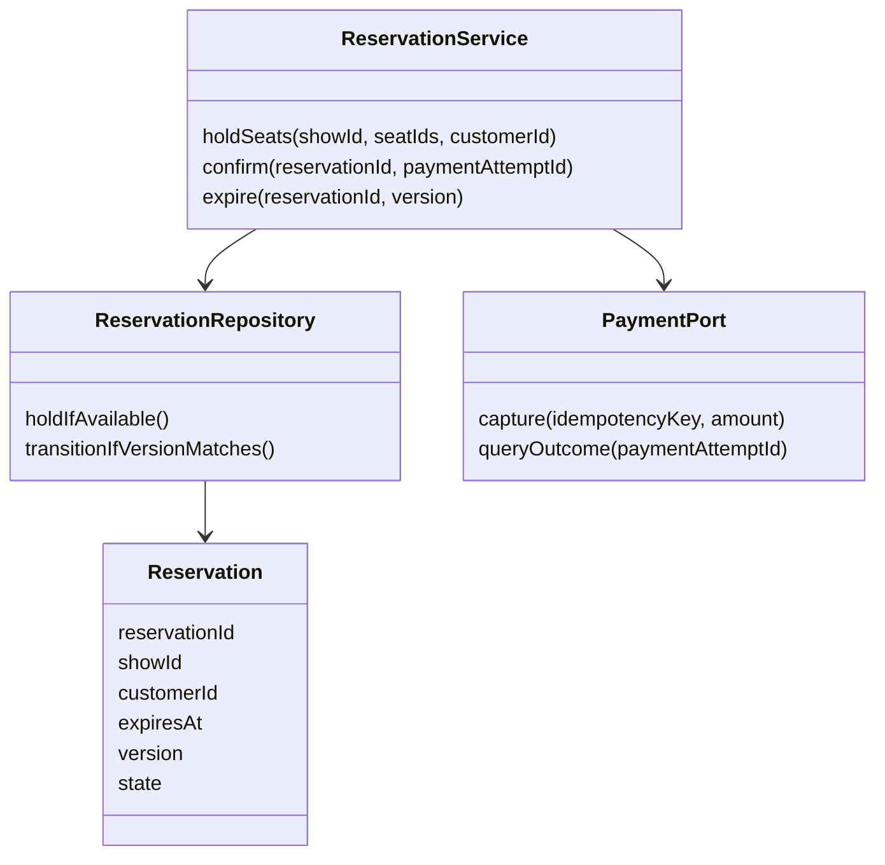

# Low-Level Design: Objects, Invariants, and State Transitions

High-level design decides system boundaries, data placement, and communication.
Low-level design defines responsibilities and behavior inside those boundaries.
A list of classes is not yet a complete design: operations, invalid transitions,
ownership, and invariants must be explicit.

## From a use case to an object model

Use ticket booking as an example:

1. List actors: customer, operator, payment provider, expiry worker.
2. List operations: discover a show, hold selected seats, confirm payment,
   expire a hold, cancel according to policy.
3. Define invariants: one active reservation per seat/show; one payment outcome
   per payment attempt; no confirmation after hold expiry; retries cannot
   release someone else's newer reservation.
4. Identify entities: Show, Seat, Reservation, PaymentAttempt. Use value objects
   for Money, TimeRange, and IDs where their validation reduces mistakes.
5. Assign one owner to each mutable invariant. ReservationService coordinates;
   the repository/storage boundary enforces exclusive seat ownership.
6. Specify commands, results, and failures before writing constructors.

This diagram is a proposed boundary, not a claim that the local seat-booking
lesson implements an external payment port or durable repository.

## Contracts and state machines

| Current state | Trigger | Next state or result |
| --- | --- | --- |
| Available seats | Valid hold command | Create Held reservation with ownership/version and expiry. |
| Held | Confirmed payment before expiry | Confirmed, with a recorded payment reference. |
| Held | Expiry matches current ownership/version | Expired and release only that reservation's seats. |
| Held | Unknown payment result | Reconcile/query the attempt; do not silently charge a second time. |
| Confirmed | Same confirmation request again | Replay prior result without another charge. |
| Confirmed | Expiry for an old hold | Ignore stale expiry; do not release confirmed seats. |
| Confirmed | Eligible cancellation | Cancel and create/track refund workflow. |

Use explicit enums/results rather than magic strings where that improves type
checking. An enum plus validated transitions is a state machine; it is not
necessarily the GoF State pattern, which moves behavior into state objects.

State preconditions should fail without partial mutation. For example, validate
all quantities before decrementing any stock. Where allocation or external calls
can throw, define the exception/transaction guarantee. An in-memory mutex only
protects threads sharing that mutex; a multi-process invariant needs an atomic
storage operation, constraint, or correctly designed coordination mechanism.

## SOLID and useful patterns

| Principle | Concrete application | Trap to avoid |
| --- | --- | --- |
| Single responsibility | PricePolicy calculates prices; Reservation owns its state. | Making one manager perform persistence, pricing, payment, and logging. |
| Open/closed | Add a pricing strategy behind a stable interface when variation is real. | Introducing an abstraction for every two-line function. |
| Liskov substitution | Every repository implementation preserves its documented contract. | A subtype silently weakening transactional or error guarantees. |
| Interface segregation | A reader depends on query operations, not every admin operation. | One huge service interface inherited everywhere. |
| Dependency inversion | Workflow depends on PaymentPort/Repository contracts. | Domain logic directly constructing a real provider client on every call. |

Prefer composition when responsibilities vary independently. Use inheritance
when the substitutability contract is clear. Strategy fits pricing/eviction;
Factory fits controlled construction; Observer fits local notification;
Adapter fits provider boundaries; Command fits queued actions. These patterns
organize code, but do not themselves provide distributed delivery or atomicity.
The [C++ pattern examples](../../Advanced-CPP/Design-Patterns) teach several of
these forms; apply them only where they clarify the actual requirement.

## C++ ownership and domain details

Use RAII and make object lifetime explicit. Prefer unique ownership unless data
must genuinely be shared; shared_ptr is not a thread-safety mechanism. Delete
copy operations for classes whose raw owning pointers would cause double deletes.
Do not expose mutable internals that let callers bypass an invariant.

Store money in integer minor units with a currency and rounding policy. Validate
ranges and arithmetic overflow. Represent time consistently, distinguish wall
clock from elapsed/monotonic time, and inject the clock for expiry tests. Define
whether a time range is closed or half-open; hotel stays normally compose as
[check-in, check-out), permitting a new stay at the previous check-out boundary.

A local LLD exercise can be single-threaded, but it must say so. To add concurrency,
identify lock granularity, lock order, transaction boundaries, stale version
checks, and safe ownership of callbacks/iterators. Test races against the actual
invariant rather than relying on the presence of a mutex somewhere in the code.

## Validation before calling an LLD exercise complete

- Walk each successful use case and every rejected transition.
- Repeat commands, use stale ownership/version tokens, and send unknown IDs.
- Test empty capacity, boundary time, insufficient balance/stock, and overflow.
- Inject failure after each externally visible side effect; define recovery.
- Verify conservation: balances, stock, seat ownership, and resource release.
- Separate implemented behavior from documented extension ideas.

Practice with [parking](../LLD-Problems/parking_lot.cpp),
[ticket booking](../LLD-Problems/movie_ticket_booking.cpp), and
[checkout](../LLD-Problems/online_shopping.cpp), then compare their local logic
with the [outbox](../Distributed-Patterns/transactional_outbox.cpp) and
[saga](../Distributed-Patterns/saga_order_workflow.cpp) models.
