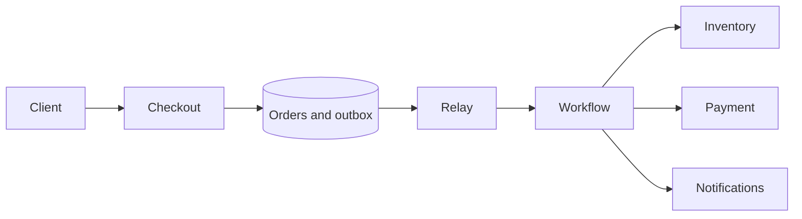

# High-Level Design Walkthroughs

These are worked design exercises, not deployed services. The names below are
conceptual interfaces; the linked C++ lessons implement selected local logic.
For each exercise, supply your own capacity estimates using the first guide,
then defend the consistency and failure choices.

## 1. URL shortener and redirect service

**Scope:** Create a mapping, redirect by code, optionally expire or disable it.
Redirect latency dominates; administration must still revoke abusive links.

**Data:** `links(code PRIMARY KEY, destination, owner, expires_at, disabled)`.
Use a unique constraint on custom aliases. Partition by code; retain owner indexes
for management. Code generation must be collision-safe and independent of how
many API workers happen to run.

**Write:** Authenticate and validate the request, reserve the code transactionally,
then return it. A client request ID makes a retried creation repeatable.
**Read:** CDN/application cache lookup, then authoritative lookup, expiry/disabled
check, redirect response. Define how quickly disable/expiry propagates through
all caches. Permanent redirect caching can obstruct later revocation.

**Failure/scaling:** Cache misses must not overwhelm the mapping store. Emit click
analytics asynchronously; do not require analytics availability for a redirect.
Unknown response after code reservation should replay the same mapping.

**Exercise:** Race two clients requesting one alias, disable a cached link, and
retry after creation committed but its response was lost.
[Local mapping model](../DSA-for-System-Design/url_shortener.cpp).

## 2. Social feed and timelines

**Scope:** Publish posts, follow/unfollow, read a paginated home timeline. Decide
whether visibility/privacy changes must take effect immediately.

**Data:** Authoritative `posts`, `follow_edges`, and derived `timeline_entries`.
A timeline cursor includes a stable ordering tuple such as `(created_at, post_id)`;
offset pagination alone can skip/repeat items while new posts arrive.

**Write:** Store the post and outbox event together. Background fan-out inserts
post references into follower timelines with `(recipient, post_id)` uniqueness.
**Read:** Merge materialized timeline references with pull-based celebrity posts,
apply current visibility rules, hydrate content, and return a cursor.

**Failure/scaling:** Fan-out-on-write has high write amplification for celebrities;
fan-out-on-read moves cost to readers. A hybrid needs explicit thresholds and
ordering. Replayed events must not duplicate timeline entries. A delete requires
a tombstone/visibility check and asynchronous cleanup of derived copies.

**Exercise:** A fan-out worker crashes after half its batch; retry it and verify
no duplicated posts or private-content leaks. Measure feed freshness lag.
[Outbox model](../Distributed-Patterns/transactional_outbox.cpp).

## 3. Chat and presence

**Scope:** Durable one-to-one/group messages, reconnect, unread state. Presence
and typing are ephemeral and can use weaker guarantees than message storage.

**Data:** `messages(conversation_id, sequence, client_message_id, sender, body)`;
unique sender-scoped client IDs prevent retry duplication. Store per-user
last-delivered/read cursors separately from the message log.

**Write:** Authorize membership, deduplicate, persist the message, then acknowledge
server acceptance. Route a delivery event to connection owners through a broker.
**Read/reconnect:** The client sends its last received conversation cursor and
fetches missing records. Distinguish accepted, delivered, and read receipts.

**Failure/scaling:** Partition by conversation for order; one enormous group is
a hot partition. Gateways own WebSocket connections but not durable history.
A socket disconnect must not erase messages. Presence uses leases/TTL and may
briefly be stale. Slow clients need bounded outbound buffers and resynchronization.

**Exercise:** Disconnect after persistence but before acknowledgement, reconnect,
retry the same client message ID, and verify one stored message and recoverable
history. [Partitioned log model](../LLD-Problems/pub_sub_message_broker.cpp).

## 4. Video upload, processing, and playback

**Scope:** Upload media, process renditions, serve playback. Processing may be
asynchronous; playback should not depend on a healthy upload API.

**Data:** `assets(id, owner, object_key, status, version)` and rendition metadata.
Large objects belong in object storage; the database stores ownership and state.

**Write:** Issue a scoped, expiring upload permission; the client uploads directly.
Verify size/checksum/completion before an outbox event schedules transcoding.
Workers write versioned immutable outputs and atomically publish the manifest
only when required renditions are complete.
**Read:** Authorize playback, fetch the manifest, then use CDN/object storage.

**Failure/scaling:** Idempotent processing keys prevent repeated tasks from
publishing conflicting manifests. Handle abandoned multipart uploads, poison
media, duplicate completion events, processing backlogs, and CDN invalidation.
DRM, moderation, and rights management require their own requirements.

**Exercise:** Deliver a processing task twice and crash after one rendition is
written. Resume without publishing an incomplete manifest.
[Work queue model](../Distributed-Patterns/reliable_work_queue.cpp).

## 5. Checkout, reservations, and payments

**Scope:** Reserve stock, take payment, confirm the order, send a receipt.
Define whether a reservation can expire while payment is still uncertain.

**Data:** `orders`, `order_items` with price snapshots, inventory reservations,
payment attempts, idempotency records, and outbox rows. Money uses integer minor
units and an explicit currency. Never infer a successful charge from a timeout.

**Flow:** Start an idempotent order, reserve stock conditionally, capture payment
with a stable payment request ID, then confirm. Failed fulfillment may require
refund/release compensation. Record uncertain payment states for provider query
and reconciliation instead of blindly issuing another charge.

**Failure/scaling:** Keep the inventory invariant in an appropriate transaction
or compare-and-set boundary. Outbox publication and consumer deduplication cover
replays. Compensation can fail; keep it pending and alert on age. Notifications
are asynchronous and must not determine whether a committed order exists.

**Exercise:** Retry checkout concurrently; lose the payment response; fail a
refund; restart the workflow at each boundary and reconcile the final balances.
[Ledger](../Distributed-Patterns/idempotency_keys.cpp),
[outbox](../Distributed-Patterns/transactional_outbox.cpp),
[saga](../Distributed-Patterns/saga_order_workflow.cpp),
[local storefront](../LLD-Problems/online_shopping.cpp).

## 6. Search and autocomplete

**Scope:** Index documents, search by terms/phrases, suggest prefixes. State the
maximum indexing delay and whether deleted/private documents may appear.

**Data:** Authoritative documents plus inverted-index shards, an index generation,
and per-document version/tombstone. Trie/FST-style prefix structures and ranking
signals serve autocomplete; a trie alone does not solve relevance or permissions.

**Write:** Document commits produce CDC/outbox events. Indexers reject older
versions and apply idempotent updates. Rebuild a new index generation, verify it,
then switch the query alias rather than mutating a live schema blindly.
**Read:** Query shards in parallel, collect local top-K, merge/rerank globally,
and enforce authorization. A bounded deadline and partial-result policy are needed.

**Failure/scaling:** Query latency depends on slow shards and fan-out. Monitor
index lag and deletion propagation. A rebuild needs checkpoint/replay boundaries;
a naive snapshot plus unbounded new writes can lose updates at the handoff.

**Exercise:** Apply a newer update, then an older replay; rebuild during writes;
delete a document and ensure cached/indexed results obey the chosen policy.
[Inverted index](../Advanced-System-Design/inverted_index.cpp).

## 7. Nearby search and ride dispatch

**Scope:** Update vehicle locations, find nearby available drivers, assign one
ride to one driver. Approximate search and exclusive assignment have different
correctness needs.

**Data:** Latest location with timestamp/version, driver availability, rides,
and assignment leases. Partition spatial indexes by cell/region; hot city cells
may need finer subdivision and load-aware routing.

**Flow:** Query the current and neighboring cells, filter stale locations, then
rank exact candidates by distance/ETA. Assign using an atomic state transition
or constraint so two riders cannot simultaneously reserve one driver. Handle
acceptance/timeout as a state machine with ownership/version checks.

**Failure/scaling:** Nearby points can lie on opposite geohash boundaries, so one
prefix is not a complete radius query. Vehicle GPS is noisy and can arrive out
of order. An expired assignment must not let an old client overwrite a newer
assignment. Road travel time differs from straight-line distance.

**Exercise:** Send out-of-order GPS updates, search across cell boundaries, and
race two assignment requests. [Quadtree](../DSA-for-System-Design/geohash_quadtree.cpp),
[local ride lifecycle](../LLD-Problems/ride_sharing.cpp).

## 8. File storage and synchronization

**Scope:** Upload/download files, list directories, version changes, synchronize
clients. Decide conflict handling, sharing permissions, deletion retention,
and whether simultaneous edits need merging or explicit conflicting versions.

**Data:** Metadata records reference immutable objects/chunks and versioned
manifests. Directory entries, ACLs, upload sessions, and tombstones are metadata;
blob bytes are separate. Content hashes need a cryptographic choice for integrity
or untrusted deduplication; the repository's FNV Merkle example is illustrative.

**Flow:** Upload chunks, verify checksums, then atomically publish a new manifest
using an expected metadata version. Clients synchronize from a change cursor.
Failed version checks produce conflict handling instead of silent overwrite.

**Failure/scaling:** Reuse chunks only within the intended privacy boundary.
Abandoned uploads and unreferenced chunks need delayed garbage collection that
respects active uploads and retained versions. A missing metadata reference and
a missing object are different failures and require reconciliation.

**Exercise:** Crash between chunk upload and manifest publication; reconnect
with an old cursor; race a rename and delete; restore a retained version.
[Merkle proof model](../Advanced-System-Design/merkle_tree.cpp),
[vector clocks](../Advanced-System-Design/vector_clock.cpp).

## Design review deliverable

For any case above, produce a one-page requirement/estimate sheet, a component
diagram, key schemas/indexes, read/write sequences, failure-state transitions,
and an explicit list of unsupported features. Test one duplicate, one partial
failure, one hot key, and one recovery path before calling the design complete.
